# Phone-width sweep: small phones and a large system font

The people who use Classnode most open it on budget Android phones (a Redmi 13C,
an Oukitel C66: 360px or narrower), often with the system font turned up. This
sweep photographed every screen at those sizes, listed what did not fit, fixed
it at the root, and photographed everything again.

**Rule for the fix: fit and wrap only.** No colour, no layout style and nothing
a screen shows was changed. Where a value used to break in the middle, it now
moves to the next line whole; where a box ran off the screen, it now fits it.

## How it was swept

- **Script:** `scripts/phone_sweep.mjs` (Playwright, Chromium). It photographs
  each screen and measures it in the page.
- **Data:** the demo, served as CI's `screens` job serves it, plus **Crestfield**
  (`manage.py crestfield create`). Every role was signed in: principal, vice
  principal (exam officer), administrator, bursar, teacher, parent. A student
  sat Crestfield's open CBT test with a printed admission number and PIN.
  The public pages were opened signed out: Classnode's own site, the portal's
  doors, Crestfield's and Harbour's school websites, the result checker, the
  test-score door and the exam door. A few screens only the demo has (a
  released CBT result, ID-card checks) came from Sunrise.
- **Widths:** 320, 360, 390 and 412px.
- **Text:** 100% and 130%. 130% raises the browser's default font size from
  16px to 21px, which scales every `rem` the design uses, as a system font of
  130% does in Chrome on Android. Every size in Classnode's CSS is a `rem`.
- **Size of it:** 100 screens (pages and their states after a tap) × 4 widths ×
  2 text sizes = **800 screenshots**.
- **What counts as a fault:** the page scrolls sideways; something runs past
  the screen's edge outside a scroller; a button wider than the screen; text
  cut off by its box; two lines of text drawn over each other; a table
  running out of its card; a wide table whose box gives no sign that it
  scrolls; and an amount, a date, a class name, an admission number or a PIN
  broken across two lines.

Not a fault, and left alone: a row that scrolls sideways on purpose (the
homepage's tour tabs, the exam's strip of question numbers), text kept for a
screen reader, and a menu laid over the page while it is open.

**The viewport.** All 48 page templates that set a viewport (and the exam
specimen) say `width=device-width, initial-scale=1`, and none sets
`user-scalable=no` or a `maximum-scale`, so a reader can always pinch to zoom
and the system font applies. Nothing needed changing; `tests/test_design.py`
now holds every template to it.

## Before: what was found

**24 problems**, seen as 107 distinct faults on 177 of the 800 screenshots.
"320/130" means 320px wide with text at 130%.

| # | Screen (role) | Problem | Where it showed |
|---|---|---|---|
| 1 | The phone's tab bar, every staff page (principal, vice principal, administrator, teacher) | Labels cut off: "Absenc…", "Broads…", "Exam sl…", "Promot…", "Timeta…"; "Who teaches what" at every size | 320/130; "Broadsheets" to 390/130; "Who teaches what" at all 8 |
| 2 | Home, every role | The date in the term chip broken: "Fri 27 / Nov" | 320/130 |
| 3 | Results (principal, vice principal) | Class names broken: "JSS / 1B", "SS / 2B" | 320/130, 360/130 |
| 4 | Tests list (principal, vice principal, teacher; Sunrise's results list) | Opening and closing dates broken ("27 Nov / 2026"); class name "JSS / 2B" | 320 to 412, at both sizes |
| 5 | A test's sitting (principal) | Dates broken in the sitting line, the hint and each student's log: "Fri 27 / Nov", "Sat 28 / Nov" | 320/130 to 412/130 |
| 6 | Exam slips (principal, administrator) | Dates broken in the print log, each class's last print and the officer list; "JSS / 3A" in the log | 320 to 412, both sizes |
| 7 | Who teaches what (principal) | Dates broken in Recent changes; "SS / 2B", "SS / 3A" in its lines | 320 to 412, both sizes |
| 8 | Start here (principal, administrator) | The page scrolls sideways by a pixel; the date in the change list broken | 320/130, 360/130 |
| 9 | Website editor (principal) | "27 Nov / 2026" in the published line; "JSS / 1" in a section's summary | 320 to 390 at 130; 320/100 |
| 10 | Setup (administrator) | Term dates and the cut-off hint's date broken; "SS / 2B" in the class hint | 320 to 412 |
| 11 | Roll import (administrator) | The list of this term's classes breaks inside names: "JSS / 2B" | 360 and 412 at 100; 320 to 412 at 130 |
| 12 | Fees (bursar) | A class row's amounts drawn over its words: "₦585,000.00 outstanding" over "76% collected" | 320/130 |
| 13 | A family's fee account (bursar) | The payment form is wider than the screen: the page scrolls sideways (325px in 320) | 320/130 |
| 14 | Register (teacher) | "Fri 27 / Nov" under the class name | 320/130 |
| 15 | Marking (teacher) | Class names broken in the list of papers; on the marks sheet each child's total runs off the screen and the page scrolls sideways (345px in 320) | 320/130, 360/130 |
| 16 | Broadsheet (principal) | A 1,504px table scrolls in its box with no edge to say there is more | every width and size |
| 17 | Report card, Ogun State sheet (parent; Crestfield's and Sunrise's) | The page scrolls sideways (368px in 320 and in 360): Attendance and Summary are a grid whose columns are at least 16rem; the Affective table runs out of the card; the subjects grid scrolls with no edge; "Monday 14 December / 2026" broken | 320 to 412 at 130; the grid's edge and the date at every size |
| 18 | The exam, CBT (student) | The bottom bar's "Calculator" button is cut off to "Calculato" | 320/100; 320 to 412 at 130 |
| 19 | ID cards, choosing children (principal) | Each child's admission number is drawn over the next child's name | 320 to 412 at 130 |
| 20 | Test scores (parent); a test's results (principal) | "Fri 27 / Nov" broken | 320/130 to 390/130 |
| 21 | School websites: Crestfield and Harbour (public) | Class ranges broken in the hero, the principal's message and the admissions band: "JSS / 1", "SS / 3", "SSS / 1" | 320 to 412, both sizes |
| 22 | Classnode's terms (public) | "Last updated 9 November / 2026" | 320/130 |
| 23 | Classnode's result-computation page (public) | "JSS / 1" broken | 390/100 |
| 24 | Classnode's Excel comparison page (public) | The table's two column headings drawn over each other: "Excel result template" over "Classnode" | every width and size |

What was **not** found anywhere: a button wider than the screen, a table
bursting out of a card on a staff page, an amount (₦10,749,000.00), an
admission number (CFC/2025/070) or a PIN (0105 7149) broken across lines, or
overlapping text on the sign-in pages, the exam door, the result checker or
Classnode's homepage.

## The fix: at the root, not page by page

Each problem above traced back to one of six causes. Each cause is fixed once,
where it lives, so every page that has it is fixed together.

**1. Values that break in the middle (problems 2 to 7, 9 to 11, 14, 17, 20 to 23).**
The rule was already in `typography.py` for class names on the dashboard. It now
covers dates ("Fri 20 Nov", "20 Nov 2026", "20 November 2026", "November 2026"),
"7:33 p.m." and exam PINs ("0105 7149") too, and it has a twin for page
modules, `keepTogether()` in `static/web/html.js`. The spaces inside each value
become non-breaking (U+00A0), so the sentence still wraps but never inside the
value. Where values are made:

- **Dates, at their formatters.** The API helpers that word a moment
  (`cbt/api.py`, `cbt/setting.py`, `cbt/bank_api.py`, `cbt/sittings.py`,
  `gradebook/assignments_api.py`, `idcards/api.py`); `dayFirst()` and every
  module that words a date (`register`, `sit`, `tests`, `test-results`,
  `test-scores`, `site-editor`, `web/snapshots.js`, the report card's
  `date()`); the `nobreak` filter on the two template dates (Start here, the
  terms page); and `time { white-space: nowrap }` for every `<time>`.
- **Class names, where a list draws them**: results, marking, tests, exam slips,
  who teaches what, roll import, setup's hint and the website editor's section
  summaries.
- **The school website's own words** (`schoolsite/render.py`): a section's
  heading, text and message go through the rule once, for every school and every
  theme. Classnode's solution pages do the same in `landing.html`.

A whole weekday ("Monday 14 December 2026") may still end a line before its
date: at 320px with text at 130% the four words are wider than the line, and
"Monday" then "14 December 2026" reads better than the date broken anywhere else.
Amounts (₦10,749,000.00) and admission numbers (CFC/2025/070) contain no space,
so nothing breaks them but a box too narrow for them, which is cause 2.

**2. Boxes narrower than what they must hold (problems 3, 8, 12, 15, 17).** A
`1fr` grid column, a `fieldset` and a flex item each default to "never narrower
than my longest word", and a grid column of `minmax(16rem, 1fr)` is 333px at
130% text. Fixed with `minmax(0, 1fr)` and `min-width: 0` where content must
give way (`design.css` for `fieldset` and the shared `.page-head`, `.card-head`,
`.actions` and `.msg` rows; Start here's lists; the marking roster), and
`minmax(min(16rem, 100%), 1fr)` on the report card's two grids.

**3. Cards that sit in different widths (problems 3, 12, 15, 18).** Container
queries, sized in `em` so that a larger font reaches them sooner, as it
should: the fee list's rows put the amounts under the class's words, the
results rows put where a class stands under its name, the marking roster puts
the total under the mark, and the exam's bottom bar puts each icon above its
word, when their own card or bar is too narrow, whatever the screen.

**4. Wide tables (problems 16, 17).** They scroll inside their own box (they
already did) and the box now shows a 1px edge on whichever side has more,
driven by its own scroll position, so a table that fits shows none
(`design.css`, `@keyframes edge`). The broadsheet's position column stops
sticking when the box is under 30em, so the name stays put and the subjects
scroll beside it instead of under two frozen columns that filled the screen.
The report card's Affective and Psychomotor tables now scroll in the same box
instead of running out of the card.

**5. Labels that could not fit (problems 1, 18).** Each tab of the phone's tab
bar is a size container and its word is at most 16% of the tab's width, up to
the 13px it was; a label of several words takes two balanced lines. The exam
bar's word keeps a 15px floor, the exam screen's own minimum.

**6. Overlaps (problems 19, 24).** The ID-card picker's rows were squeezed to
their 44px minimum inside a height-limited grid (`grid-auto-rows: max-content`);
the comparison table's headings were `nowrap` inside a fixed-layout table.

**Headings** everywhere wrap to balanced lines (`text-wrap: balance` on `h1` to
`h3` and `legend`), so a heading never leaves one word on its last line.

**What it cost.** `design.css` grew by 308 bytes, which the homepage's 400 KB
and School setup's 170 KB budgets would not have taken: five comments on its
tokens and one on setup's conduct section moved to `docs/design.md` and
`docs/module-notes.md`, as their earlier ones had.

## After: the same sweep again

**0 faults on all 800 screenshots** (same screens, roles, widths and text sizes).
Every one of the 24 problems is fixed.

| # | Problem | After |
|---|---|---|
| 1 | Tab labels cut off | Each fits its tab; "Who teaches what" on two lines |
| 2, 14, 20 | "Fri 27 / Nov" | One line |
| 3 | Results: "JSS / 1B" | One line; the status goes under the name when the row is narrow |
| 4 to 7, 9, 10 | Dates and class names in lists and logs | One line |
| 8 | Start here a pixel too wide | Fits; the long email in its log wraps |
| 11 | Roll import's class list | One line per name |
| 12 | Fee rows' amounts over their words | Amounts under the words on a narrow card |
| 13 | Payment form wider than the screen | Fits |
| 15 | Marking: names broken, totals off the screen | Fits; the total goes under the mark on a narrow phone |
| 16 | Broadsheet with no edge | An edge on the side with more; the name stays put |
| 17 | Report card wider than the screen | Fits; its tables scroll in their own box with an edge |
| 18 | "Calculato" | "Calculator", icon above it |
| 19 | ID-card names over each other | Each row its own height |
| 21 to 23 | Class ranges and dates on the public pages | One line |
| 24 | Comparison table's headings over each other | Each wraps in its own column |

Before and after, at 320px with text at 130% (`docs/screens/phone-width/`):

| | |
|---|---|
| Tab bar | 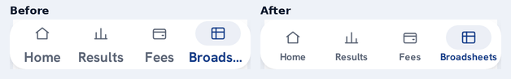 |
| Home's date | 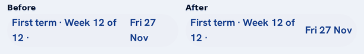 |
| Fees, the class list | 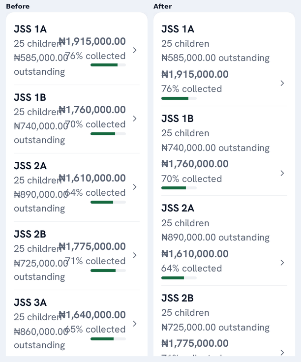 |
| A family's payment form | 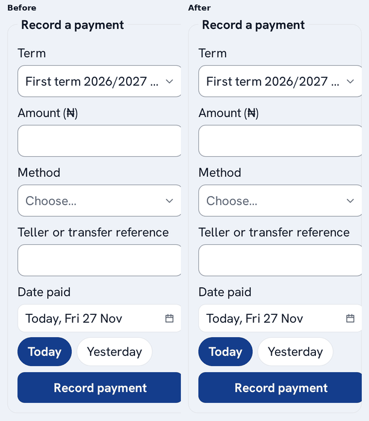 |
| Results | 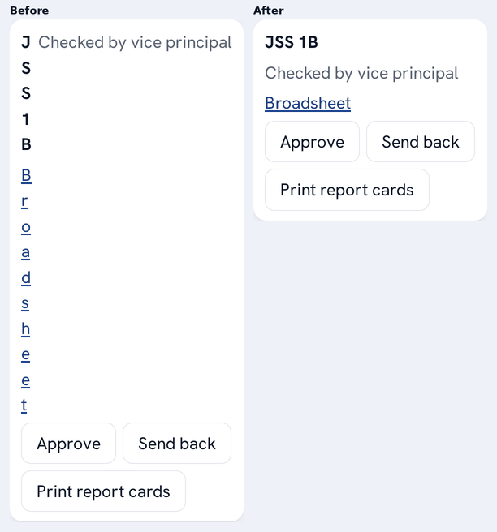 |
| Broadsheet, scrolled | 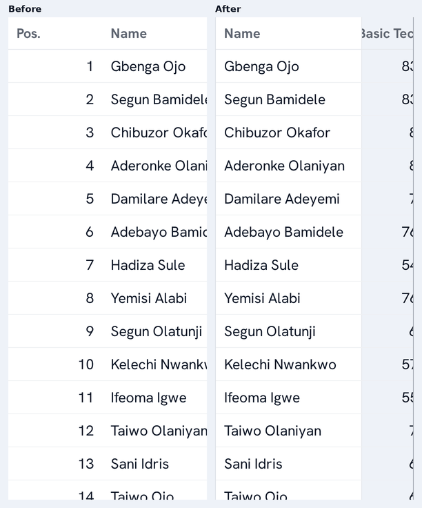 |
| Marking sheet | 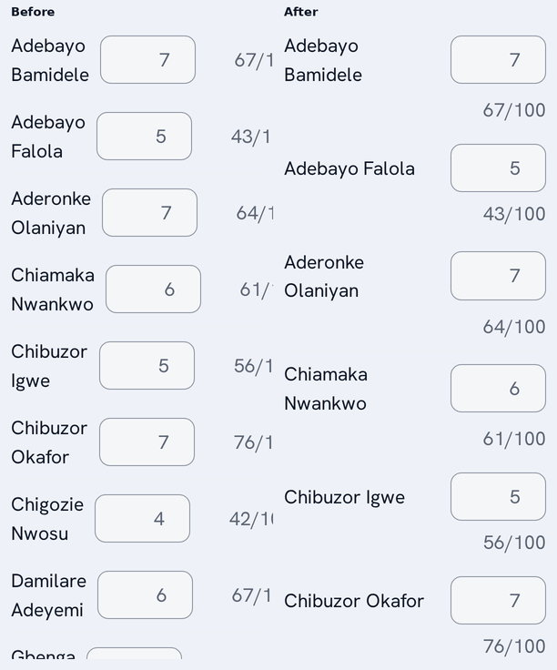 |
| Report card | 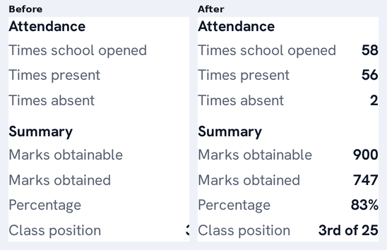 |
| ID cards, choosing children | 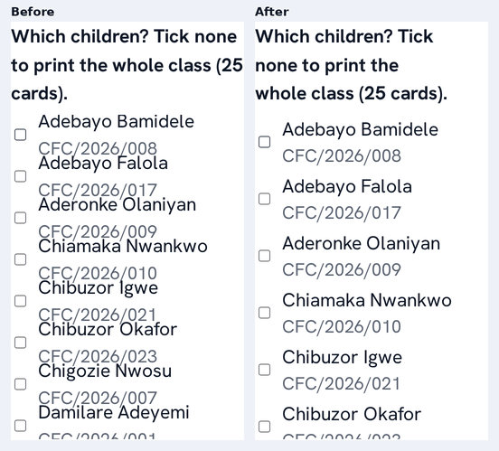 |
| Tests list | 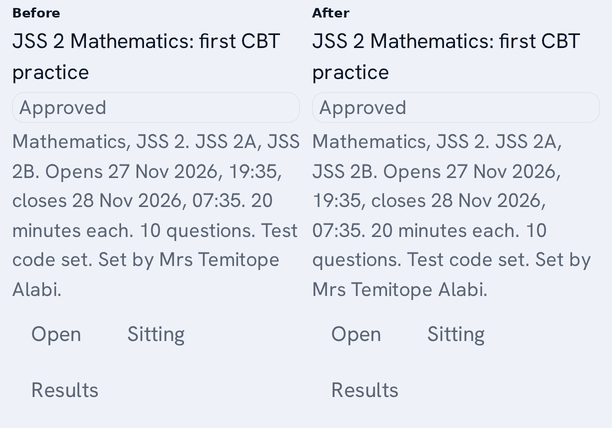 |
| School website | 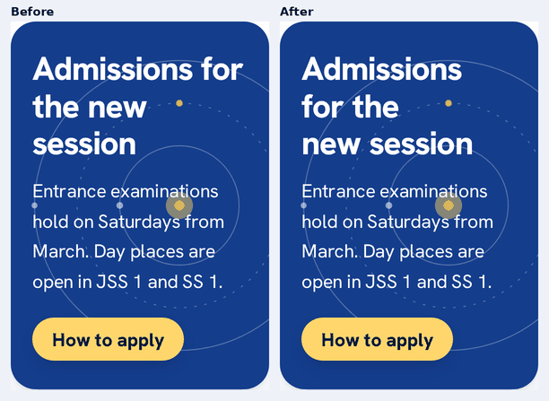 |
| Classnode's comparison table | 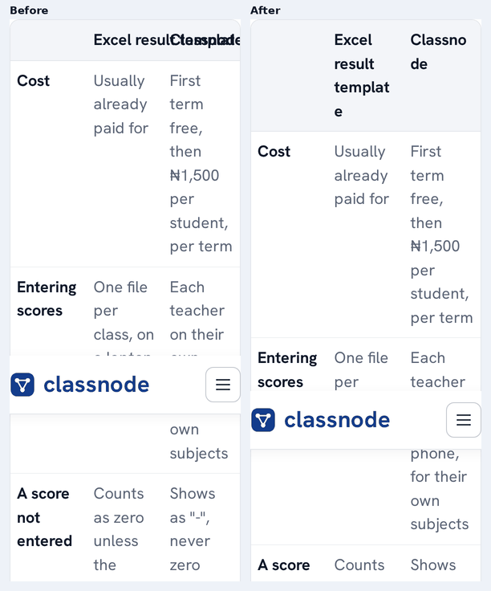 |

## What keeps it fixed

- **`tests/ui/phone_width.test.js`**, in CI's `screens` job: 25 key pages, every
  role, at 320px with text at 100% and 130%. It fails if a page scrolls
  sideways, or if an amount, a date or a class name is split over two lines.
  Run against the code before this fix it failed 9 of the 25; after, none.
- **`tests/test_design.py`**: every viewport lets the reader zoom.
- **`tests/test_typography.py`** and `tests/js/`: what is held together, and
  what is left free ("10 Marks", "1 of 10").
- **`scripts/phone_sweep.mjs`** for the whole sweep again, by hand.

**Not fixed, and why.** Nothing found is left open. One trade-off to know: the
tab bar's labels no longer grow with the system font beyond what their tab can
hold. On a 320px phone they are 11.5px at either text size (13px before, and
"Who teaches what" cut off); at 130% they are 13px at 360px and 15px at 412px,
where before they were 17px and the longer ones cut off. The icons above them are unchanged.

