# Classnode UI audit

*An audit of every screen a school uses, at 375 px and 1280 px, against WCAG 2.2 AA, a low-end phone on a slow network, missing states, rough edges and consistency. Report only: nothing in the product was changed to produce it.*

- **Commit audited:** `42256b3` ("The nightly backup works as root…"), the head of `main` on 2026-10-21, built fresh and seeded with `manage.py seed_demo` and `seed_ui`.
- **Screens:** 94 screens (plus 15 drill-down states), each at 375 and 1280 px: **109 screenshots** are in [`docs/ui-audit/img/`](ui-audit/img/) and the per-screen numbers are in [`docs/ui-audit/data/metrics.csv`](ui-audit/data/metrics.csv).
- **Read this first:** the short answer, the ten fixes, is at the top. Method and caveats are at the foot.

## The short answer

Classnode is in better shape than most products at this stage. **axe-core finds no colour-contrast failure, no unlabelled form field and no unnamed icon button on any of the 94 screens**; every form field has a label, every target passes WCAG 2.2's 24 px minimum, there are no keyboard traps, focus rings are drawn on every control, and a phone loads any of the ten most-used screens in about a second on Lighthouse's slow-4G, 4x-CPU profile. **Lighthouse performance is 100 on all twelve screens measured, and none is over 400 KB** (the heaviest app page is 74 KB on the wire; the heaviest page anywhere is the blog at 128 KB).

What is wrong is mostly **plumbing that was never connected to the design**, plus a few states nobody has designed yet. No blockers (nothing stops a person finishing a core task), but these seven high-severity findings matter most (a few more Highs are specific to one screen, in the tables below):

1. **72 of 94 screens have no `<!doctype html>` and no `lang`**, so every staff page renders in quirks mode and fails WCAG 3.1.1 (C1, C2).
2. **Mistyped addresses, server errors and `app.classnode.co/` itself show Django's bare default pages** (C12).
3. **Platform operators sign in and are told "No school on this account yet"** (C13).
4. **Keyboard focus is hidden under the phone tab bar** on 19 screens: a WCAG 2.2 AA failure (C3).
5. **Errors say "something went wrong on our side" when the phone has no signal, with no Retry** (C8).
6. **Opening a class or an account adds no history entry, so the phone's Back button leaves the page** (C10).
7. **Two missing pieces on the doors:** staff have no "Forgot password", and the parent door's "phone number or email" field has a phone-only keypad.

The ten fixes with the most impact for the least work are listed in [Ranked fixes](#ranked-fixes).

### Scoreboard

| Check | Result |
|---|---|
| axe-core 4.14 (WCAG 2.0, 2.1, 2.2 A/AA and best practice), all screens, both widths | 8 distinct rules failed in total, and every one traces to the cross-cutting items below (C1, C2, C5, C11, C21, and a missing `<h1>`/title on two `/write/` pages). Colour contrast: **0 failures** (81 "incomplete" nodes on the sidebar and sign-in backgrounds were measured by hand: 5.96:1 to 17.96:1). |
| Form fields without a label | **0** of 225 fields (one honeypot field on the homepage is `aria-hidden`) |
| Icon-only buttons without a name | **0** |
| Keyboard traps | **0**; focus ring missing on **0** stops |
| Focus hidden by the tab bar (2.4.11) | **19 screens** (C3) |
| Text at 200% | **40 screens** break at the phone's Largest font (C6, C19) |
| Lighthouse mobile performance, 12 screens x 3 runs | **100 on all 12**; accessibility 90 to 100; none over 400 KB |
| Pages with a styled error state | all 24 data pages have one; **none has a Retry**, and the **Django default 404/500/CSRF pages are unstyled** |

### Severity

| Level | Meaning |
|---|---|
| **Blocker** | A person cannot finish a core task, or data is lost. *None found.* |
| **High** | A WCAG A or AA failure on a core path, a state that misleads, or a core-path task that fails on a phone. |
| **Medium** | Real friction or a WCAG failure with a workaround; or an inconsistency a user will notice. |
| **Low** | Polish and best practice. |

*Effort* in the fix lists is XS (a line or a rule), S (under a day), M (a day or two).

## Cross-cutting findings

The screen tables below point here, so each fix is described once. Where a count is given it is the number of screens it was measured on.

| # | Sev | Finding | Effort |
|---|---|---|---|
| **C1** | High | No `<!doctype html>`: the page renders in quirks mode | XS |
| **C2** | High | `<html>` has no `lang` (WCAG 3.1.1, level A) | XS |
| **C3** | High | Keyboard focus is hidden under the phone tab bar (WCAG 2.4.11 Focus Not Obscured, new in 2.2 AA) | XS |
| **C4** | Medium | No skip link in the staff shell | XS |
| **C5** | Low | Account button name does not contain its visible text (WCAG 2.5.3) | XS |
| **C6** | Medium | The administrator's top bar overflows at 320 px and at large text | XS |
| **C7** | Medium | Loading is the bare words "Loading…" | S |
| **C8** | High | The error state blames the server for a dead network, and has no Retry | S |
| **C9** | Medium | Screen-reader announcements and focus are lost when a view changes | S |
| **C10** | High | Drill-downs add no history entry: Back leaves the page | M |
| **C11** | Medium | Sideways-scrolling tables cannot be reached by keyboard | XS |
| **C12** | High | Plain Django error pages: 404, 500, CSRF, and `app.classnode.co/` itself | S |
| **C13** | High | Platform staff land on "No school on this account yet" | S |
| **C14** | Medium | Offline works for two pages; the others show the browser's "No internet" page | S |
| **C15** | Medium | Four different "choose a class" lists | M |
| **C16** | Medium | Button vocabulary: three spellings of primary, no destructive style | S |
| **C17** | Medium | Five confirm patterns and no toast | M |
| **C18** | Low | The menu and account popovers are not keyboard-complete | S |
| **C19** | Medium | Large system text breaks several screens | M |
| **C20** | Low | Page titles are generic and do not follow the view | XS |
| **C21** | Low | Content outside landmarks on the door pages (axe `region`) | XS |
| **C22** | Low | Raw values and mixed date styles leak into the UI | S |

### C1. No `<!doctype html>`: the page renders in quirks mode

**High** · effort XS

**Evidence.** 72 of 94 screens (every staff page, the parent door, the result checker, the invitation page, the 403 page, `/platform/`) start at `<meta charset>`. `document.compatMode` is `BackCompat`; Lighthouse's `doctype` audit fails. Quirks mode changes how tables inherit fonts, how percentage heights and inline images size, and the box model of a few elements. The CSS has been written and tested against it, so nothing is visibly broken today, but the public site (which has a doctype) and these 72 screens are laid out by different rules, and any new page written the usual way will not match them.

**Fix.** Put `<!doctype html>` first in each page template, or move the shared `<head>` into one `base.html` the 72 pages extend. Add `compatMode === "CSS1Compat"` to `tests/ui/screens.test.js` so it cannot come back.

### C2. `<html>` has no `lang` (WCAG 3.1.1, level A)

**High** · effort XS

**Evidence.** Same 72 screens. axe `html-has-lang` is the only serious failure on most staff pages. Without it, screen readers that switch voice by page language, browser translation, hyphenation and spell-check have nothing to go on, and WCAG 3.1.1 is a Level A criterion.

**Fix.** `<html lang="en">` (or `en-NG`) in the same change as C1.

### C3. Keyboard focus is hidden under the phone tab bar (WCAG 2.4.11 Focus Not Obscured, new in 2.2 AA)

**High** · effort XS

**Evidence.** At 375 px, tabbing to a control near the foot of the viewport scrolls it to the edge, under the 61 px fixed `.tabbar`. Found on 19 screens (the roll has 15 to 17 such stops; teaching, marking, fees, absences, setup, notices, start-here, results). The design test only checks the last control at the end of the page, not controls reached by keyboard on the way down.

**Fix.** `html { scroll-padding-bottom: calc(var(--tabbar) + 16px); scroll-padding-top: var(--topbar) }` in `design.css` (the sticky top bar hides focus when tabbing upward). One rule, fixes every page.

### C4. No skip link in the staff shell

**Medium** · effort XS

**Evidence.** On all 60 screens that carry the staff shell the first Tab stop is the Menu button; at 1280 px the sidebar puts 15 to 20 links ahead of the page content on every page load. The public site and the blog have a skip link; the app does not. Landmarks help screen-reader users but not a sighted keyboard user.

**Fix.** Add `<a class="skip" href="#main">Skip to content</a>` as the first child of `<body>` in `design/shell_open.html`, styled like the site's.

### C5. Account button name does not contain its visible text (WCAG 2.5.3)

**Low** · effort XS

**Evidence.** `
PS`: a voice-control user who says "click PS" gets nothing. axe `label-content-name-mismatch` on 59 screens.

**Fix.** `aria-hidden="true"` on the initials, or `aria-label="PS, your account"`.

### C6. The administrator's top bar overflows at 320 px and at large text

**Medium** · effort XS

**Evidence.** The "Setup 7 of 8" chip plus the avatar do not fit beside the logo below about 340 px: the account menu (and its Sign out) hangs 32 px off the right edge at 320 px (WCAG 1.4.10 Reflow), and 130 px off at 375 px with the phone's font size at Largest (200%). 28 administrator screens.

**Fix.** Collapse the chip to its flag icon (with the same `aria-label`) below 360 px, and let `.topbar` wrap or shrink the school name first.

### C7. Loading is the bare words "Loading…"

**Medium** · effort S

**Evidence.** 24 data pages show one grey line of text (`
`) with no skeleton, no spinner and no live region. On Lighthouse's slow 4G + 4x CPU the first paint is the word "Loading…" at about 0.5 s and the page is usable at 1.0 to 1.2 s, so a teacher stares at an empty grey page for about 0.6 s on every visit (the HTML, then 5 to 6 ES modules, then the API call are three round trips in a row).

**Fix.** One `skeleton()` helper in `web/html.js` (three grey bars and a card, `aria-busy` on `<main>`); each page's loading state draws the shape of its own page. Optionally `<link rel="modulepreload">` for the page's modules to cut a round trip.

### C8. The error state blames the server for a dead network, and has no Retry

**High** · effort S

**Evidence.** A refused connection and a 500 both say "This page is not working. Something went wrong on our side." A teacher in a room with no signal is told the school's system is broken. Neither state has a Retry button, so the only recovery is to reload the whole page. "Tell whoever runs this system for your school" is the closest thing to a next step. The Subjects page draws a different error (`state-refused`, "Something went wrong", `role=alert`).

**Fix.** In the shared `states.broken()`: `navigator.onLine === false` or a thrown `fetch` gets "You are not connected. Check your signal and try again"; a 5xx gets the current copy; both get a "Try again" button that re-runs the load. Point the Subjects page at the same function.

### C9. Screen-reader announcements and focus are lost when a view changes

**Medium** · effort S

**Evidence.** No `aria-live` region exists on any data page at rest, so "Loading…" turning into the page is silent. 5 of the 6 drill-downs tested (class register, marking sheet, fee class, fee account, broadsheet class; opening a marks paper kept focus) leave `document.activeElement` on `<body>`, and the scroll position and `<title>` stay where they were. A keyboard or screen-reader user starts again from the top of the page after every tap.

**Fix.** After a view renders, move focus to its `<h1>`/`<h2>` (`tabindex="-1"`), and put the loading and result text in a polite live region.

### C10. Drill-downs add no history entry: Back leaves the page

**High** · effort M

**Evidence.** Opening a class register, a marking sheet, a fee class or an account does not change the URL or push state. The Back button (the Android hardware key, which is how phones are used) goes to the previous page, not to the class list. Tested on `/register/` and `/fees/`: Back landed on `/help/`. A teacher partway down a register who presses Back loses the screen, not just the view.

**Fix.** `history.pushState` (or `#/class/12`) when a view opens and a `popstate` handler that redraws the previous one; the pages already render from state, so this is wiring.

### C11. Sideways-scrolling tables cannot be reached by keyboard

**Medium** · effort XS

**Evidence.** axe `scrollable-region-focusable` at 375 px on the timetable (3 screens), the broadsheet's class view, the report card on a parent's phone and the result checker's card. A keyboard or switch user cannot scroll to the Exam column.

**Fix.** `tabindex="0" role="region" aria-label="Timetable, scrolls sideways"` on every `.wide` wrapper; `design.css` already draws the focus ring.

### C12. Plain Django error pages: 404, 500, CSRF, and `app.classnode.co/` itself

**High** · effort S

**Evidence.** There is no `404.html`, `500.html` or `CSRF_FAILURE_VIEW`. With `DEBUG` off (checked on a second server) the portal's root, any mistyped address on any host (platform, school, blog, `/write/`) and an unknown school name all answer "Not Found / The requested resource was not found on this server." in the browser's default serif, black on white, with no logo and no link. A server fault answers "Server Error (500)" and an expired-form POST "Forbidden (403) CSRF verification failed." in the same style. These are the pages a school's first impression is built from when a link is mistyped, and the portal root is where everyone who types `app.classnode.co` lands.

**Fix.** `templates/404.html` and `500.html` in the design (logo, one sentence, a link to the staff and parent doors; the 403 page's inline style is the pattern: no assets, because a 500 cannot rely on static files). `CSRF_FAILURE_VIEW` to a friendly "Your session expired, go back and try again". Route `/` on the portal to `/staff-sign-in/`.

### C13. Platform staff land on "No school on this account yet"

**High** · effort S

**Evidence.** A platform operator signs in at `/staff-sign-in/`, correctly, and is told "No school on this account yet. If a school has invited you, open the link in their invitation". The reply is wrong for them: nothing says `/platform/`, `/platform/handover/` or the admin exist, and the page offers only Sign out. The same screen is what an invited-but-not-accepted or suspended person sees (correct for them).

**Fix.** In `staff-signin/states.js` `nowhere()`: if the account is platform staff (the login response can carry it), draw the hub with links to Schools, New school handover and Admin, instead of the invitation sentence.

### C14. Offline works for two pages; the others show the browser's "No internet" page

**Medium** · effort S

**Evidence.** The service worker keeps `/register/` and `/marking/` (a clear "This is a copy from today 20:26. You are not connected." banner, verified offline). Every other page tried (Home, Timetable, Remarks, Help) shows Chrome's dinosaur page, not a Classnode page, with no way back to the two pages that do work.

**Fix.** Add an `offline.html` (Classnode shell, "You are offline. Registers and marks are still on this phone", links to `/register/` and `/marking/`) as the worker's fallback for navigations.

### C15. Four different "choose a class" lists

**Medium** · effort M

**Evidence.** Results: cards with a status chip and inline buttons. Broadsheets and Fees: pill buttons (Fees adds "10 children" beside each). Remarks, Register, Marking: full-width bordered tiles. Same task, same data, four shapes.

**Fix.** One `class-list` component (the full-width tile) with optional trailing meta (children, status). Roughly a template per page.

### C16. Button vocabulary: three spellings of primary, no destructive style

**Medium** · effort S

**Evidence.** Primary is `button[type=submit]` by default, `.btn.primary` (9), `.btn.btn-primary` (9) and `.btn-primary` (8); quiet is `.quiet-button`, `.btn-quiet` or `button.signout`/`.again`. `Remove`, `Revoke`, `Remove crest`, `Remove photo`, `Unpublish` are drawn exactly like "Details" or "Open": nothing says which tap is destructive, and several sit next to a primary "Add" (roll > Guardians).

**Fix.** Pick `.btn-primary` / `.btn-quiet` and add `.btn-danger` (the existing `--stop` red); sweep the templates and JS once. A test that greps for the old spellings keeps it done.

### C17. Five confirm patterns and no toast

**Medium** · effort M

**Evidence.** Offline sign-out uses `window.confirm()` (marking, register); the bank connection and end-of-session promotion use a full-page confirm state; removing a guardian (roll), a paper (teaching) and revoking a concession (fees) each use an inline "are you sure" that its own page words and styles (in Teaching the confirming "Remove" is a blue primary button); the blog editor uses a real `<dialog>`; and Remove crest, Remove photo and Cancel invitation confirm nothing. Success is an inline `
` that appears in a different place on each page ("Saved.", "Sent", "Released"); there is no toast.

**Fix.** Make the `<dialog>` the one confirm (it is already in `/write/`) with a `.btn-danger` confirm button, and one `status()` helper for success notes. Use it for every Remove/Revoke/Cancel.

### C18. The menu and account popovers are not keyboard-complete

**Low** · effort S

**Evidence.** The phone sidebar is a non-modal `popover`: Tab walks out of the open menu into the page behind it, and Esc closes it without returning focus to the Menu button. The `
` account menu ignores Esc.

**Fix.** `popover` + `inert` on `.content` while open, `focus()` back to the button on `toggle`; an Esc keydown on `details.account`.

### C19. Large system text breaks several screens

**Medium** · effort M

**Evidence.** With the phone's font size at Largest (root text 200%): the dashboard's tiles are clipped 121 px past the screen, the tab bar labels collide ("Fees Absences") and the avatar overlaps the logo; the Results rows overflow 101 px; the result checker's two fields overflow 36 px, so on the parent-facing form the Admission number box runs off the screen. These are real settings on Android phones in Nigeria. Layout uses `rem`, so the text scales; the containers do not give way.

**Fix.** Add the 200%-root case to `tests/ui/screens.test.js` (set `html { font-size: 200% }`, assert no sideways scroll) and fix as it fails: let tile grids drop to one column and `.row`s wrap below 400 px; `min-width: 0` on the checker's fields.

### C20. Page titles are generic and do not follow the view

**Low** · effort XS

**Evidence.** "Home" is the title of 9 different screens, "Fees" of 4, and a class view keeps "Fees" as its title. Deliberate for privacy (`marking_page.html` explains it), but it makes browser history, tab switching and screen-reader page announcements indistinguishable, and says "Home", not "Classnode".

**Fix.** `Home · Classnode`, and set `document.title` to the view name ("Ada Adeyemi · Fees"), keeping the school and children out of it.

### C21. Content outside landmarks on the door pages (axe `region`)

**Low** · effort XS

**Evidence.** The logo and "Classnode" footer of the sign-in pages, the result checker, the report card and `/platform/` sit outside any landmark.

**Fix.** Wrap in `<header>` / `<footer>` or put the logo inside `<main>`.

### C22. Raw values and mixed date styles leak into the UI

**Low** · effort S

**Evidence.** Staff invite's Role select shows the enum ("admin", "vice principal academic") rather than "School administrator"; Setup writes terms as `2026-10-05 to 2026-12-28` and " school days" with no number when it is unknown; the dashboard says "Wed 21 Oct", the handover list "Wednesday 21 October 2026", and native date inputs follow the phone's locale (mm/dd on a US-English phone). The design rule is one date format.

**Fix.** Role labels from `Role.label`; one `formatDate()` in `web/html.js`; hide the days count when it is not a number.

#### Evidence

**Production error pages** (DEBUG off): the portal root, a mistyped school address and a 500. Below, the portal root at desktop width.

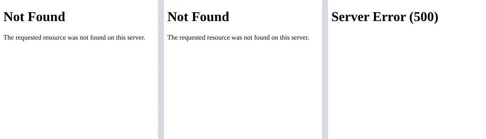

**Platform operator after a correct sign-in** (`platform.operator`, a superuser) at 375 and 1280 px. The operator's real home, `/platform/`, is not mentioned:

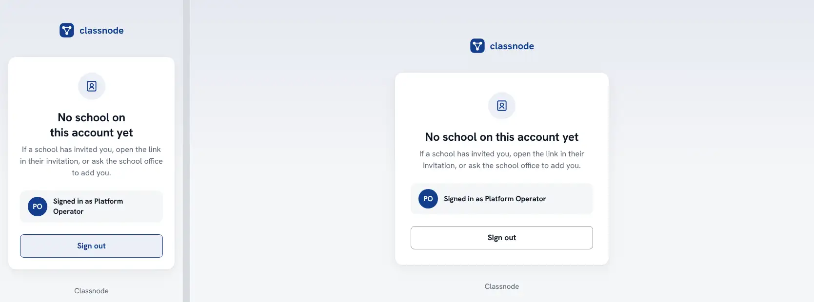

**Sign-in states**: wrong password on the staff door, the "choose where to go" hub a principal sees after a correct one, and the parent door's code step:

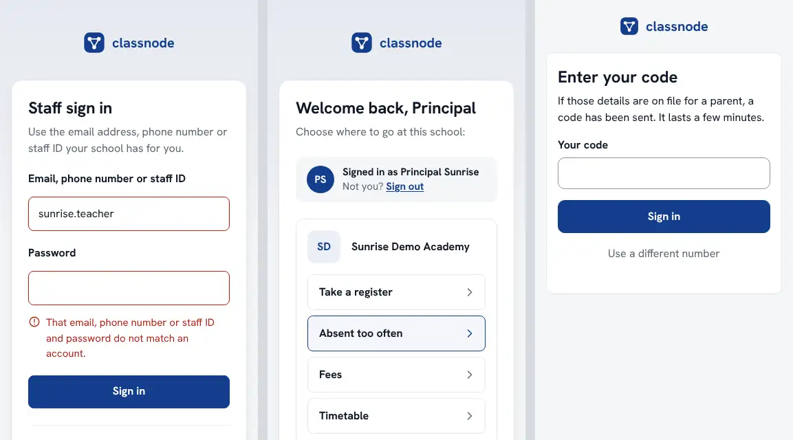

**Loading** is a line of text (Fees, Marks, parent Report cards, Roll):

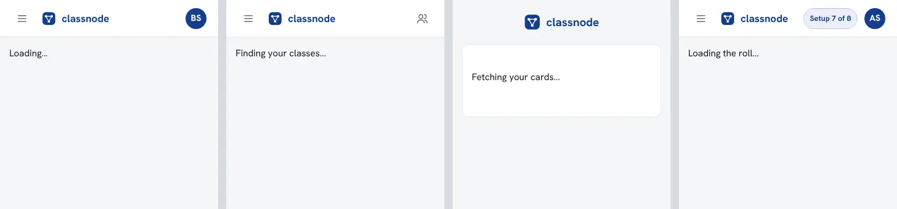

**Errors**: a 500 on Fees, a dead network on Fees (identical), the Subjects page's different error, and the parent's error:

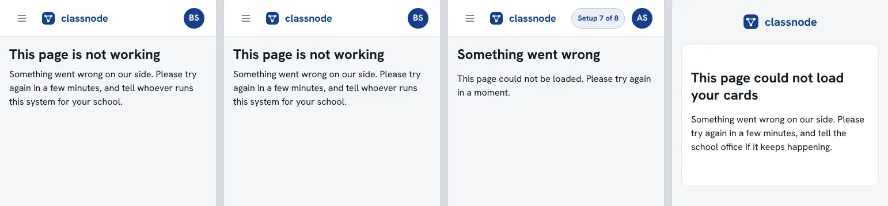

**Offline**: Register and Marks are kept and say so; Home is the browser's dinosaur:

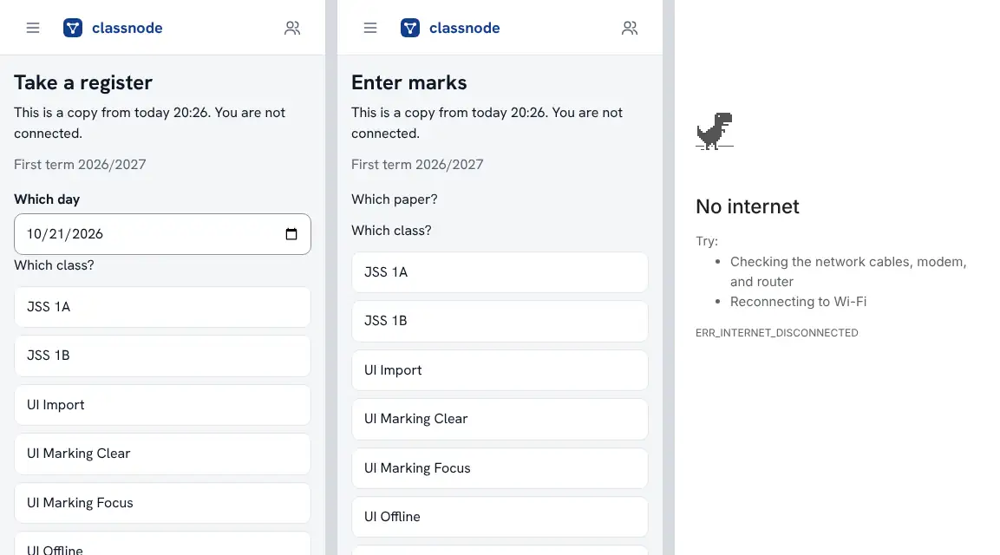

**Large system text** (root font 200%) on the dashboard, staff sign-in, result checker and parent Report cards:

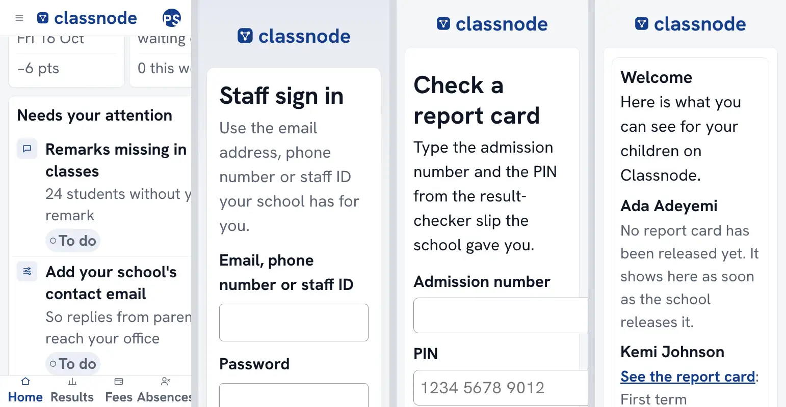

## Screen by screen

Each screen shows the 375 px view (left, full size) and the 1280 px view (right, half size), then a table. Rows tagged **C#** are cross-cutting findings measured on that screen. Every screen has had axe run at both widths, a 80-press Tab walk, a 200% text check and a page-weight measurement; the screens' own numbers are in `metrics.csv`.

### Public site and blog

#### Classnode homepage

`/` · visitor · HTTP 200 · 98 KB on the wire, 9 requests, 33 Tab stops

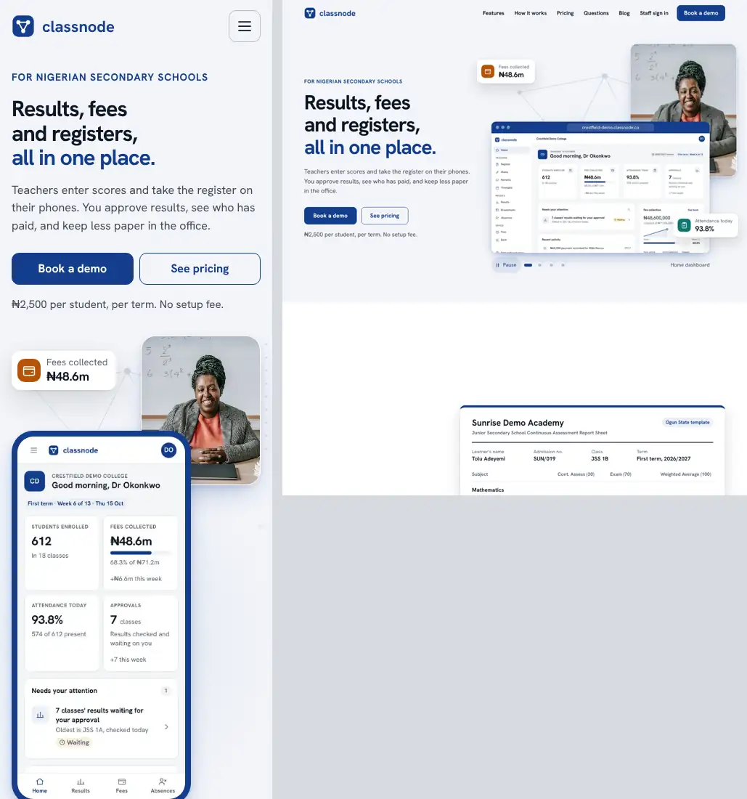

| Issue | Severity | Suggested fix |
|---|---|---|
| Breaks at large system text: 45 px sideways overflow at 200% | Medium | **C19**: Wrap rows and tiles at large text; add a 200% test. |
| Image delivery: Lighthouse estimates 103 KiB saved by right-sizing the photos (98 KB on the wire in total, so nothing is heavy) | Low | `srcset` with 300/440/880 variants is already there; add the 300 w variant to the phone `sizes`. |
| At 200% text the dark top band's strapline ("FOR NIGERIAN SECONDARY SCHOOLS") is clipped | Low | Let `.top-band` wrap. |

#### Privacy notice

`/privacy/` · visitor · HTTP 200 · 51 KB on the wire, 5 requests, 29 Tab stops

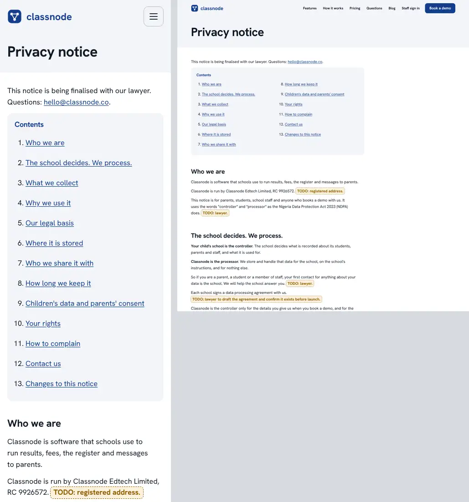

No issues found beyond the platform's strengths (axe clean, labelled fields, visible focus, loads in about a second).

#### Terms

`/terms/` · visitor · HTTP 200 · 50 KB on the wire, 5 requests, 30 Tab stops

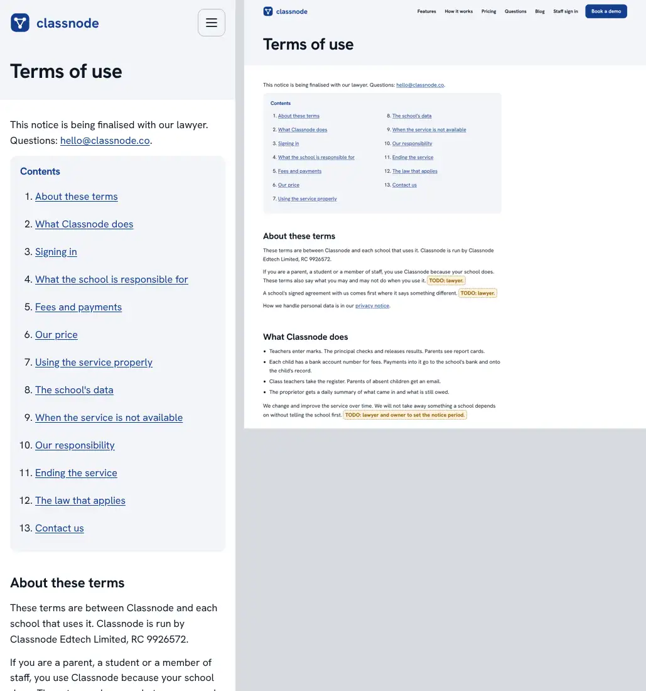

No issues found beyond the platform's strengths (axe clean, labelled fields, visible focus, loads in about a second).

#### Public site: unknown address

`/no-such-page/` · visitor · HTTP 404 · 2 KB on the wire, 1 requests, 0 Tab stops

| Issue | Severity | Suggested fix |
|---|---|---|
| Unstyled Django default error page in production | High | **C12**: Styled 404/500/CSRF templates; redirect the portal root. |

#### Blog index

`/blog/` · visitor · HTTP 200 · 128 KB on the wire, 10 requests, 17 Tab stops

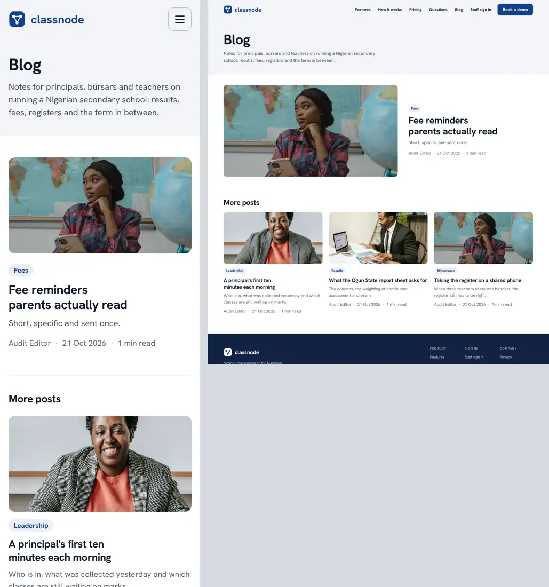

| Issue | Severity | Suggested fix |
|---|---|---|
| 128 KB, of which 76 KB is four card images; Lighthouse estimates 119 KiB saved | Low | Serve the `-small` variants at the card's real width, or AVIF. |

#### A blog post

`/blog/ogun-report-sheet/` · visitor · HTTP 200 · 128 KB on the wire, 10 requests, 18 Tab stops

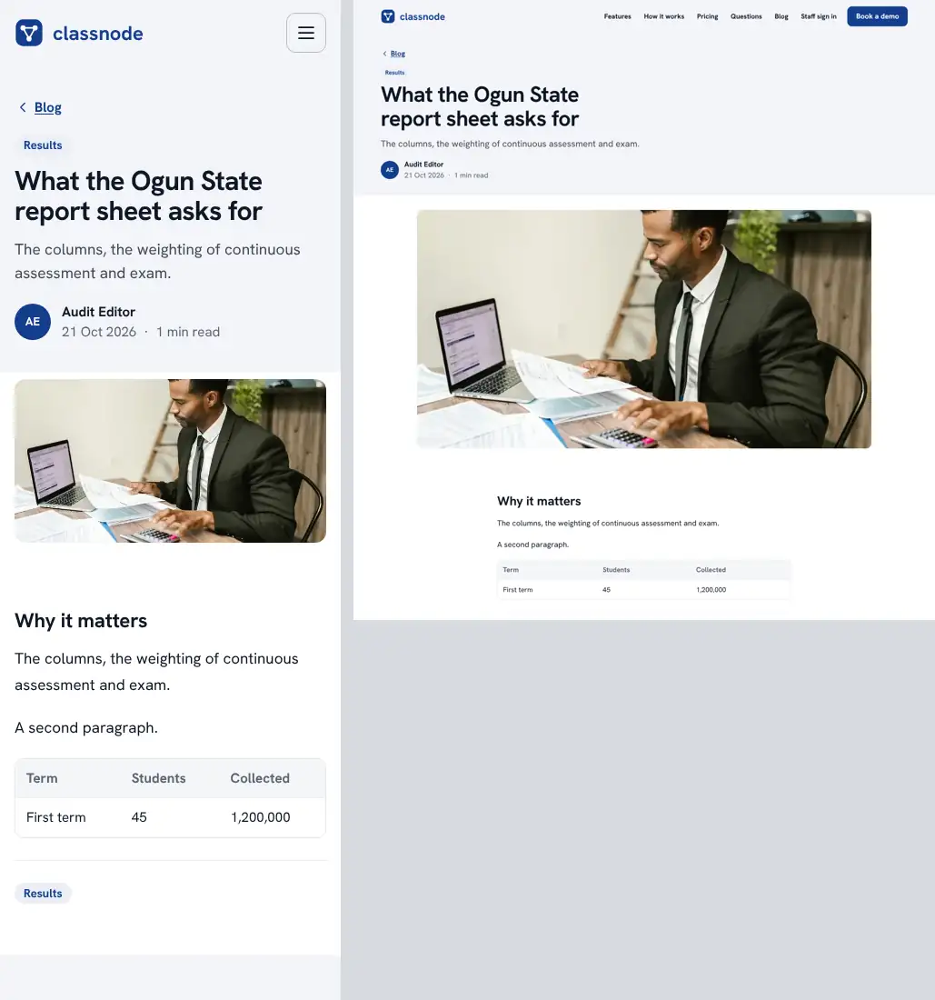

No issues found beyond the platform's strengths (axe clean, labelled fields, visible focus, loads in about a second).

#### Blog: unknown post

`/blog/no-such-post/` · visitor · HTTP 404 · 2 KB on the wire, 1 requests, 0 Tab stops

| Issue | Severity | Suggested fix |
|---|---|---|
| Blog 404 is Django's default "No such post." page in production (see C12) | High | C12: a blog 404 that offers the blog index and the latest posts. |

### Doors, errors and the result checker

#### Parent sign-in door

`/sign-in/` · parent / student · HTTP 200 · 51 KB on the wire, 10 requests, 3 Tab stops

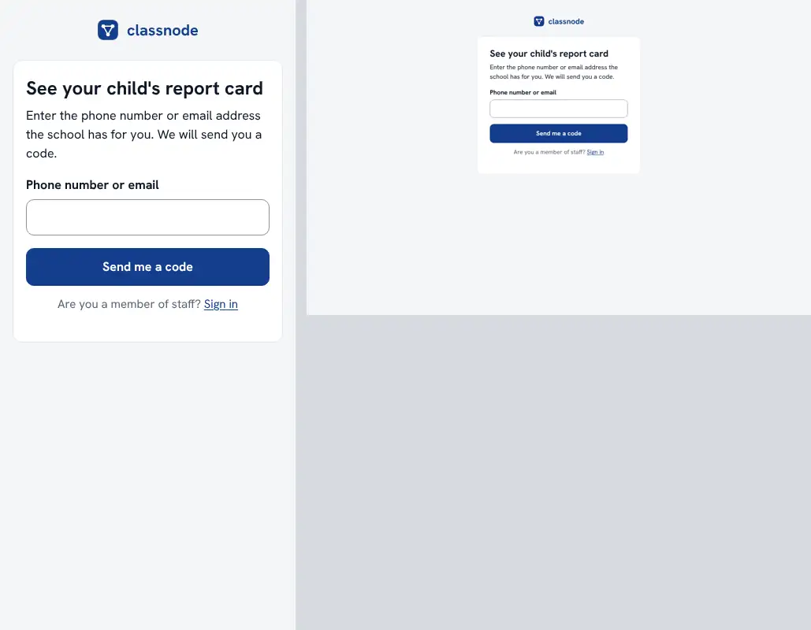

| Issue | Severity | Suggested fix |
|---|---|---|
| The field says "Phone number or email" but is `inputmode="tel"`: on Android the dial pad has no letters and no @, so a parent registered by email cannot type it without finding the keyboard switch | High | Drop `inputmode="tel"` (type=text, `autocomplete="username"`), or switch it to `email` when the typed value contains a letter. |
| Quirks mode: no `<!doctype>` | High | **C1**: Add `<!doctype html>` (one shared base template) and a `compatMode` test. |
| Two states look alike: the "If those details are on file, a code has been sent" step gives a parent no clue the number was wrong (deliberate, to avoid an oracle) and no way to resend a code | Medium | Add "Send it again" (30 s timer) beside "Use a different number". |
| Lighthouse a11y 93: `html-has-lang`, `region` | Low | See **C2**, **C21** |

#### Staff sign-in door

`/staff-sign-in/` · staff · HTTP 200 · 54 KB on the wire, 10 requests, 4 Tab stops

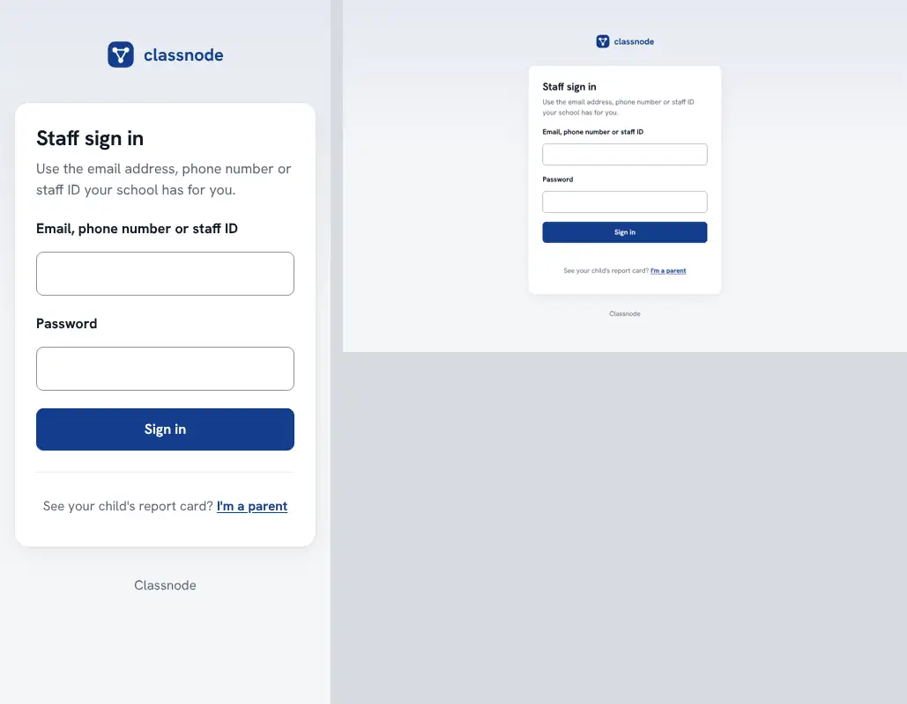

| Issue | Severity | Suggested fix |
|---|---|---|
| No "Forgot password" path: the form has no reset link, and no password-reset route exists in the codebase. Staff who forget a password cannot recover it on their own | High | Add a reset route (emailed link or SMS code, like the parent door) and a link under the Password field. |
| Platform operators sign in successfully and are told "No school on this account yet" | High | **C13**: Show Platform links on the hub for platform staff. |
| After a correct password the person lands on a "Welcome back, Principal / Choose where to go" step, an extra tap on every sign-in even with one school. The parent door redirects a one-school guardian straight in | Medium | Redirect to the role's home when the account has exactly one school and one role set. |
| Password has no show/hide toggle; on a phone, typing a long password blind is the commonest cause of the red error | Low | A `Show` toggle button with `aria-pressed`. |
| Content outside landmarks (axe `region`) | Low | **C21**: Wrap the logo and footer in landmarks. |

#### Invitation link (dead link)

`/invitations/not-a-token/` · invitee · HTTP 200 · 45 KB on the wire, 11 requests, 0 Tab stops

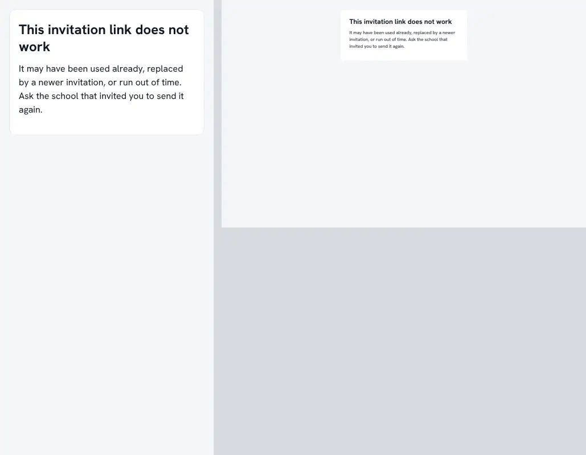

| Issue | Severity | Suggested fix |
|---|---|---|
| Quirks mode: no `<!doctype>` | High | **C1**: Add `<!doctype html>` (one shared base template) and a `compatMode` test. |
| `<html>` has no `lang` | High | **C2**: `<html lang="en">`, in the same change as C1. |
| A dead end: no logo, no link to sign in, nothing but "Ask the school that invited you to send it again" (also what the demo shows for a mistyped link) | Medium | Same card as the sign-in pages, with the logo and a "Staff sign in" link. |
| Plain white card on the grey page with no brand mark: plainer than the door pages next to it | Low | Use the door layout (`door-logo`, `door-foot`). |

#### app.classnode.co root (`/`)

`/` · anyone · HTTP 404 · 2 KB on the wire, 1 requests, 0 Tab stops

| Issue | Severity | Suggested fix |
|---|---|---|
| `app.classnode.co/` answers "Not Found" in the browser's default serif (see C12) | High | Redirect `/` to `/staff-sign-in/` (or to the public site). |

#### Portal: unknown address

`/no-such-page/` · anyone · HTTP 404 · 2 KB on the wire, 1 requests, 0 Tab stops

| Issue | Severity | Suggested fix |
|---|---|---|
| Unstyled Django default error page in production | High | **C12**: Styled 404/500/CSRF templates; redirect the portal root. |

#### A school's public page

`/` · visitor · HTTP 200 · 36 KB on the wire, 5 requests, 3 Tab stops

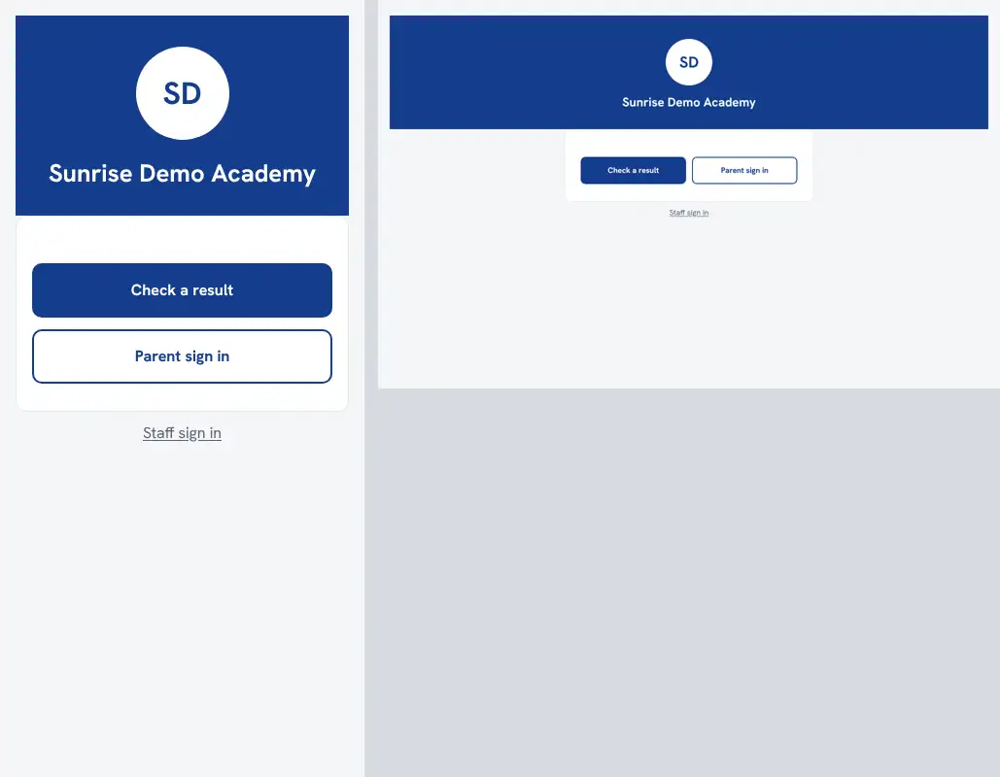

| Issue | Severity | Suggested fix |
|---|---|---|
| A school's own public page at its root is the school's face; no issues found | Low |  |

#### School host: unknown address

`/no-such-page/` · anyone · HTTP 404 · 2 KB on the wire, 1 requests, 0 Tab stops

| Issue | Severity | Suggested fix |
|---|---|---|
| A mistyped address on a school's host: default Not Found (C12) | High | C12 with a link to the school's home page. |

#### A staff page, signed out

`/home/` · signed-out staff · HTTP 200 · 40 KB on the wire, 5 requests, 2 Tab stops

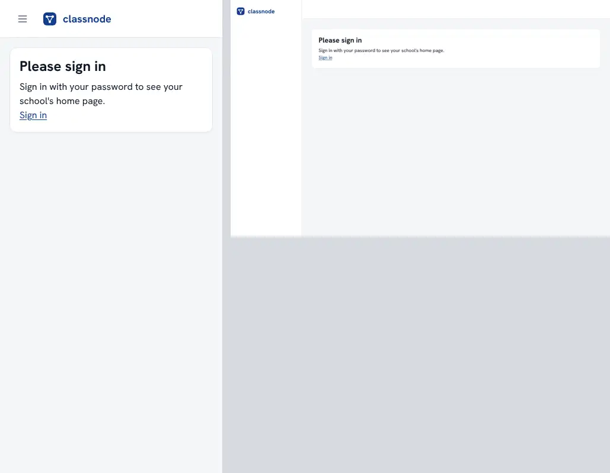

| Issue | Severity | Suggested fix |
|---|---|---|
| Quirks mode: no `<!doctype>` | High | **C1**: Add `<!doctype html>` (one shared base template) and a `compatMode` test. |
| `<html>` has no `lang` | High | **C2**: `<html lang="en">`, in the same change as C1. |
| A signed-out person opening a staff URL gets the page frame with a "Please sign in" state, not a redirect; the page title and shell are the staff ones | Medium | Redirect to `/staff-sign-in/?next=...`; the sign-in hub can return them to where they were. |
| No skip link; Menu and the sidebar come first in the Tab order | Medium | **C4**: Skip link as the first child of `<body>` in `shell_open.html`. |
| Title is just "Home" | Low | **C20**: `Home · Classnode`; set the title per view. |

#### Signed in at the wrong school (403)

`/register/` · wrong school · HTTP 403 · 1 KB on the wire, 1 requests, 0 Tab stops

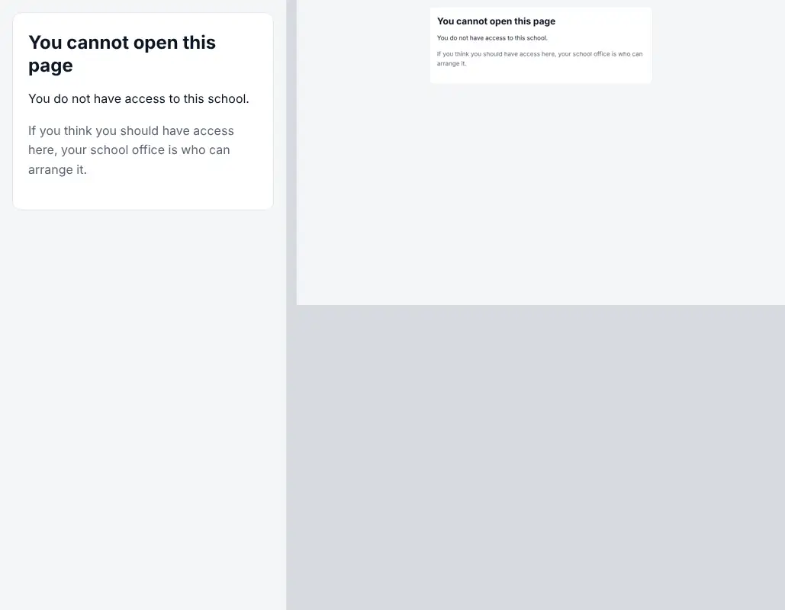

| Issue | Severity | Suggested fix |
|---|---|---|
| Quirks mode: no `<!doctype>` | High | **C1**: Add `<!doctype html>` (one shared base template) and a `compatMode` test. |
| `<html>` has no `lang` | High | **C2**: `<html lang="en">`, in the same change as C1. |
| The "You cannot open this page" card has no logo, no Sign out and no link at all (zero Tab stops): a teacher signed in at the wrong school has to edit the URL | Medium | Add logo, "Go to your school" and Sign out; the page is deliberately asset-free, so use inline SVG and the inline style it already has. |
| Plainer than the rest: white card, no brand | Low | Same as the door layout. |

#### Result checker: form

`/check/` · student / family · HTTP 200 · 63 KB on the wire, 14 requests, 4 Tab stops

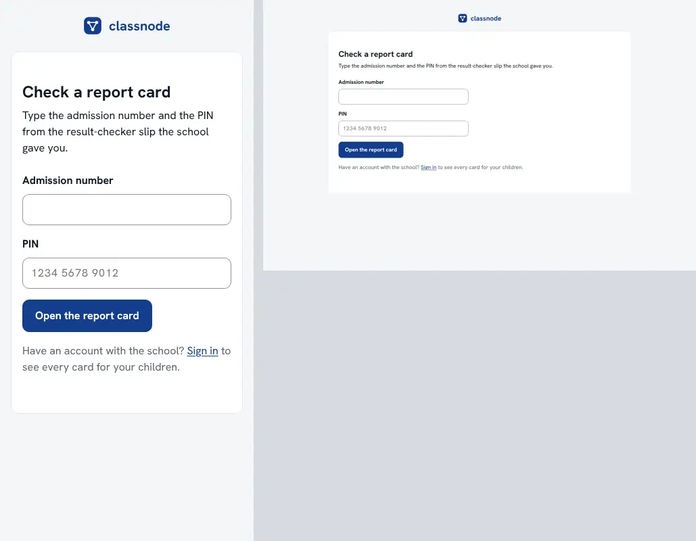

| Issue | Severity | Suggested fix |
|---|---|---|
| Quirks mode: no `<!doctype>` | High | **C1**: Add `<!doctype html>` (one shared base template) and a `compatMode` test. |
| `<html>` has no `lang` | High | **C2**: `<html lang="en">`, in the same change as C1. |
| Error state blames the server for a lost connection; no Retry | High | **C8**: Offline-aware `states.broken()` with a Try again button. |
| Free-text Admission number (`SUN/011`): no `autocapitalize`, `spellcheck=false` or `autocomplete=off` hints, and a slash is awkward on the default keyboard | Medium | Add `autocapitalize="characters" spellcheck="false" autocomplete="off"`. |
| At 200% system text the fields overflow the screen by 36 px (C19) | Medium | `min-width: 0`; let the card pad less. |
| Loading is the bare words "Loading…" | Medium | **C7**: A skeleton helper in `web/html.js`, used by every loading state. |
| No live region; focus not managed when a view changes | Medium | **C9**: Focus the new view's heading; polite live region. |
| Content outside landmarks (axe `region`) | Low | **C21**: Wrap the logo and footer in landmarks. |

#### Result checker: wrong PIN

`/check/` · student / family · HTTP 200 · 63 KB on the wire, 15 requests, 4 Tab stops

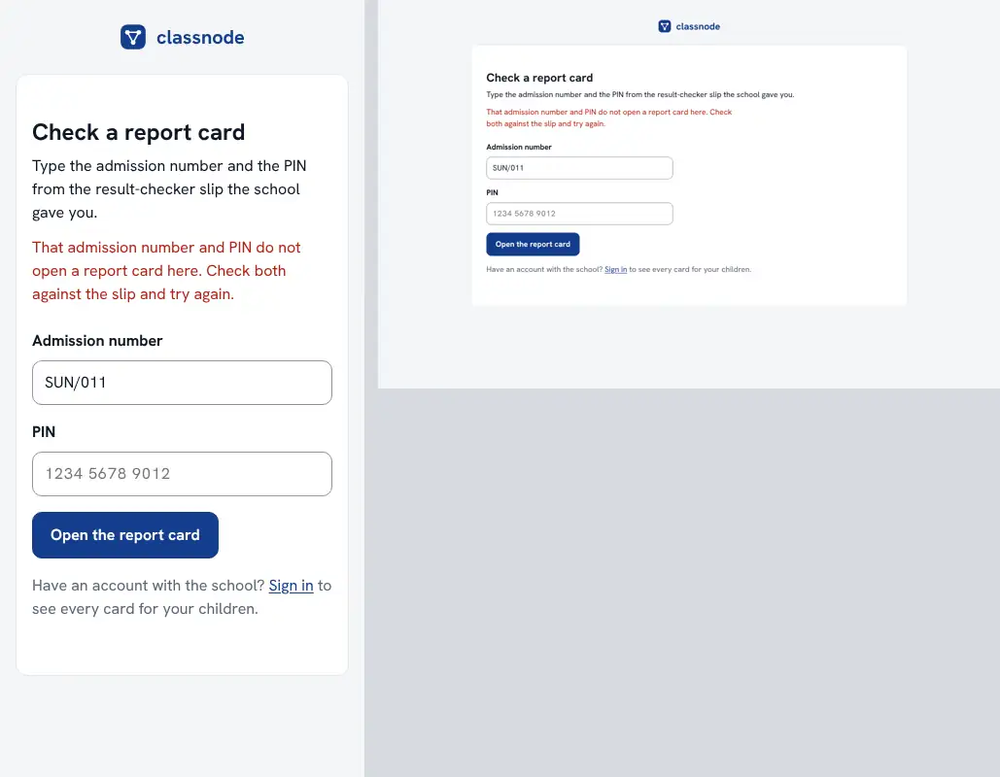

| Issue | Severity | Suggested fix |
|---|---|---|
| Quirks mode: no `<!doctype>` | High | **C1**: Add `<!doctype html>` (one shared base template) and a `compatMode` test. |
| `<html>` has no `lang` | High | **C2**: `<html lang="en">`, in the same change as C1. |
| Error state blames the server for a lost connection; no Retry | High | **C8**: Offline-aware `states.broken()` with a Try again button. |
| Loading is the bare words "Loading…" | Medium | **C7**: A skeleton helper in `web/html.js`, used by every loading state. |
| No live region; focus not managed when a view changes | Medium | **C9**: Focus the new view's heading; polite live region. |
| Breaks at large system text: 36 px sideways overflow at 200% | Medium | **C19**: Wrap rows and tiles at large text; add a 200% test. |
| Wrong PIN message works and is plain; no count of tries left, only a wait after too many (deliberate) | Low |  |
| Content outside landmarks (axe `region`) | Low | **C21**: Wrap the logo and footer in landmarks. |

#### Result checker: report card

`/check/` · student / family · HTTP 200 · 65 KB on the wire, 15 requests, 2 Tab stops

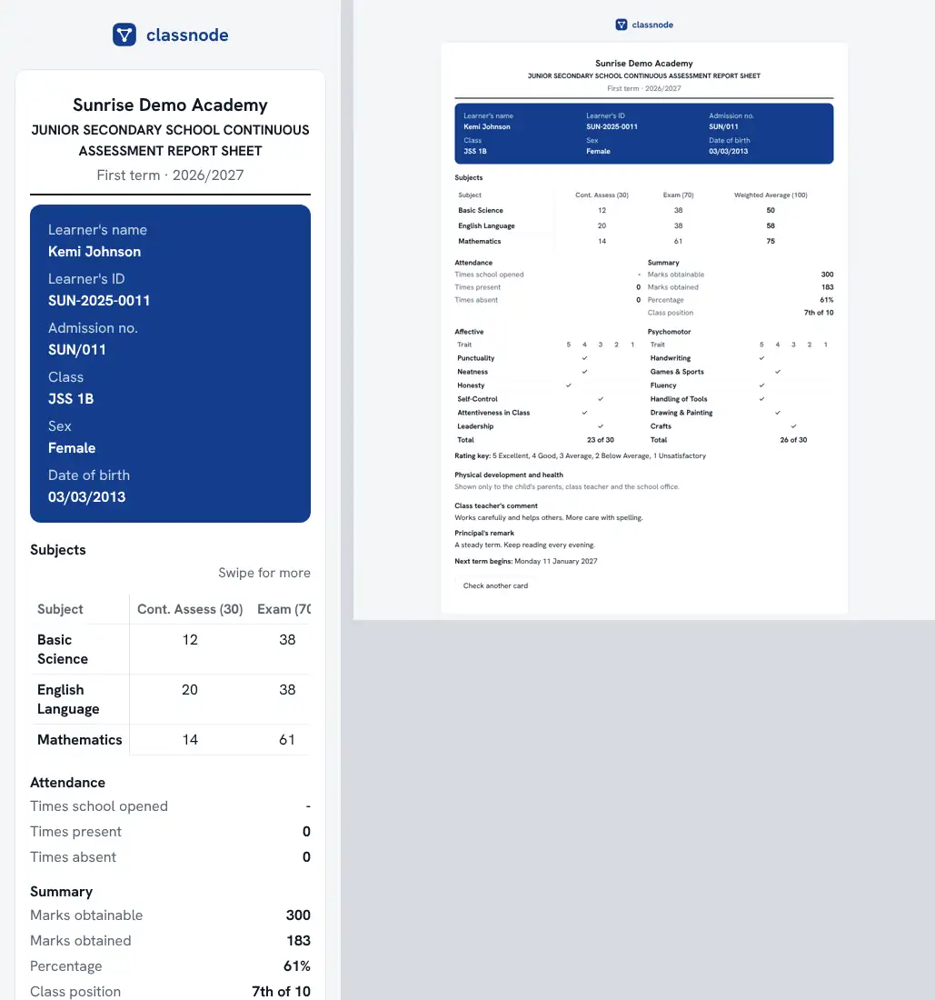

| Issue | Severity | Suggested fix |
|---|---|---|
| Quirks mode: no `<!doctype>` | High | **C1**: Add `<!doctype html>` (one shared base template) and a `compatMode` test. |
| `<html>` has no `lang` | High | **C2**: `<html lang="en">`, in the same change as C1. |
| Error state blames the server for a lost connection; no Retry | High | **C8**: Offline-aware `states.broken()` with a Try again button. |
| Loading is the bare words "Loading…" | Medium | **C7**: A skeleton helper in `web/html.js`, used by every loading state. |
| No live region; focus not managed when a view changes | Medium | **C9**: Focus the new view's heading; polite live region. |
| Sideways-scroll region is not keyboard-focusable | Medium | **C11**: `tabindex="0"`, `role="region"` and a label on `.wide`. |
| Breaks at large system text: 170 px sideways overflow at 200% | Medium | **C19**: Wrap rows and tiles at large text; add a 200% test. |
| `✓`: aria-label on a span with no role is ignored by some screen readers | Low | `role="img"` or visually-hidden text "ticked". |
| Content outside landmarks (axe `region`) | Low | **C21**: Wrap the logo and footer in landmarks. |

### Principal

#### Home (dashboard)

`/home/` · principal · HTTP 200 · 43 KB on the wire, 5 requests, 15 Tab stops

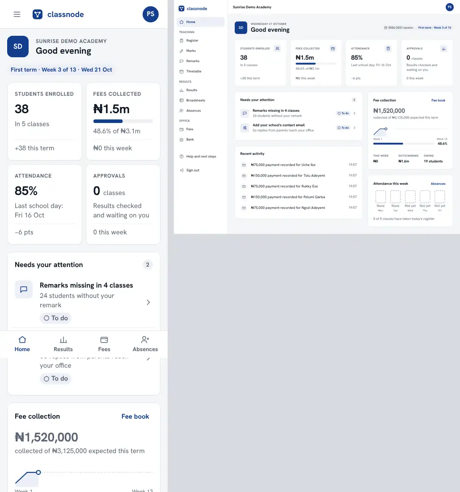

| Issue | Severity | Suggested fix |
|---|---|---|
| Quirks mode: no `<!doctype>` | High | **C1**: Add `<!doctype html>` (one shared base template) and a `compatMode` test. |
| `<html>` has no `lang` | High | **C2**: `<html lang="en">`, in the same change as C1. |
| Focus lands under the phone tab bar on 1 control when tabbing at 375 px | High | **C3**: `scroll-padding-bottom` of the tab bar's height on `html`. |
| At 200% system text the four tiles and "Needs your attention" run 121 px off the screen and the tab bar labels collide (C19) | Medium | One column and wrapping below 400 px. |
| No skip link; Menu and the sidebar come first in the Tab order | Medium | **C4**: Skip link as the first child of `<body>` in `shell_open.html`. |
| Offline: browser's "No internet" page, not a Classnode page | Medium | **C14**: An offline fallback page in the service worker. |
| Two blocks that read as the same list: "Needs your attention" rows have a status chip and a chevron, "Recent activity" rows a timestamp: both are links in some rows and plain in others | Low | Make every row of a list the same kind. |
| Account button's name ("Your account") does not contain its visible initials | Low | **C5**: `aria-hidden` on the initials, or include them in the label. |
| Title is just "Home" | Low | **C20**: `Home · Classnode`; set the title per view. |

#### Results

`/results/` · principal · HTTP 200 · 57 KB on the wire, 11 requests, 18 Tab stops

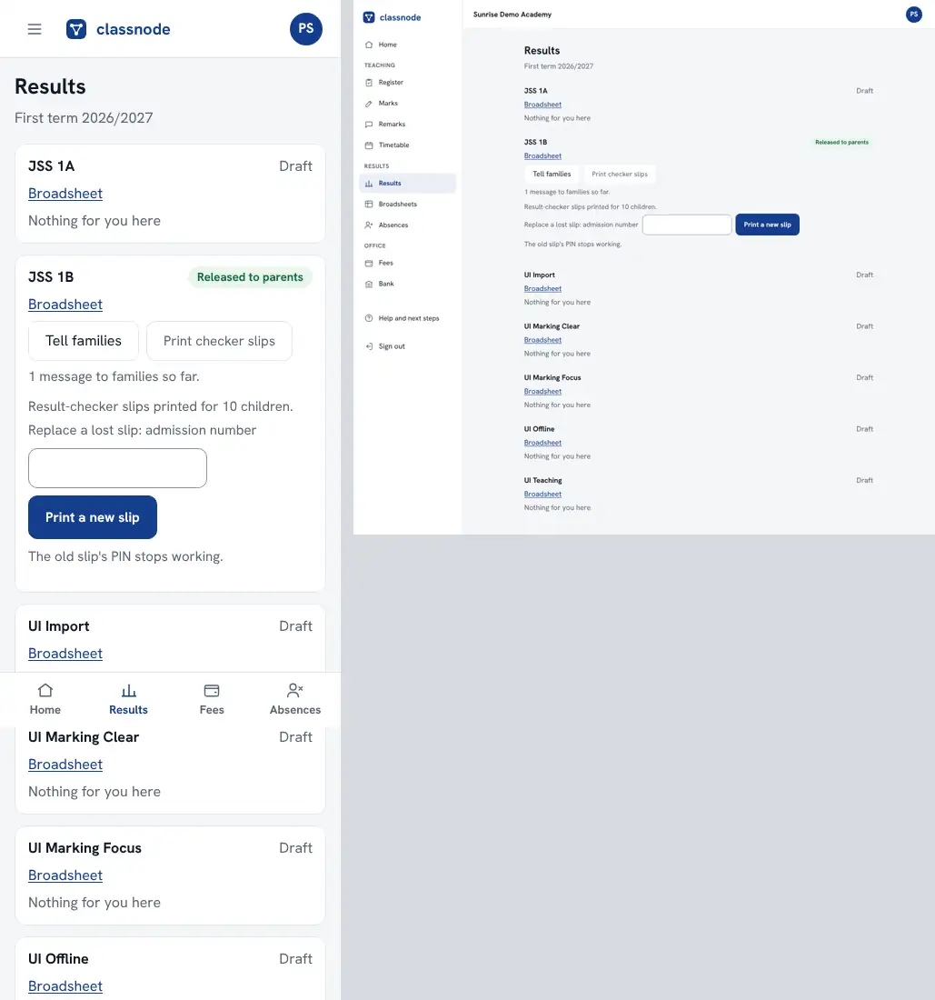

| Issue | Severity | Suggested fix |
|---|---|---|
| Quirks mode: no `<!doctype>` | High | **C1**: Add `<!doctype html>` (one shared base template) and a `compatMode` test. |
| `<html>` has no `lang` | High | **C2**: `<html lang="en">`, in the same change as C1. |
| Focus lands under the phone tab bar on 1 control when tabbing at 375 px | High | **C3**: `scroll-padding-bottom` of the tab bar's height on `html`. |
| Error state blames the server for a lost connection; no Retry | High | **C8**: Offline-aware `states.broken()` with a Try again button. |
| Rows overflow by 101 px at 200% text (C19) | Medium | Wrap `.row`; actions drop below the name. |
| No skip link; Menu and the sidebar come first in the Tab order | Medium | **C4**: Skip link as the first child of `<body>` in `shell_open.html`. |
| Loading is the bare words "Loading…" | Medium | **C7**: A skeleton helper in `web/html.js`, used by every loading state. |
| No live region; focus not managed when a view changes | Medium | **C9**: Focus the new view's heading; polite live region. |
| Offline: browser's "No internet" page, not a Classnode page | Medium | **C14**: An offline fallback page in the service worker. |
| "Replace a lost slip: admission number" is a labelled text field inside a card with two other controls; the order (Tell families, Print checker slips, a label, a field, a button) reads as a form, not as steps | Low | Group into "Tell families" and "Result-checker slips" sections. |
| Account button's name ("Your account") does not contain its visible initials | Low | **C5**: `aria-hidden` on the initials, or include them in the label. |

#### Broadsheets

`/broadsheet/` · principal · HTTP 200 · 51 KB on the wire, 12 requests, 15 Tab stops

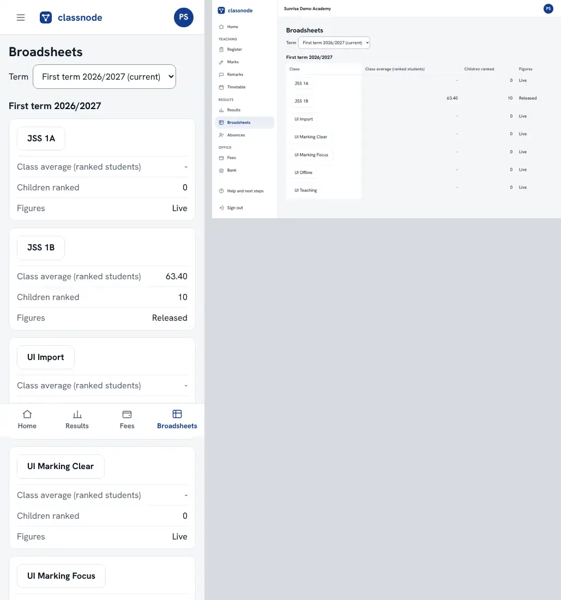

*After tapping through: class*

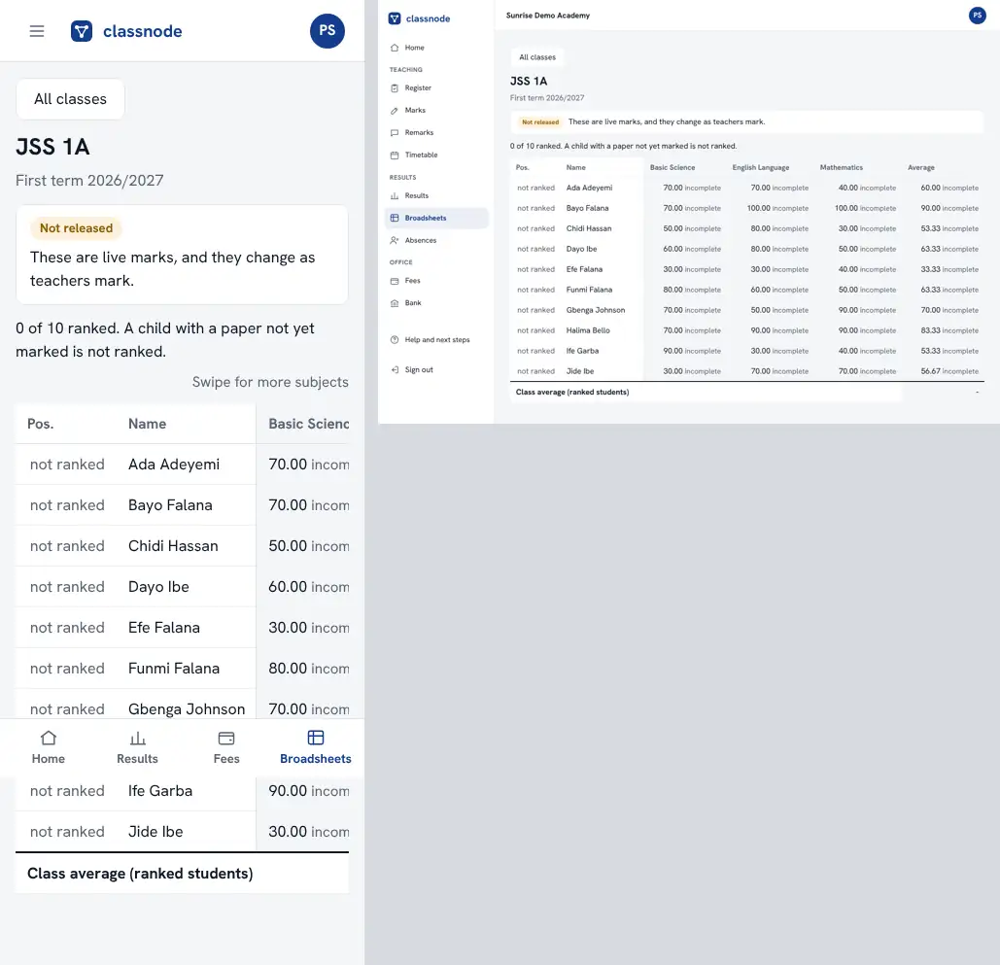

| Issue | Severity | Suggested fix |
|---|---|---|
| Quirks mode: no `<!doctype>` | High | **C1**: Add `<!doctype html>` (one shared base template) and a `compatMode` test. |
| `<html>` has no `lang` | High | **C2**: `<html lang="en">`, in the same change as C1. |
| Focus lands under the phone tab bar on 1 control when tabbing at 375 px | High | **C3**: `scroll-padding-bottom` of the tab bar's height on `html`. |
| Error state blames the server for a lost connection; no Retry | High | **C8**: Offline-aware `states.broken()` with a Try again button. |
| Drilling into a class/account adds no history entry: Back leaves the page | High | **C10**: `pushState` per view and a `popstate` handler. |
| No skip link; Menu and the sidebar come first in the Tab order | Medium | **C4**: Skip link as the first child of `<body>` in `shell_open.html`. |
| Loading is the bare words "Loading…" | Medium | **C7**: A skeleton helper in `web/html.js`, used by every loading state. |
| No live region; focus not managed when a view changes | Medium | **C9**: Focus the new view's heading; polite live region. |
| Sideways-scroll region is not keyboard-focusable | Medium | **C11**: `tabindex="0"`, `role="region"` and a label on `.wide`. |
| Account button's name ("Your account") does not contain its visible initials | Low | **C5**: `aria-hidden` on the initials, or include them in the label. |

#### Absent too often

`/absences/` · principal · HTTP 200 · 49 KB on the wire, 11 requests, 11 Tab stops

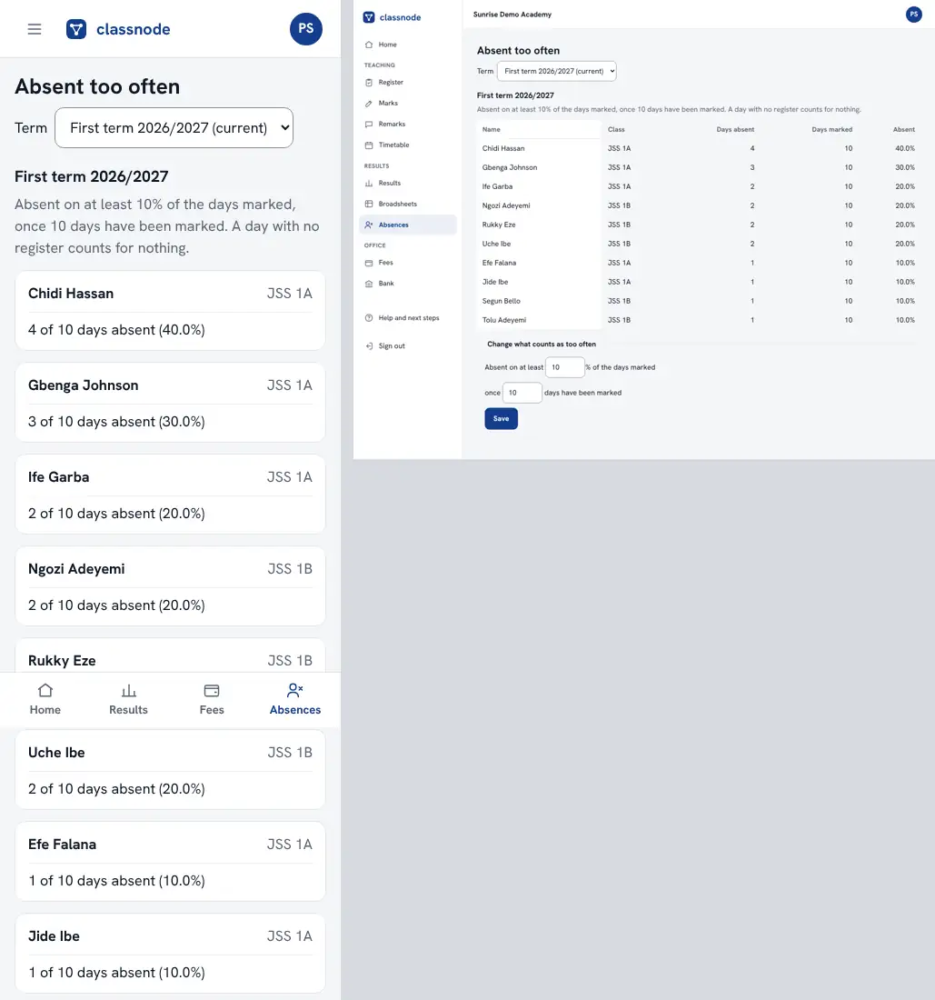

| Issue | Severity | Suggested fix |
|---|---|---|
| Quirks mode: no `<!doctype>` | High | **C1**: Add `<!doctype html>` (one shared base template) and a `compatMode` test. |
| `<html>` has no `lang` | High | **C2**: `<html lang="en">`, in the same change as C1. |
| Error state blames the server for a lost connection; no Retry | High | **C8**: Offline-aware `states.broken()` with a Try again button. |
| No skip link; Menu and the sidebar come first in the Tab order | Medium | **C4**: Skip link as the first child of `<body>` in `shell_open.html`. |
| Loading is the bare words "Loading…" | Medium | **C7**: A skeleton helper in `web/html.js`, used by every loading state. |
| No live region; focus not managed when a view changes | Medium | **C9**: Focus the new view's heading; polite live region. |
| Heading "First term 2026/2027" repeats the term the select above already shows | Low | Drop the repeated heading; keep the sentence that explains the 10% rule. |
| Account button's name ("Your account") does not contain its visible initials | Low | **C5**: `aria-hidden` on the initials, or include them in the label. |

#### Fees

`/fees/` · principal · HTTP 200 · 61 KB on the wire, 13 requests, 14 Tab stops

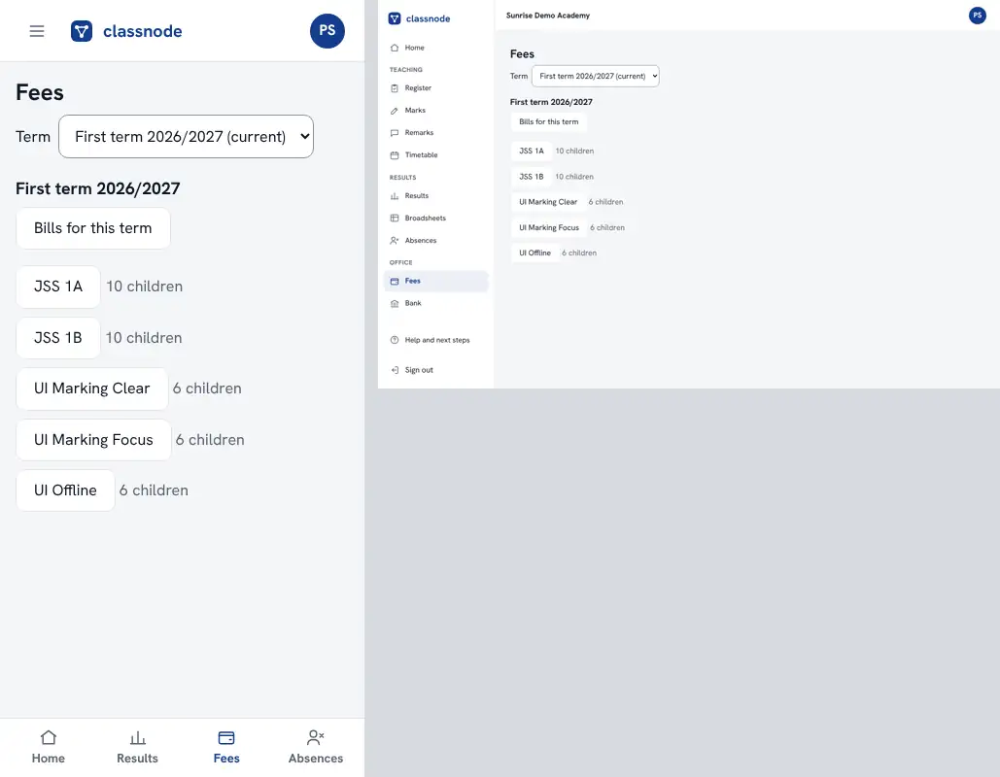

*After tapping through: account*

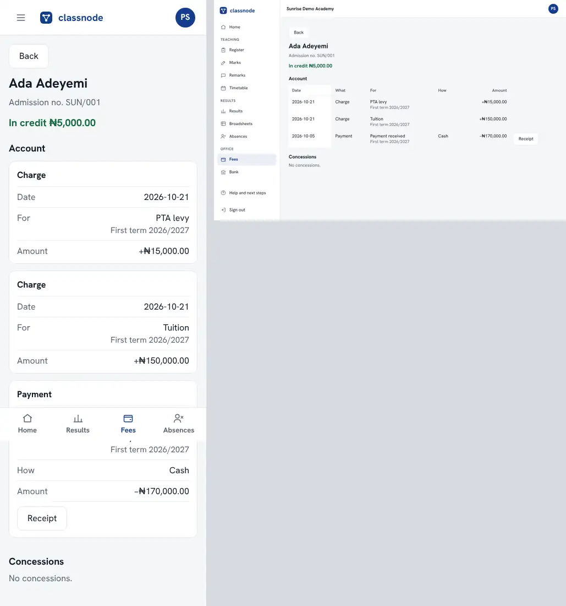

*After tapping through: class*

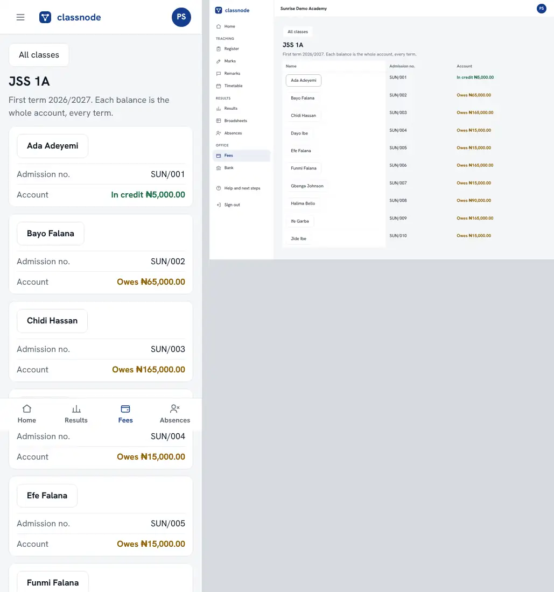

| Issue | Severity | Suggested fix |
|---|---|---|
| Quirks mode: no `<!doctype>` | High | **C1**: Add `<!doctype html>` (one shared base template) and a `compatMode` test. |
| `<html>` has no `lang` | High | **C2**: `<html lang="en">`, in the same change as C1. |
| Focus lands under the phone tab bar on 1 control when tabbing at 375 px | High | **C3**: `scroll-padding-bottom` of the tab bar's height on `html`. |
| Error state blames the server for a lost connection; no Retry | High | **C8**: Offline-aware `states.broken()` with a Try again button. |
| Drilling into a class/account adds no history entry: Back leaves the page | High | **C10**: `pushState` per view and a `popstate` handler. |
| Class list uses pills, not tiles (C15); "Bills for this term" pill reads as a tab but is a button that opens a different view | Medium | C15; make it a clear secondary action. |
| No skip link; Menu and the sidebar come first in the Tab order | Medium | **C4**: Skip link as the first child of `<body>` in `shell_open.html`. |
| Loading is the bare words "Loading…" | Medium | **C7**: A skeleton helper in `web/html.js`, used by every loading state. |
| No live region; focus not managed when a view changes | Medium | **C9**: Focus the new view's heading; polite live region. |
| Offline: browser's "No internet" page, not a Classnode page | Medium | **C14**: An offline fallback page in the service worker. |
| Account button's name ("Your account") does not contain its visible initials | Low | **C5**: `aria-hidden` on the initials, or include them in the label. |

#### Remarks

`/comments/` · principal · HTTP 200 · 54 KB on the wire, 11 requests, 14 Tab stops

| Issue | Severity | Suggested fix |
|---|---|---|
| Quirks mode: no `<!doctype>` | High | **C1**: Add `<!doctype html>` (one shared base template) and a `compatMode` test. |
| `<html>` has no `lang` | High | **C2**: `<html lang="en">`, in the same change as C1. |
| Error state blames the server for a lost connection; no Retry | High | **C8**: Offline-aware `states.broken()` with a Try again button. |
| No skip link; Menu and the sidebar come first in the Tab order | Medium | **C4**: Skip link as the first child of `<body>` in `shell_open.html`. |
| Loading is the bare words "Loading…" | Medium | **C7**: A skeleton helper in `web/html.js`, used by every loading state. |
| No live region; focus not managed when a view changes | Medium | **C9**: Focus the new view's heading; polite live region. |
| No Term control, unlike Results, Fees and Broadsheets: inconsistent headings between sibling pages | Low | Show the term the same way on all four. |
| Account button's name ("Your account") does not contain its visible initials | Low | **C5**: `aria-hidden` on the initials, or include them in the label. |

#### Timetable

`/timetable/` · principal · HTTP 200 · 52 KB on the wire, 12 requests, 10 Tab stops

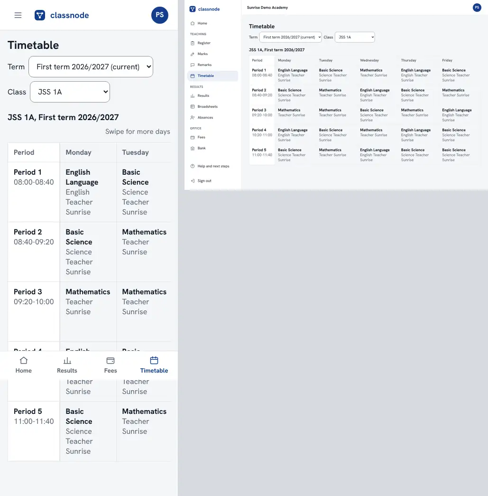

| Issue | Severity | Suggested fix |
|---|---|---|
| Quirks mode: no `<!doctype>` | High | **C1**: Add `<!doctype html>` (one shared base template) and a `compatMode` test. |
| `<html>` has no `lang` | High | **C2**: `<html lang="en">`, in the same change as C1. |
| Error state blames the server for a lost connection; no Retry | High | **C8**: Offline-aware `states.broken()` with a Try again button. |
| Timetable grid on a phone needs a sideways swipe to see Wednesday to Friday; the scroller is not focusable (C11). A teacher's "what do I teach now" is a per-day question | Medium | A one-day-at-a-time view with day tabs on phones, defaulting to today. |
| No skip link; Menu and the sidebar come first in the Tab order | Medium | **C4**: Skip link as the first child of `<body>` in `shell_open.html`. |
| Loading is the bare words "Loading…" | Medium | **C7**: A skeleton helper in `web/html.js`, used by every loading state. |
| No live region; focus not managed when a view changes | Medium | **C9**: Focus the new view's heading; polite live region. |
| Offline: browser's "No internet" page, not a Classnode page | Medium | **C14**: An offline fallback page in the service worker. |
| Account button's name ("Your account") does not contain its visible initials | Low | **C5**: `aria-hidden` on the initials, or include them in the label. |

#### Help and next steps

`/help/` · principal · HTTP 200 · 44 KB on the wire, 6 requests, 9 Tab stops

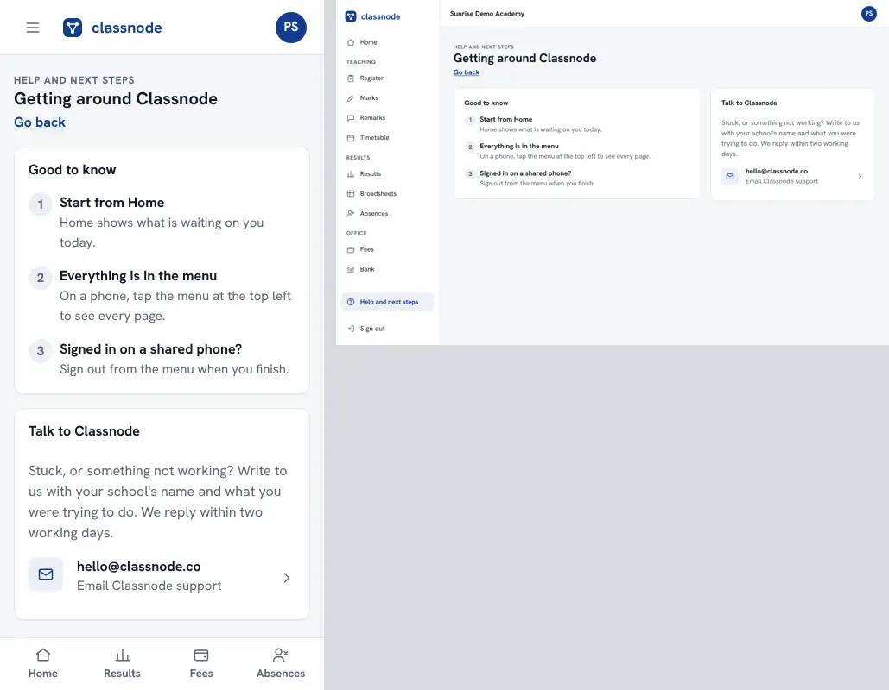

| Issue | Severity | Suggested fix |
|---|---|---|
| Quirks mode: no `<!doctype>` | High | **C1**: Add `<!doctype html>` (one shared base template) and a `compatMode` test. |
| `<html>` has no `lang` | High | **C2**: `<html lang="en">`, in the same change as C1. |
| No skip link; Menu and the sidebar come first in the Tab order | Medium | **C4**: Skip link as the first child of `<body>` in `shell_open.html`. |
| Offline: browser's "No internet" page, not a Classnode page | Medium | **C14**: An offline fallback page in the service worker. |
| Account button's name ("Your account") does not contain its visible initials | Low | **C5**: `aria-hidden` on the initials, or include them in the label. |

#### Report cards (opened by a principal)

`/cards/` · principal · HTTP 200 · 52 KB on the wire, 12 requests, 1 Tab stops

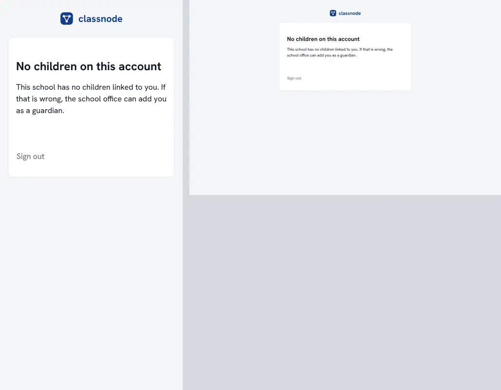

| Issue | Severity | Suggested fix |
|---|---|---|
| Quirks mode: no `<!doctype>` | High | **C1**: Add `<!doctype html>` (one shared base template) and a `compatMode` test. |
| `<html>` has no `lang` | High | **C2**: `<html lang="en">`, in the same change as C1. |
| A principal who opens `/cards/` sees "No children on this account", a parent screen, with nothing pointing back to where they can see cards | Low | Redirect staff to Results, or say "Report cards for staff are under Results". |
| Content outside landmarks (axe `region`) | Low | **C21**: Wrap the logo and footer in landmarks. |

### Vice principal

#### Home (dashboard)

`/home/` · vice principal · HTTP 200 · 42 KB on the wire, 5 requests, 12 Tab stops

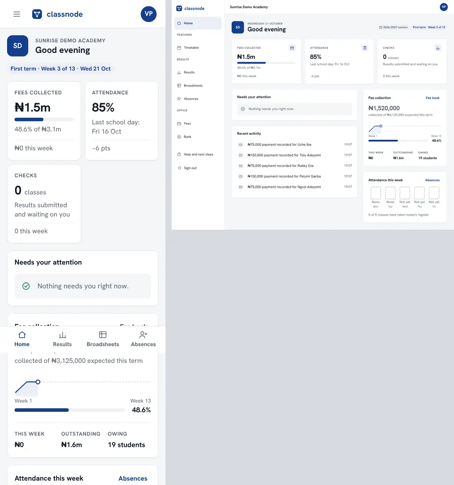

| Issue | Severity | Suggested fix |
|---|---|---|
| Quirks mode: no `<!doctype>` | High | **C1**: Add `<!doctype html>` (one shared base template) and a `compatMode` test. |
| `<html>` has no `lang` | High | **C2**: `<html lang="en">`, in the same change as C1. |
| Focus lands under the phone tab bar on 1 control when tabbing at 375 px | High | **C3**: `scroll-padding-bottom` of the tab bar's height on `html`. |
| No skip link; Menu and the sidebar come first in the Tab order | Medium | **C4**: Skip link as the first child of `<body>` in `shell_open.html`. |
| Offline: browser's "No internet" page, not a Classnode page | Medium | **C14**: An offline fallback page in the service worker. |
| Breaks at large system text: 121 px sideways overflow at 200% | Medium | **C19**: Wrap rows and tiles at large text; add a 200% test. |
| Account button's name ("Your account") does not contain its visible initials | Low | **C5**: `aria-hidden` on the initials, or include them in the label. |
| Title is just "Home" | Low | **C20**: `Home · Classnode`; set the title per view. |

#### Results

`/results/` · vice principal · HTTP 200 · 57 KB on the wire, 11 requests, 14 Tab stops

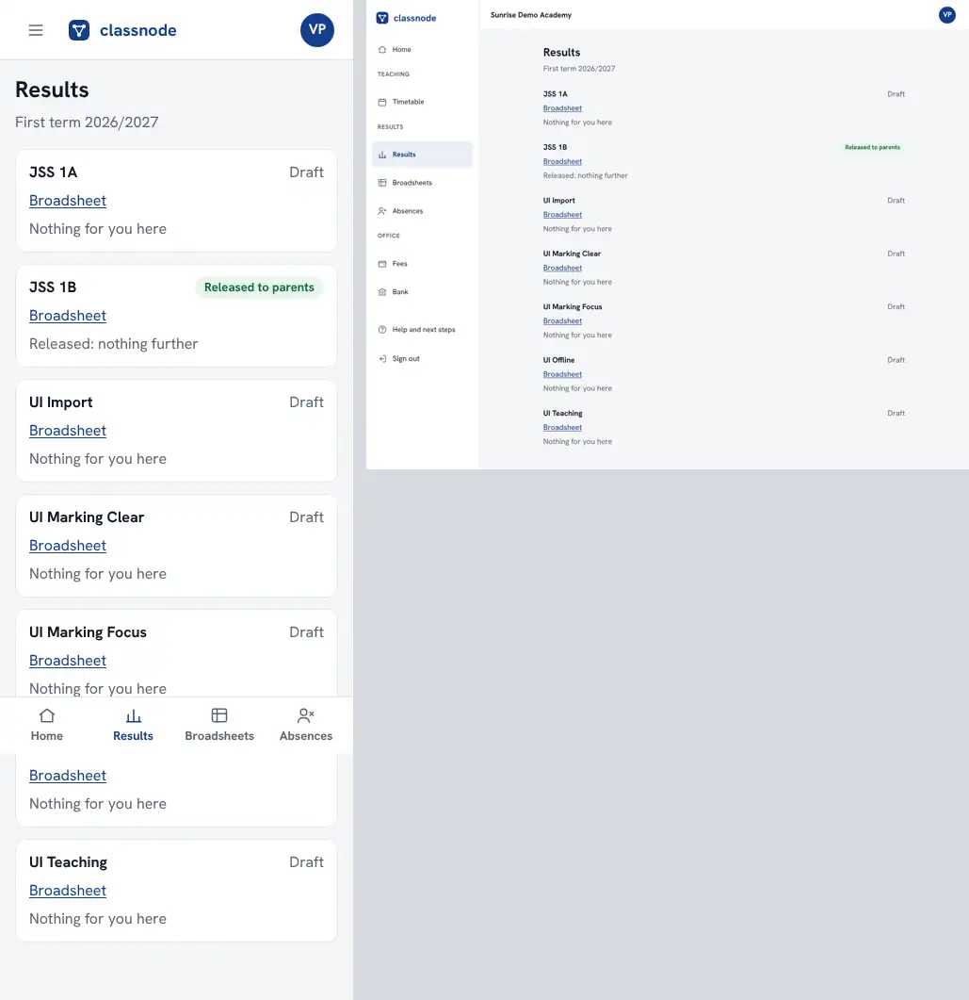

| Issue | Severity | Suggested fix |
|---|---|---|
| Quirks mode: no `<!doctype>` | High | **C1**: Add `<!doctype html>` (one shared base template) and a `compatMode` test. |
| `<html>` has no `lang` | High | **C2**: `<html lang="en">`, in the same change as C1. |
| Error state blames the server for a lost connection; no Retry | High | **C8**: Offline-aware `states.broken()` with a Try again button. |
| No skip link; Menu and the sidebar come first in the Tab order | Medium | **C4**: Skip link as the first child of `<body>` in `shell_open.html`. |
| Loading is the bare words "Loading…" | Medium | **C7**: A skeleton helper in `web/html.js`, used by every loading state. |
| No live region; focus not managed when a view changes | Medium | **C9**: Focus the new view's heading; polite live region. |
| Breaks at large system text: 101 px sideways overflow at 200% | Medium | **C19**: Wrap rows and tiles at large text; add a 200% test. |
| Account button's name ("Your account") does not contain its visible initials | Low | **C5**: `aria-hidden` on the initials, or include them in the label. |

#### Broadsheets

`/broadsheet/` · vice principal · HTTP 200 · 51 KB on the wire, 12 requests, 15 Tab stops

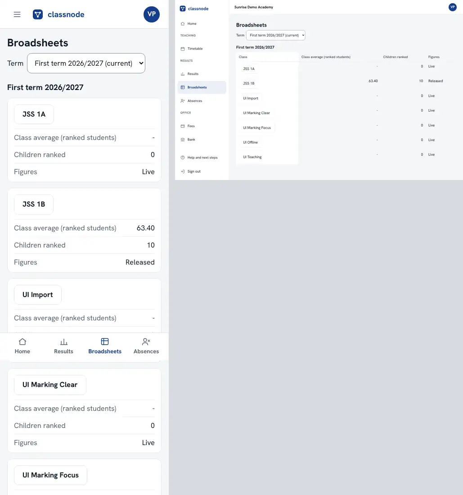

| Issue | Severity | Suggested fix |
|---|---|---|
| Quirks mode: no `<!doctype>` | High | **C1**: Add `<!doctype html>` (one shared base template) and a `compatMode` test. |
| `<html>` has no `lang` | High | **C2**: `<html lang="en">`, in the same change as C1. |
| Focus lands under the phone tab bar on 1 control when tabbing at 375 px | High | **C3**: `scroll-padding-bottom` of the tab bar's height on `html`. |
| Error state blames the server for a lost connection; no Retry | High | **C8**: Offline-aware `states.broken()` with a Try again button. |
| No skip link; Menu and the sidebar come first in the Tab order | Medium | **C4**: Skip link as the first child of `<body>` in `shell_open.html`. |
| Loading is the bare words "Loading…" | Medium | **C7**: A skeleton helper in `web/html.js`, used by every loading state. |
| No live region; focus not managed when a view changes | Medium | **C9**: Focus the new view's heading; polite live region. |
| Account button's name ("Your account") does not contain its visible initials | Low | **C5**: `aria-hidden` on the initials, or include them in the label. |

#### Absent too often

`/absences/` · vice principal · HTTP 200 · 49 KB on the wire, 11 requests, 8 Tab stops

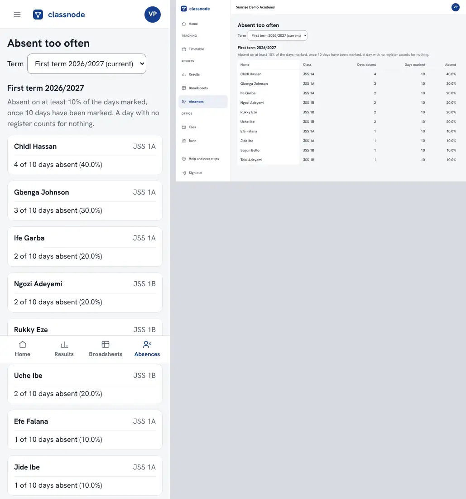

| Issue | Severity | Suggested fix |
|---|---|---|
| Quirks mode: no `<!doctype>` | High | **C1**: Add `<!doctype html>` (one shared base template) and a `compatMode` test. |
| `<html>` has no `lang` | High | **C2**: `<html lang="en">`, in the same change as C1. |
| Error state blames the server for a lost connection; no Retry | High | **C8**: Offline-aware `states.broken()` with a Try again button. |
| No skip link; Menu and the sidebar come first in the Tab order | Medium | **C4**: Skip link as the first child of `<body>` in `shell_open.html`. |
| Loading is the bare words "Loading…" | Medium | **C7**: A skeleton helper in `web/html.js`, used by every loading state. |
| No live region; focus not managed when a view changes | Medium | **C9**: Focus the new view's heading; polite live region. |
| Account button's name ("Your account") does not contain its visible initials | Low | **C5**: `aria-hidden` on the initials, or include them in the label. |

#### Fees (read-only)

`/fees/` · vice principal · HTTP 200 · 61 KB on the wire, 13 requests, 14 Tab stops

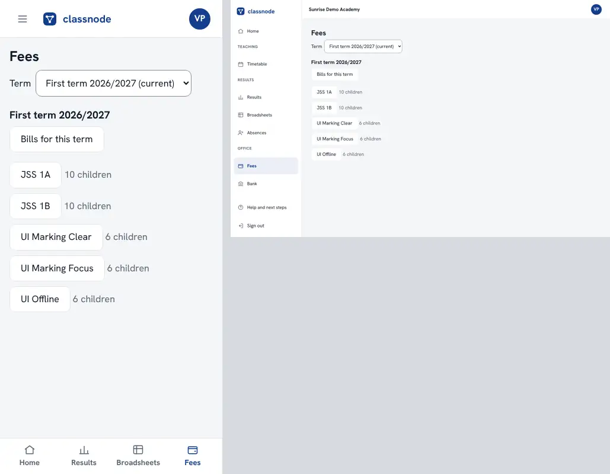

| Issue | Severity | Suggested fix |
|---|---|---|
| Quirks mode: no `<!doctype>` | High | **C1**: Add `<!doctype html>` (one shared base template) and a `compatMode` test. |
| `<html>` has no `lang` | High | **C2**: `<html lang="en">`, in the same change as C1. |
| Error state blames the server for a lost connection; no Retry | High | **C8**: Offline-aware `states.broken()` with a Try again button. |
| No skip link; Menu and the sidebar come first in the Tab order | Medium | **C4**: Skip link as the first child of `<body>` in `shell_open.html`. |
| Loading is the bare words "Loading…" | Medium | **C7**: A skeleton helper in `web/html.js`, used by every loading state. |
| No live region; focus not managed when a view changes | Medium | **C9**: Focus the new view's heading; polite live region. |
| Account button's name ("Your account") does not contain its visible initials | Low | **C5**: `aria-hidden` on the initials, or include them in the label. |

### Administrator

#### Home (dashboard)

`/home/` · administrator · HTTP 200 · 43 KB on the wire, 5 requests, 17 Tab stops

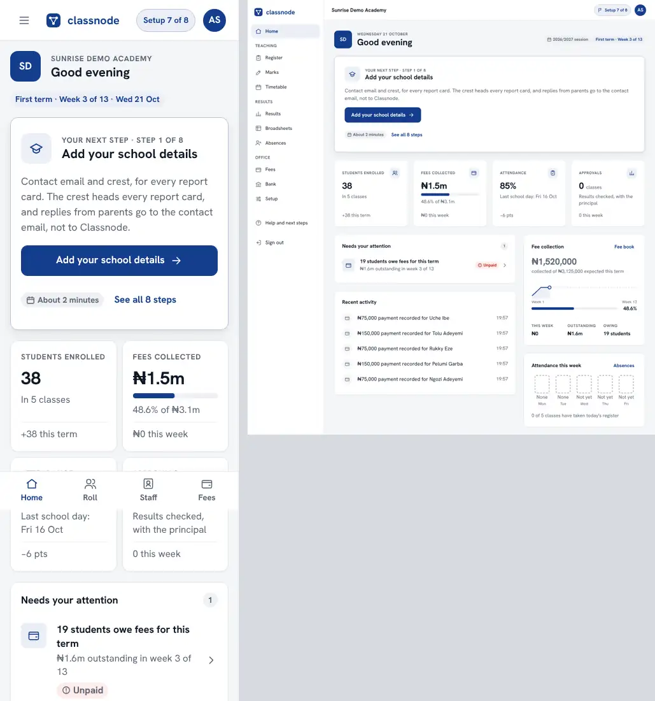

| Issue | Severity | Suggested fix |
|---|---|---|
| Quirks mode: no `<!doctype>` | High | **C1**: Add `<!doctype html>` (one shared base template) and a `compatMode` test. |
| `<html>` has no `lang` | High | **C2**: `<html lang="en">`, in the same change as C1. |
| For a school that has finished setup the Home still shows the "Setup 7 of 8" chip in the top bar on every page | Medium | Hide the chip once only optional steps remain, or after the first release. |
| No skip link; Menu and the sidebar come first in the Tab order | Medium | **C4**: Skip link as the first child of `<body>` in `shell_open.html`. |
| Top bar overflows at 320 px and at large text; account menu off screen | Medium | **C6**: Collapse the Setup chip to its icon below 360 px. |
| Offline: browser's "No internet" page, not a Classnode page | Medium | **C14**: An offline fallback page in the service worker. |
| Account button's name ("Your account") does not contain its visible initials | Low | **C5**: `aria-hidden` on the initials, or include them in the label. |
| Title is just "Home" | Low | **C20**: `Home · Classnode`; set the title per view. |

#### Start here

`/start/` · administrator · HTTP 200 · 44 KB on the wire, 6 requests, 18 Tab stops

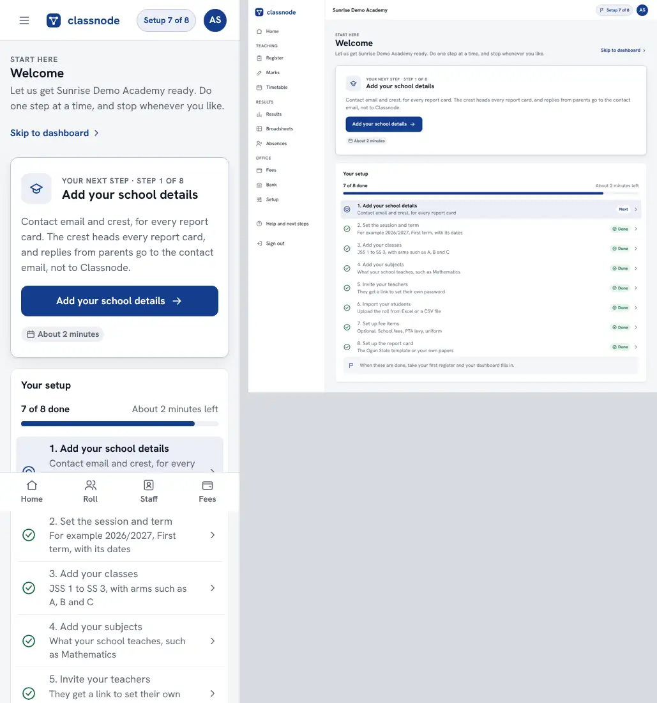

| Issue | Severity | Suggested fix |
|---|---|---|
| Quirks mode: no `<!doctype>` | High | **C1**: Add `<!doctype html>` (one shared base template) and a `compatMode` test. |
| `<html>` has no `lang` | High | **C2**: `<html lang="en">`, in the same change as C1. |
| Focus lands under the phone tab bar on 3 controls when tabbing at 375 px | High | **C3**: `scroll-padding-bottom` of the tab bar's height on `html`. |
| No skip link; Menu and the sidebar come first in the Tab order | Medium | **C4**: Skip link as the first child of `<body>` in `shell_open.html`. |
| Top bar overflows at 320 px and at large text; account menu off screen | Medium | **C6**: Collapse the Setup chip to its icon below 360 px. |
| "Skip to dashboard" is a plain text link above the card, and the whole card is a link to step 1: two ways to do the same thing at the top | Low | One primary action, one quiet skip. |
| Account button's name ("Your account") does not contain its visible initials | Low | **C5**: `aria-hidden` on the initials, or include them in the label. |

#### A setup step

`/start/school-details/` · administrator · HTTP 200 · 44 KB on the wire, 6 requests, 14 Tab stops

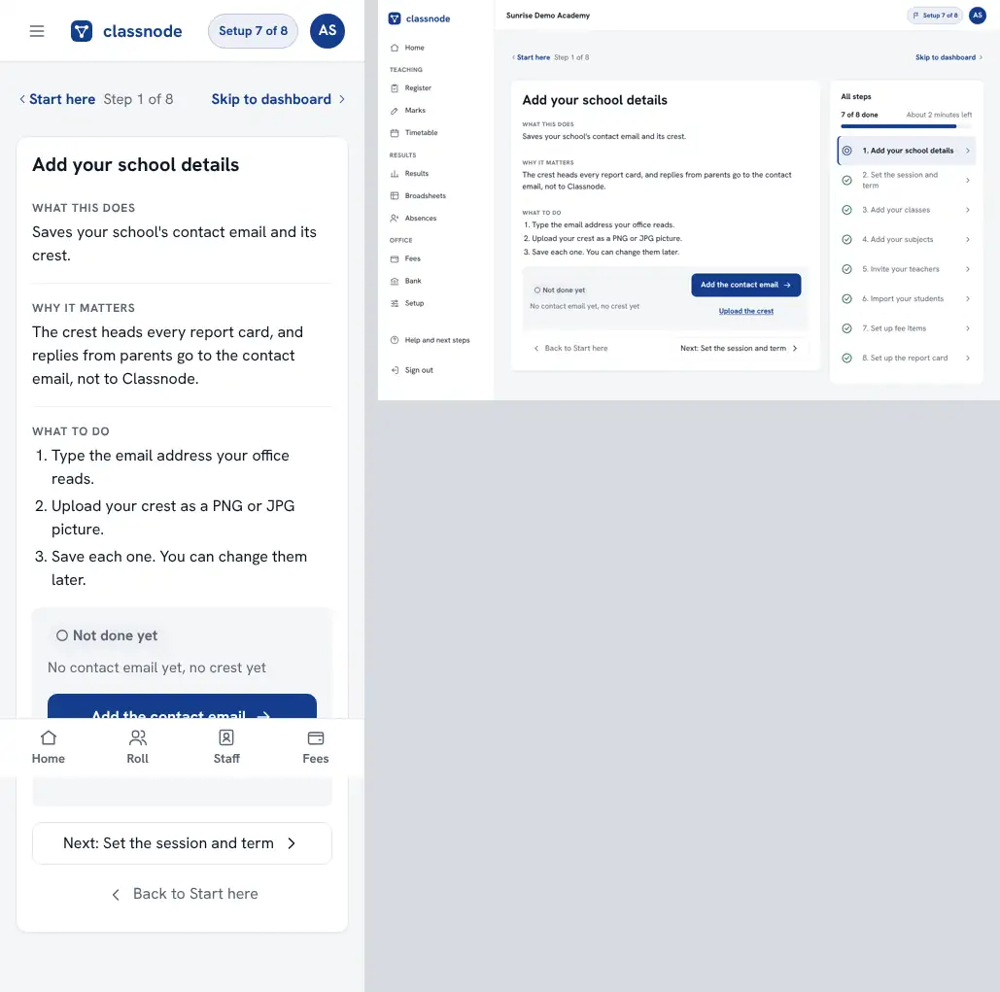

| Issue | Severity | Suggested fix |
|---|---|---|
| Quirks mode: no `<!doctype>` | High | **C1**: Add `<!doctype html>` (one shared base template) and a `compatMode` test. |
| `<html>` has no `lang` | High | **C2**: `<html lang="en">`, in the same change as C1. |
| Focus lands under the phone tab bar on 1 control when tabbing at 375 px | High | **C3**: `scroll-padding-bottom` of the tab bar's height on `html`. |
| No skip link; Menu and the sidebar come first in the Tab order | Medium | **C4**: Skip link as the first child of `<body>` in `shell_open.html`. |
| Top bar overflows at 320 px and at large text; account menu off screen | Medium | **C6**: Collapse the Setup chip to its icon below 360 px. |
| Account button's name ("Your account") does not contain its visible initials | Low | **C5**: `aria-hidden` on the initials, or include them in the label. |

#### A locked setup step

`/start/report-card/` · administrator · HTTP 200 · 44 KB on the wire, 6 requests, 14 Tab stops

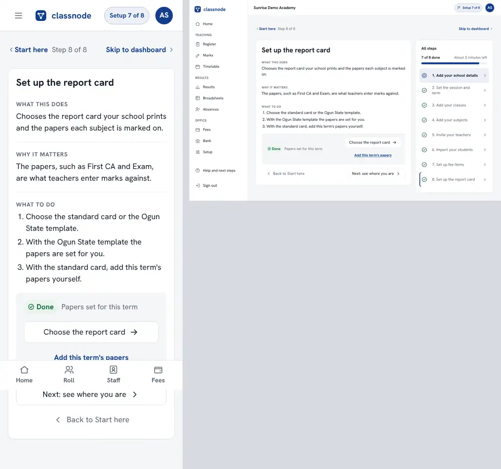

| Issue | Severity | Suggested fix |
|---|---|---|
| Quirks mode: no `<!doctype>` | High | **C1**: Add `<!doctype html>` (one shared base template) and a `compatMode` test. |
| `<html>` has no `lang` | High | **C2**: `<html lang="en">`, in the same change as C1. |
| No skip link; Menu and the sidebar come first in the Tab order | Medium | **C4**: Skip link as the first child of `<body>` in `shell_open.html`. |
| Top bar overflows at 320 px and at large text; account menu off screen | Medium | **C6**: Collapse the Setup chip to its icon below 360 px. |
| A locked step's page explains what it waits for; no issues beyond the shared ones | Low |  |
| Account button's name ("Your account") does not contain its visible initials | Low | **C5**: `aria-hidden` on the initials, or include them in the label. |

#### School setup

`/setup/` · administrator · HTTP 200 · 60 KB on the wire, 12 requests, 9 Tab stops

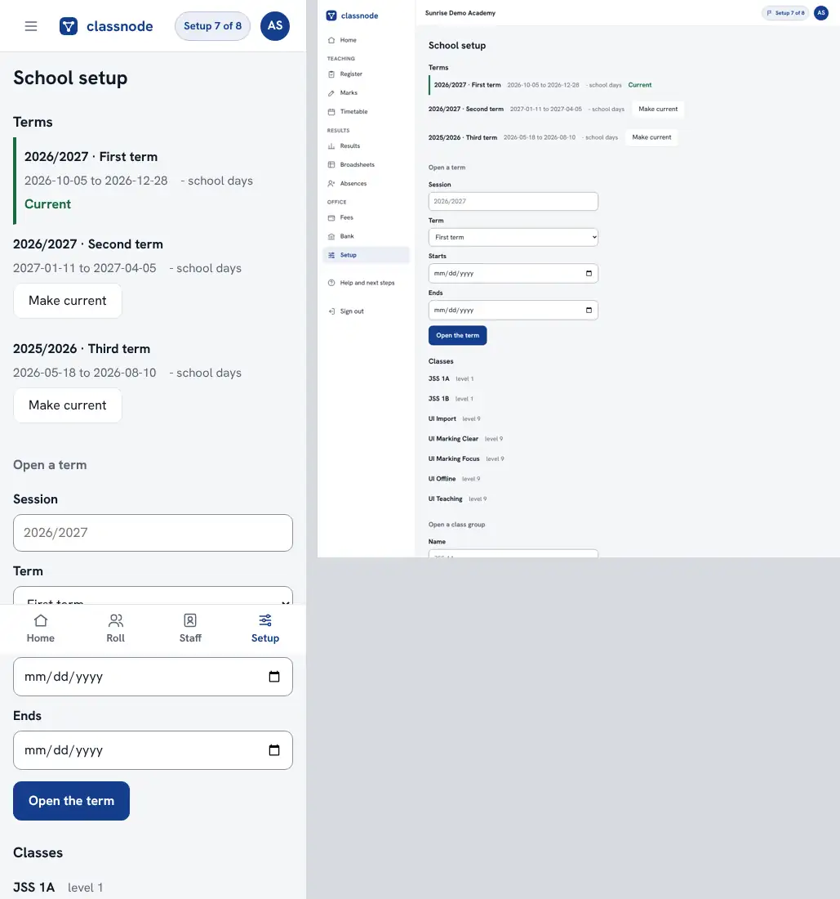

| Issue | Severity | Suggested fix |
|---|---|---|
| Quirks mode: no `<!doctype>` | High | **C1**: Add `<!doctype html>` (one shared base template) and a `compatMode` test. |
| `<html>` has no `lang` | High | **C2**: `<html lang="en">`, in the same change as C1. |
| Focus lands under the phone tab bar on 1 control when tabbing at 375 px | High | **C3**: `scroll-padding-bottom` of the tab bar's height on `html`. |
| Error state blames the server for a lost connection; no Retry | High | **C8**: Offline-aware `states.broken()` with a Try again button. |
| Plain page: unframed lists, no cards (the dashboard and Start here use cards), dates as `2026-10-05 to 2026-12-28 - school days` with the number missing (C22), terms listed with the oldest last | Medium | Card per term with "Current" as a chip and a formatted date range; hide the school-day count when unknown. |
| No skip link; Menu and the sidebar come first in the Tab order | Medium | **C4**: Skip link as the first child of `<body>` in `shell_open.html`. |
| Top bar overflows at 320 px and at large text; account menu off screen | Medium | **C6**: Collapse the Setup chip to its icon below 360 px. |
| Loading is the bare words "Loading…" | Medium | **C7**: A skeleton helper in `web/html.js`, used by every loading state. |
| No live region; focus not managed when a view changes | Medium | **C9**: Focus the new view's heading; polite live region. |
| Contact email field lacks `autocomplete="email"` | Low | Add it (WCAG 1.3.5). |
| Account button's name ("Your account") does not contain its visible initials | Low | **C5**: `aria-hidden` on the initials, or include them in the label. |

#### Subjects and teachers

`/teaching/` · administrator · HTTP 200 · 51 KB on the wire, 11 requests, 21 Tab stops

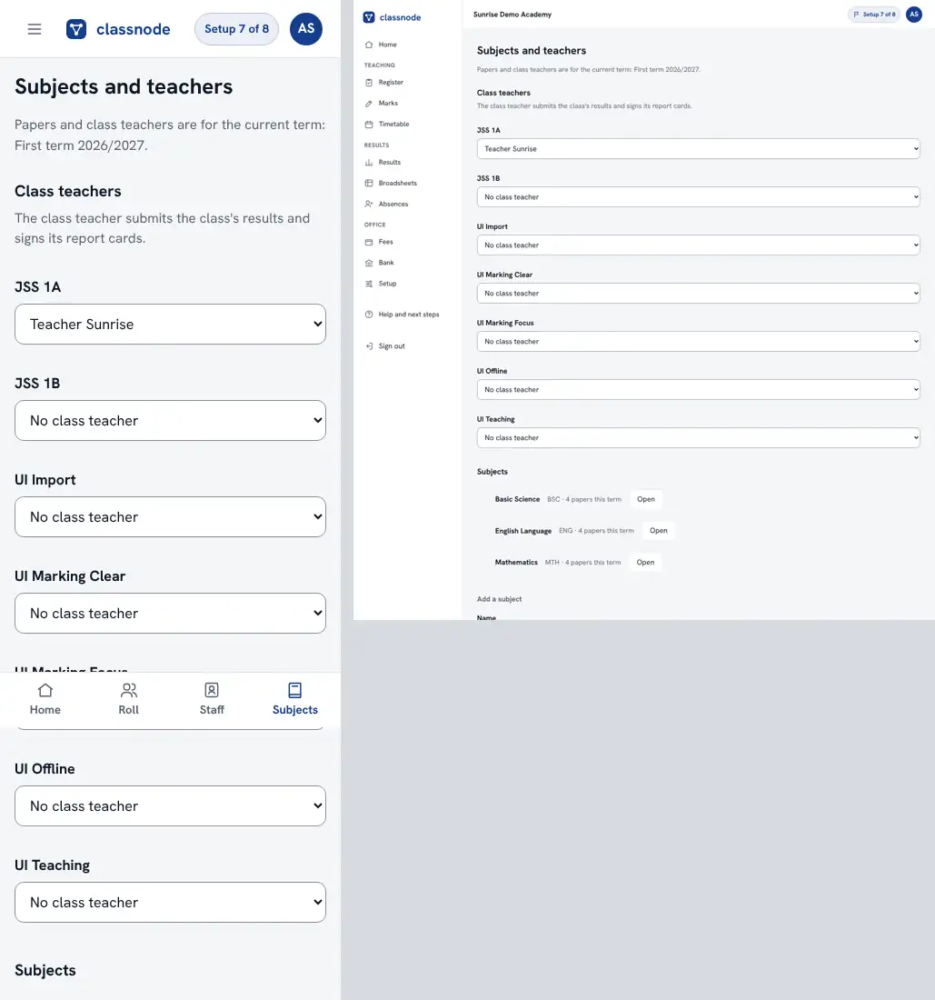

*After tapping through: subject*

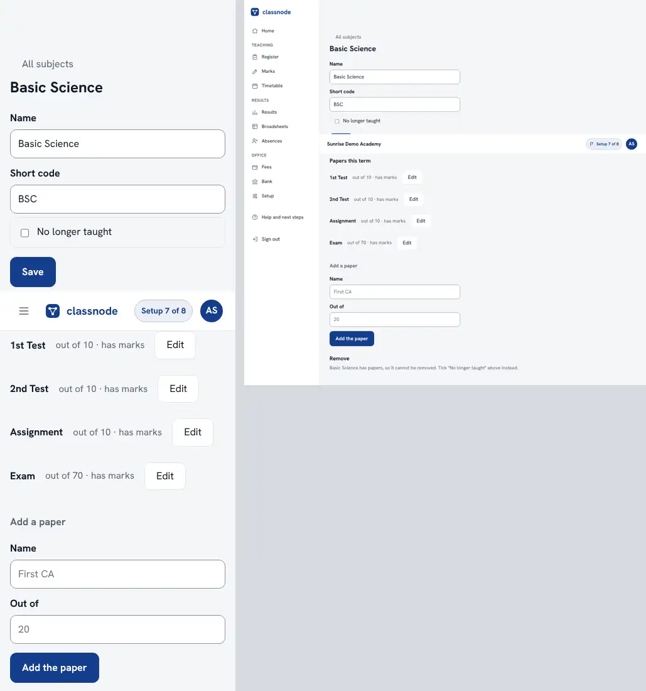

| Issue | Severity | Suggested fix |
|---|---|---|
| Quirks mode: no `<!doctype>` | High | **C1**: Add `<!doctype html>` (one shared base template) and a `compatMode` test. |
| `<html>` has no `lang` | High | **C2**: `<html lang="en">`, in the same change as C1. |
| Focus lands under the phone tab bar on 3 controls when tabbing at 375 px | High | **C3**: `scroll-padding-bottom` of the tab bar's height on `html`. |
| Error state blames the server for a lost connection; no Retry | High | **C8**: Offline-aware `states.broken()` with a Try again button. |
| Drilling into a class/account adds no history entry: Back leaves the page | High | **C10**: `pushState` per view and a `popstate` handler. |
| Four "No class teacher" selects are separate controls with no Save: confirm how changes persist (`change` fires a save) and show "Saved" beside the select | Medium | Inline "Saved" status (C17). |
| No skip link; Menu and the sidebar come first in the Tab order | Medium | **C4**: Skip link as the first child of `<body>` in `shell_open.html`. |
| Top bar overflows at 320 px and at large text; account menu off screen | Medium | **C6**: Collapse the Setup chip to its icon below 360 px. |
| Loading is the bare words "Loading…" | Medium | **C7**: A skeleton helper in `web/html.js`, used by every loading state. |
| No live region; focus not managed when a view changes | Medium | **C9**: Focus the new view's heading; polite live region. |
| Account button's name ("Your account") does not contain its visible initials | Low | **C5**: `aria-hidden` on the initials, or include them in the label. |

#### Promotion

`/promotion/` · administrator · HTTP 200 · 49 KB on the wire, 11 requests, 8 Tab stops

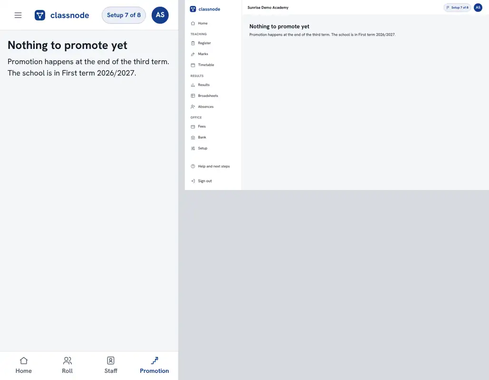

| Issue | Severity | Suggested fix |
|---|---|---|
| Quirks mode: no `<!doctype>` | High | **C1**: Add `<!doctype html>` (one shared base template) and a `compatMode` test. |
| `<html>` has no `lang` | High | **C2**: `<html lang="en">`, in the same change as C1. |
| Error state blames the server for a lost connection; no Retry | High | **C8**: Offline-aware `states.broken()` with a Try again button. |
| "Nothing to promote yet" is two lines of text on an empty grey page: no icon, no card, no next step, and it is the plainest empty state in the app | Medium | Use the roll's `empty-card` (icon, one sentence, one action). |
| No skip link; Menu and the sidebar come first in the Tab order | Medium | **C4**: Skip link as the first child of `<body>` in `shell_open.html`. |
| Top bar overflows at 320 px and at large text; account menu off screen | Medium | **C6**: Collapse the Setup chip to its icon below 360 px. |
| Loading is the bare words "Loading…" | Medium | **C7**: A skeleton helper in `web/html.js`, used by every loading state. |
| No live region; focus not managed when a view changes | Medium | **C9**: Focus the new view's heading; polite live region. |
| Account button's name ("Your account") does not contain its visible initials | Low | **C5**: `aria-hidden` on the initials, or include them in the label. |

#### The roll

`/roll/` · administrator · HTTP 200 · 57 KB on the wire, 11 requests, 80 Tab stops

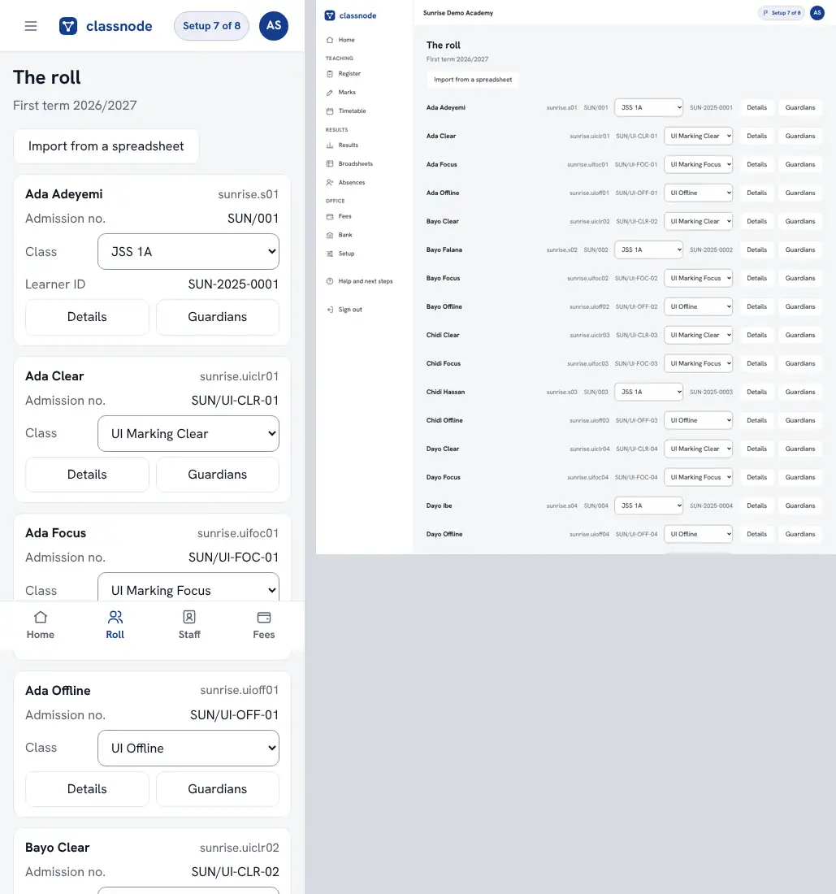

*After tapping through: details*

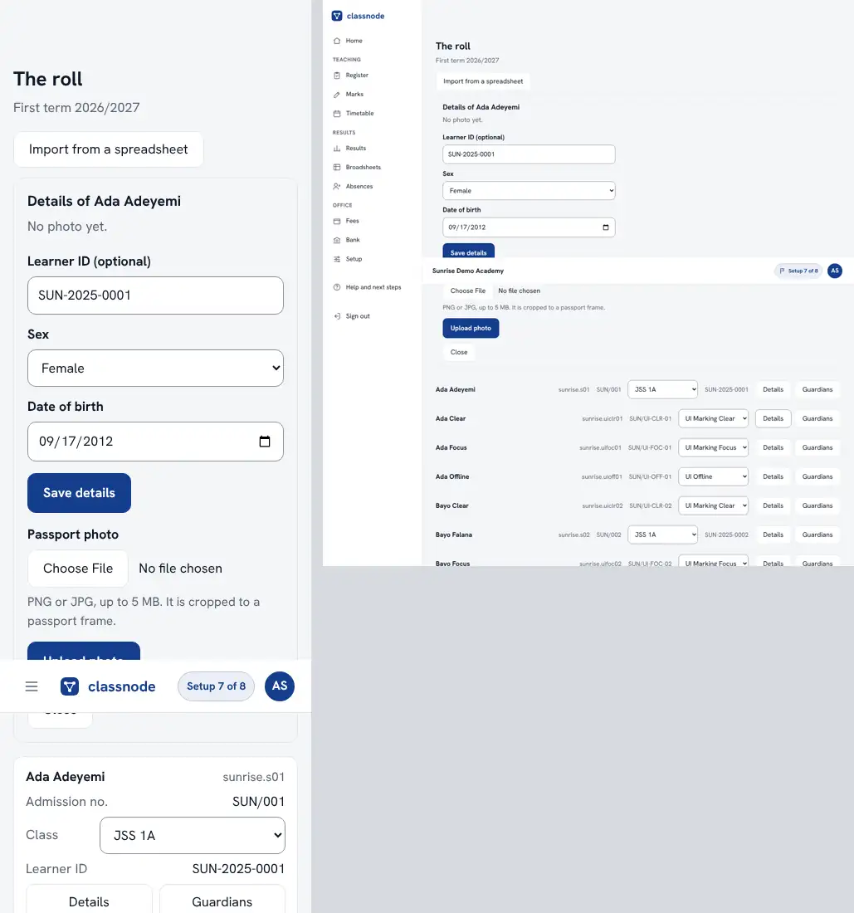

*After tapping through: guardians*

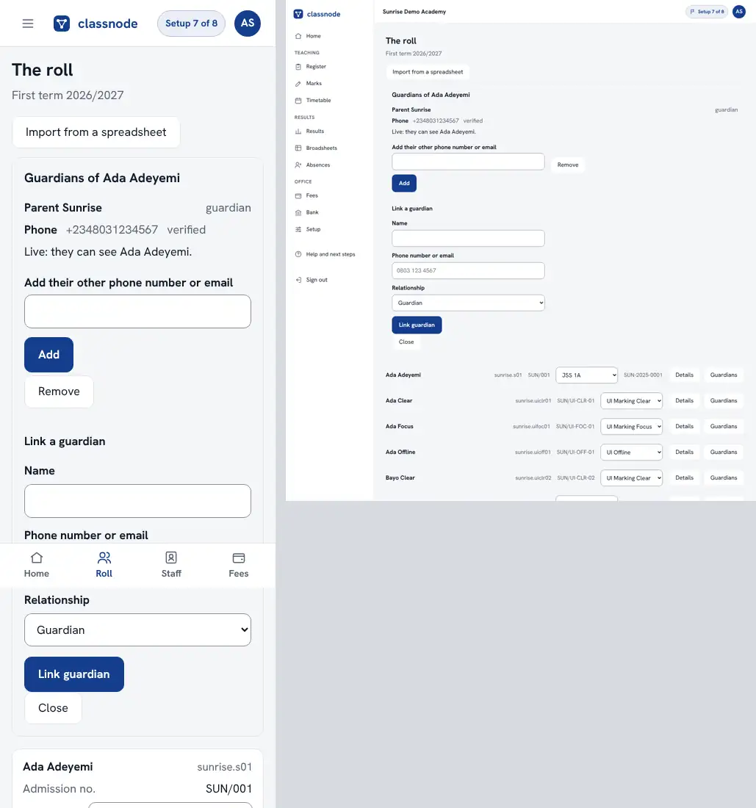

| Issue | Severity | Suggested fix |
|---|---|---|
| The whole roll is one unpaginated list with no search or class filter: the 62 children of the demo make the page 3,400 px tall at 1280, with three Tab stops per child (over 80 before the focus loop wraps); a 600-child school is a page nobody can scan. Each row also carries a class select and two buttons | High | Search box + class filter + 25-row pages; move the class select into Details. |
| Quirks mode: no `<!doctype>` | High | **C1**: Add `<!doctype html>` (one shared base template) and a `compatMode` test. |
| `<html>` has no `lang` | High | **C2**: `<html lang="en">`, in the same change as C1. |
| Focus lands under the phone tab bar on 32 controls when tabbing at 375 px | High | **C3**: `scroll-padding-bottom` of the tab bar's height on `html`. |
| Error state blames the server for a lost connection; no Retry | High | **C8**: Offline-aware `states.broken()` with a Try again button. |
| Drilling into a class/account adds no history entry: Back leaves the page | High | **C10**: `pushState` per view and a `popstate` handler. |
| "Admit a child" form sits after the list, so with a long roll the form is a long scroll away; the handle's placeholder `STM/2026/0042` is another school's style | Medium | Move it above the list behind an "Admit a child" button. |
| Guardians panel: `Remove` is drawn like `Details`, next to a primary `Add` (C16); its confirm is an inline sentence worded differently from Teaching's and Fees' (C17) | Medium | See **C16**, **C17** |
| No skip link; Menu and the sidebar come first in the Tab order | Medium | **C4**: Skip link as the first child of `<body>` in `shell_open.html`. |
| Top bar overflows at 320 px and at large text; account menu off screen | Medium | **C6**: Collapse the Setup chip to its icon below 360 px. |
| Loading is the bare words "Loading…" | Medium | **C7**: A skeleton helper in `web/html.js`, used by every loading state. |
| No live region; focus not managed when a view changes | Medium | **C9**: Focus the new view's heading; polite live region. |
| Account button's name ("Your account") does not contain its visible initials | Low | **C5**: `aria-hidden` on the initials, or include them in the label. |

#### Roll import

`/roll/import/` · administrator · HTTP 200 · 52 KB on the wire, 11 requests, 12 Tab stops

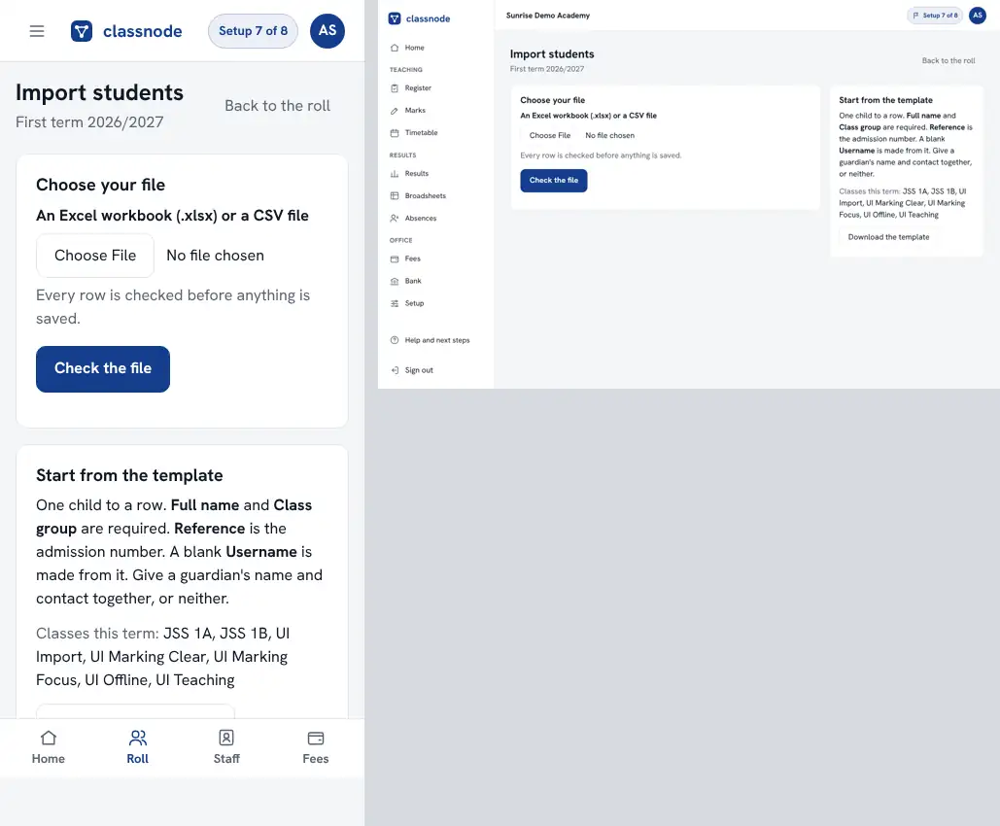

| Issue | Severity | Suggested fix |
|---|---|---|
| Quirks mode: no `<!doctype>` | High | **C1**: Add `<!doctype html>` (one shared base template) and a `compatMode` test. |
| `<html>` has no `lang` | High | **C2**: `<html lang="en">`, in the same change as C1. |
| Focus lands under the phone tab bar on 1 control when tabbing at 375 px | High | **C3**: `scroll-padding-bottom` of the tab bar's height on `html`. |
| Error state blames the server for a lost connection; no Retry | High | **C8**: Offline-aware `states.broken()` with a Try again button. |
| No skip link; Menu and the sidebar come first in the Tab order | Medium | **C4**: Skip link as the first child of `<body>` in `shell_open.html`. |
| Top bar overflows at 320 px and at large text; account menu off screen | Medium | **C6**: Collapse the Setup chip to its icon below 360 px. |
| Loading is the bare words "Loading…" | Medium | **C7**: A skeleton helper in `web/html.js`, used by every loading state. |
| No live region; focus not managed when a view changes | Medium | **C9**: Focus the new view's heading; polite live region. |
| No issues beyond shared ones; the template download link is a text button | Low |  |
| Account button's name ("Your account") does not contain its visible initials | Low | **C5**: `aria-hidden` on the initials, or include them in the label. |

#### Staff invitations

`/staff/` · administrator · HTTP 200 · 49 KB on the wire, 11 requests, 12 Tab stops

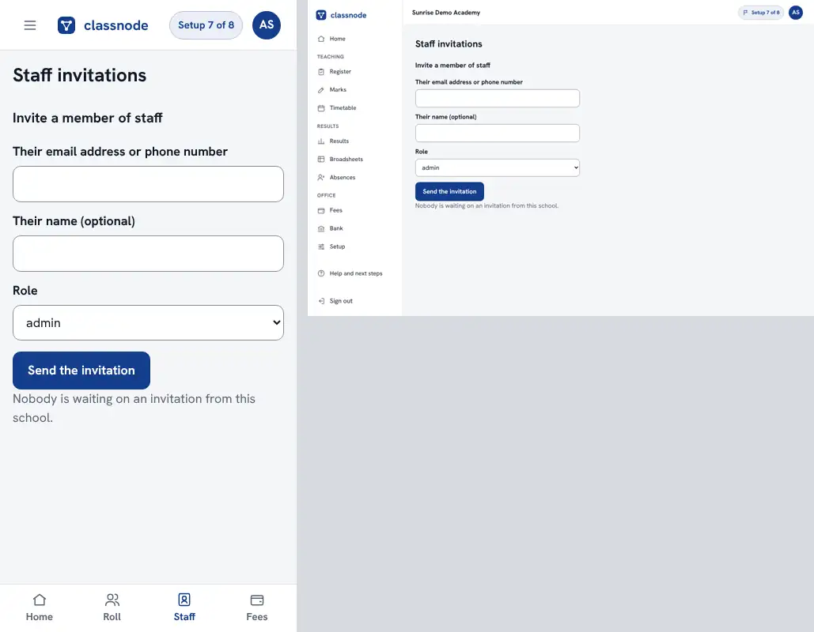

| Issue | Severity | Suggested fix |
|---|---|---|
| Quirks mode: no `<!doctype>` | High | **C1**: Add `<!doctype html>` (one shared base template) and a `compatMode` test. |
| `<html>` has no `lang` | High | **C2**: `<html lang="en">`, in the same change as C1. |
| Error state blames the server for a lost connection; no Retry | High | **C8**: Offline-aware `states.broken()` with a Try again button. |
| Role select shows raw enum text ("admin") (C22); invitation form first, the list of pending invitations is below ("Nobody is waiting") | Medium | Role labels; list first when there is any. |
| No skip link; Menu and the sidebar come first in the Tab order | Medium | **C4**: Skip link as the first child of `<body>` in `shell_open.html`. |
| Top bar overflows at 320 px and at large text; account menu off screen | Medium | **C6**: Collapse the Setup chip to its icon below 360 px. |
| Loading is the bare words "Loading…" | Medium | **C7**: A skeleton helper in `web/html.js`, used by every loading state. |
| No live region; focus not managed when a view changes | Medium | **C9**: Focus the new view's heading; polite live region. |
| Staff list shows invitations only: no way to see current staff, change a role or remove someone from this page | Low | Add "Current staff" (needed for any real school). |
| Account button's name ("Your account") does not contain its visible initials | Low | **C5**: `aria-hidden` on the initials, or include them in the label. |

#### Notices settings

`/notices/settings/` · administrator · HTTP 200 · 48 KB on the wire, 11 requests, 19 Tab stops

| Issue | Severity | Suggested fix |
|---|---|---|
| Quirks mode: no `<!doctype>` | High | **C1**: Add `<!doctype html>` (one shared base template) and a `compatMode` test. |
| `<html>` has no `lang` | High | **C2**: `<html lang="en">`, in the same change as C1. |
| Focus lands under the phone tab bar on 2 controls when tabbing at 375 px | High | **C3**: `scroll-padding-bottom` of the tab bar's height on `html`. |
| Error state blames the server for a lost connection; no Retry | High | **C8**: Offline-aware `states.broken()` with a Try again button. |
| No skip link; Menu and the sidebar come first in the Tab order | Medium | **C4**: Skip link as the first child of `<body>` in `shell_open.html`. |
| Top bar overflows at 320 px and at large text; account menu off screen | Medium | **C6**: Collapse the Setup chip to its icon below 360 px. |
| Loading is the bare words "Loading…" | Medium | **C7**: A skeleton helper in `web/html.js`, used by every loading state. |
| No live region; focus not managed when a view changes | Medium | **C9**: Focus the new view's heading; polite live region. |
| Validation message ("Nobody is chosen yet. Tick whoever…") is red text with no icon or label, against the design's rule that status colour carries an icon and a word | Low | Use `.msg` with the warn label. |
| Account button's name ("Your account") does not contain its visible initials | Low | **C5**: `aria-hidden` on the initials, or include them in the label. |

#### OGSERA filler

`/ogsera/` · administrator · HTTP 200 · 50 KB on the wire, 11 requests, 12 Tab stops

| Issue | Severity | Suggested fix |
|---|---|---|
| Quirks mode: no `<!doctype>` | High | **C1**: Add `<!doctype html>` (one shared base template) and a `compatMode` test. |
| `<html>` has no `lang` | High | **C2**: `<html lang="en">`, in the same change as C1. |
| Error state blames the server for a lost connection; no Retry | High | **C8**: Offline-aware `states.broken()` with a Try again button. |
| No skip link; Menu and the sidebar come first in the Tab order | Medium | **C4**: Skip link as the first child of `<body>` in `shell_open.html`. |
| Top bar overflows at 320 px and at large text; account menu off screen | Medium | **C6**: Collapse the Setup chip to its icon below 360 px. |
| Loading is the bare words "Loading…" | Medium | **C7**: A skeleton helper in `web/html.js`, used by every loading state. |
| No live region; focus not managed when a view changes | Medium | **C9**: Focus the new view's heading; polite live region. |
| On a school that prints the Standard card, the page only says where to choose the Ogun template | Low | Link straight to that setting. |
| Account button's name ("Your account") does not contain its visible initials | Low | **C5**: `aria-hidden` on the initials, or include them in the label. |

#### Help and next steps

`/help/` · administrator · HTTP 200 · 44 KB on the wire, 6 requests, 12 Tab stops

| Issue | Severity | Suggested fix |
|---|---|---|
| Quirks mode: no `<!doctype>` | High | **C1**: Add `<!doctype html>` (one shared base template) and a `compatMode` test. |
| `<html>` has no `lang` | High | **C2**: `<html lang="en">`, in the same change as C1. |
| No skip link; Menu and the sidebar come first in the Tab order | Medium | **C4**: Skip link as the first child of `<body>` in `shell_open.html`. |
| Top bar overflows at 320 px and at large text; account menu off screen | Medium | **C6**: Collapse the Setup chip to its icon below 360 px. |
| Account button's name ("Your account") does not contain its visible initials | Low | **C5**: `aria-hidden` on the initials, or include them in the label. |

### Class teacher

#### Home (dashboard)

`/home/` · class teacher · HTTP 200 · 42 KB on the wire, 5 requests, 12 Tab stops

| Issue | Severity | Suggested fix |
|---|---|---|
| Quirks mode: no `<!doctype>` | High | **C1**: Add `<!doctype html>` (one shared base template) and a `compatMode` test. |
| `<html>` has no `lang` | High | **C2**: `<html lang="en">`, in the same change as C1. |
| Focus lands under the phone tab bar on 1 control when tabbing at 375 px | High | **C3**: `scroll-padding-bottom` of the tab bar's height on `html`. |
| No skip link; Menu and the sidebar come first in the Tab order | Medium | **C4**: Skip link as the first child of `<body>` in `shell_open.html`. |
| Offline: browser's "No internet" page, not a Classnode page | Medium | **C14**: An offline fallback page in the service worker. |
| Breaks at large system text: 107 px sideways overflow at 200% | Medium | **C19**: Wrap rows and tiles at large text; add a 200% test. |
| Account button's name ("Your account") does not contain its visible initials | Low | **C5**: `aria-hidden` on the initials, or include them in the label. |
| Title is just "Home" | Low | **C20**: `Home · Classnode`; set the title per view. |

#### Take a register

`/register/` · class teacher · HTTP 200 · 74 KB on the wire, 17 requests, 4 Tab stops

*After tapping through: class*

| Issue | Severity | Suggested fix |
|---|---|---|
| Quirks mode: no `<!doctype>` | High | **C1**: Add `<!doctype html>` (one shared base template) and a `compatMode` test. |
| Error state blames the server for a lost connection; no Retry | High | **C8**: Offline-aware `states.broken()` with a Try again button. |
| Drilling into a class/account adds no history entry: Back leaves the page | High | **C10**: `pushState` per view and a `popstate` handler. |
| The date field is a native `<input type=date>`: on a US-English phone it reads 10/21/2026; Nigerian schools write 21/10/2026 | Medium | Show the long date ("Wed 21 Oct") as text with a Change button, or set `lang="en-NG"` (C2) so the browser picks dd/mm. |
| No skip link; Menu and the sidebar come first in the Tab order | Medium | **C4**: Skip link as the first child of `<body>` in `shell_open.html`. |
| Loading is the bare words "Loading…" | Medium | **C7**: A skeleton helper in `web/html.js`, used by every loading state. |
| No live region; focus not managed when a view changes | Medium | **C9**: Focus the new view's heading; polite live region. |
| "Which class?" lists all 7 classes of the school, not the teacher's own (JSS 1A) first | Low | Own classes first. |
| "Which class?" sits under the date as a second question; first-time teachers do not see that the date defaults to today | Low | Show "Today, Wed 21 Oct" as a chip. |

#### Enter marks

`/marking/` · class teacher · HTTP 200 · 73 KB on the wire, 15 requests, 26 Tab stops

*After tapping through: paper*

*After tapping through: sheet*

| Issue | Severity | Suggested fix |
|---|---|---|
| Quirks mode: no `<!doctype>` | High | **C1**: Add `<!doctype html>` (one shared base template) and a `compatMode` test. |
| `<html>` has no `lang` | High | **C2**: `<html lang="en">`, in the same change as C1. |
| Focus lands under the phone tab bar on 6 controls when tabbing at 375 px | High | **C3**: `scroll-padding-bottom` of the tab bar's height on `html`. |
| Error state blames the server for a lost connection; no Retry | High | **C8**: Offline-aware `states.broken()` with a Try again button. |
| Drilling into a class/account adds no history entry: Back leaves the page | High | **C10**: `pushState` per view and a `popstate` handler. |
| No skip link; Menu and the sidebar come first in the Tab order | Medium | **C4**: Skip link as the first child of `<body>` in `shell_open.html`. |
| Loading is the bare words "Loading…" | Medium | **C7**: A skeleton helper in `web/html.js`, used by every loading state. |
| No live region; focus not managed when a view changes | Medium | **C9**: Focus the new view's heading; polite live region. |
| "Which paper?" lists every paper for every class the teacher takes as one 12-row list (3 subjects x 4 papers); a subject-grouped list would halve the scroll | Low | Group by subject with the paper chips inline. |

#### Remarks

`/comments/` · class teacher · HTTP 200 · 54 KB on the wire, 11 requests, 14 Tab stops

| Issue | Severity | Suggested fix |
|---|---|---|
| Quirks mode: no `<!doctype>` | High | **C1**: Add `<!doctype html>` (one shared base template) and a `compatMode` test. |
| `<html>` has no `lang` | High | **C2**: `<html lang="en">`, in the same change as C1. |
| Error state blames the server for a lost connection; no Retry | High | **C8**: Offline-aware `states.broken()` with a Try again button. |
| No skip link; Menu and the sidebar come first in the Tab order | Medium | **C4**: Skip link as the first child of `<body>` in `shell_open.html`. |
| Loading is the bare words "Loading…" | Medium | **C7**: A skeleton helper in `web/html.js`, used by every loading state. |
| No live region; focus not managed when a view changes | Medium | **C9**: Focus the new view's heading; polite live region. |
| Same four-pattern issue (C15) | Low | See **C15** |
| Account button's name ("Your account") does not contain its visible initials | Low | **C5**: `aria-hidden` on the initials, or include them in the label. |

#### Timetable

`/timetable/` · class teacher · HTTP 200 · 52 KB on the wire, 12 requests, 10 Tab stops

| Issue | Severity | Suggested fix |
|---|---|---|
| Quirks mode: no `<!doctype>` | High | **C1**: Add `<!doctype html>` (one shared base template) and a `compatMode` test. |
| `<html>` has no `lang` | High | **C2**: `<html lang="en">`, in the same change as C1. |
| Error state blames the server for a lost connection; no Retry | High | **C8**: Offline-aware `states.broken()` with a Try again button. |
| Sideways scroll, not keyboard focusable (C11); teacher name repeated in every cell ("Teacher Sunrise") | Medium | Day tabs on phones; omit the teacher's own name in a teacher's own timetable. |
| No skip link; Menu and the sidebar come first in the Tab order | Medium | **C4**: Skip link as the first child of `<body>` in `shell_open.html`. |
| Loading is the bare words "Loading…" | Medium | **C7**: A skeleton helper in `web/html.js`, used by every loading state. |
| No live region; focus not managed when a view changes | Medium | **C9**: Focus the new view's heading; polite live region. |
| Offline: browser's "No internet" page, not a Classnode page | Medium | **C14**: An offline fallback page in the service worker. |
| Account button's name ("Your account") does not contain its visible initials | Low | **C5**: `aria-hidden` on the initials, or include them in the label. |

#### Help and next steps

`/help/` · class teacher · HTTP 200 · 44 KB on the wire, 6 requests, 9 Tab stops

| Issue | Severity | Suggested fix |
|---|---|---|
| Quirks mode: no `<!doctype>` | High | **C1**: Add `<!doctype html>` (one shared base template) and a `compatMode` test. |
| `<html>` has no `lang` | High | **C2**: `<html lang="en">`, in the same change as C1. |
| No skip link; Menu and the sidebar come first in the Tab order | Medium | **C4**: Skip link as the first child of `<body>` in `shell_open.html`. |
| Offline: browser's "No internet" page, not a Classnode page | Medium | **C14**: An offline fallback page in the service worker. |
| Account button's name ("Your account") does not contain its visible initials | Low | **C5**: `aria-hidden` on the initials, or include them in the label. |

### Subject teacher

#### Home (dashboard)

`/home/` · subject teacher · HTTP 200 · 41 KB on the wire, 5 requests, 9 Tab stops

| Issue | Severity | Suggested fix |
|---|---|---|
| Quirks mode: no `<!doctype>` | High | **C1**: Add `<!doctype html>` (one shared base template) and a `compatMode` test. |
| `<html>` has no `lang` | High | **C2**: `<html lang="en">`, in the same change as C1. |
| No skip link; Menu and the sidebar come first in the Tab order | Medium | **C4**: Skip link as the first child of `<body>` in `shell_open.html`. |
| Offline: browser's "No internet" page, not a Classnode page | Medium | **C14**: An offline fallback page in the service worker. |
| Breaks at large system text: 107 px sideways overflow at 200% | Medium | **C19**: Wrap rows and tiles at large text; add a 200% test. |
| Account button's name ("Your account") does not contain its visible initials | Low | **C5**: `aria-hidden` on the initials, or include them in the label. |
| Title is just "Home" | Low | **C20**: `Home · Classnode`; set the title per view. |

#### Register (no class)

`/register/` · subject teacher · HTTP 200 · 74 KB on the wire, 17 requests, 4 Tab stops

| Issue | Severity | Suggested fix |
|---|---|---|
| Quirks mode: no `<!doctype>` | High | **C1**: Add `<!doctype html>` (one shared base template) and a `compatMode` test. |
| `<html>` has no `lang` | High | **C2**: `<html lang="en">`, in the same change as C1. |
| Error state blames the server for a lost connection; no Retry | High | **C8**: Offline-aware `states.broken()` with a Try again button. |
| A teacher who takes no class has the same menu as a class teacher (Register, Remarks, Results, Broadsheets), and Register lists all 7 classes of the school, not "my class" first | Medium | Put the person's own classes first (or alone) and tuck the rest under "Other classes"; hide menu items the person has nothing in. |
| No skip link; Menu and the sidebar come first in the Tab order | Medium | **C4**: Skip link as the first child of `<body>` in `shell_open.html`. |
| Loading is the bare words "Loading…" | Medium | **C7**: A skeleton helper in `web/html.js`, used by every loading state. |
| No live region; focus not managed when a view changes | Medium | **C9**: Focus the new view's heading; polite live region. |

#### Enter marks

`/marking/` · subject teacher · HTTP 200 · 73 KB on the wire, 15 requests, 26 Tab stops

*After tapping through: paper*

*After tapping through: sheet*

| Issue | Severity | Suggested fix |
|---|---|---|
| Quirks mode: no `<!doctype>` | High | **C1**: Add `<!doctype html>` (one shared base template) and a `compatMode` test. |
| `<html>` has no `lang` | High | **C2**: `<html lang="en">`, in the same change as C1. |
| Focus lands under the phone tab bar on 6 controls when tabbing at 375 px | High | **C3**: `scroll-padding-bottom` of the tab bar's height on `html`. |
| Error state blames the server for a lost connection; no Retry | High | **C8**: Offline-aware `states.broken()` with a Try again button. |
| Drilling into a class/account adds no history entry: Back leaves the page | High | **C10**: `pushState` per view and a `popstate` handler. |
| No skip link; Menu and the sidebar come first in the Tab order | Medium | **C4**: Skip link as the first child of `<body>` in `shell_open.html`. |
| Loading is the bare words "Loading…" | Medium | **C7**: A skeleton helper in `web/html.js`, used by every loading state. |
| No live region; focus not managed when a view changes | Medium | **C9**: Focus the new view's heading; polite live region. |

#### Remarks

`/comments/` · subject teacher · HTTP 200 · 54 KB on the wire, 11 requests, 14 Tab stops

| Issue | Severity | Suggested fix |
|---|---|---|
| Quirks mode: no `<!doctype>` | High | **C1**: Add `<!doctype html>` (one shared base template) and a `compatMode` test. |
| `<html>` has no `lang` | High | **C2**: `<html lang="en">`, in the same change as C1. |
| Error state blames the server for a lost connection; no Retry | High | **C8**: Offline-aware `states.broken()` with a Try again button. |
| Remarks lists every class to a teacher who is not a class teacher; same menu issue as Register | Medium | As `subject-register`. |
| No skip link; Menu and the sidebar come first in the Tab order | Medium | **C4**: Skip link as the first child of `<body>` in `shell_open.html`. |
| Loading is the bare words "Loading…" | Medium | **C7**: A skeleton helper in `web/html.js`, used by every loading state. |
| No live region; focus not managed when a view changes | Medium | **C9**: Focus the new view's heading; polite live region. |
| Account button's name ("Your account") does not contain its visible initials | Low | **C5**: `aria-hidden` on the initials, or include them in the label. |

#### Timetable

`/timetable/` · subject teacher · HTTP 200 · 52 KB on the wire, 12 requests, 10 Tab stops

| Issue | Severity | Suggested fix |
|---|---|---|
| Quirks mode: no `<!doctype>` | High | **C1**: Add `<!doctype html>` (one shared base template) and a `compatMode` test. |
| `<html>` has no `lang` | High | **C2**: `<html lang="en">`, in the same change as C1. |
| Error state blames the server for a lost connection; no Retry | High | **C8**: Offline-aware `states.broken()` with a Try again button. |
| No skip link; Menu and the sidebar come first in the Tab order | Medium | **C4**: Skip link as the first child of `<body>` in `shell_open.html`. |
| Loading is the bare words "Loading…" | Medium | **C7**: A skeleton helper in `web/html.js`, used by every loading state. |
| No live region; focus not managed when a view changes | Medium | **C9**: Focus the new view's heading; polite live region. |
| Sideways-scroll region is not keyboard-focusable | Medium | **C11**: `tabindex="0"`, `role="region"` and a label on `.wide`. |
| Account button's name ("Your account") does not contain its visible initials | Low | **C5**: `aria-hidden` on the initials, or include them in the label. |

### Bursar

#### Home (dashboard)

`/home/` · bursar · HTTP 200 · 42 KB on the wire, 5 requests, 9 Tab stops

| Issue | Severity | Suggested fix |
|---|---|---|
| Quirks mode: no `<!doctype>` | High | **C1**: Add `<!doctype html>` (one shared base template) and a `compatMode` test. |
| `<html>` has no `lang` | High | **C2**: `<html lang="en">`, in the same change as C1. |
| No skip link; Menu and the sidebar come first in the Tab order | Medium | **C4**: Skip link as the first child of `<body>` in `shell_open.html`. |
| Offline: browser's "No internet" page, not a Classnode page | Medium | **C14**: An offline fallback page in the service worker. |
| Breaks at large system text: 121 px sideways overflow at 200% | Medium | **C19**: Wrap rows and tiles at large text; add a 200% test. |
| Account button's name ("Your account") does not contain its visible initials | Low | **C5**: `aria-hidden` on the initials, or include them in the label. |
| Title is just "Home" | Low | **C20**: `Home · Classnode`; set the title per view. |

#### Fees

`/fees/` · bursar · HTTP 200 · 61 KB on the wire, 13 requests, 13 Tab stops

*After tapping through: account*

*After tapping through: class*

| Issue | Severity | Suggested fix |
|---|---|---|
| Quirks mode: no `<!doctype>` | High | **C1**: Add `<!doctype html>` (one shared base template) and a `compatMode` test. |
| `<html>` has no `lang` | High | **C2**: `<html lang="en">`, in the same change as C1. |
| Focus lands under the phone tab bar on 2 controls when tabbing at 375 px | High | **C3**: `scroll-padding-bottom` of the tab bar's height on `html`. |
| Error state blames the server for a lost connection; no Retry | High | **C8**: Offline-aware `states.broken()` with a Try again button. |
| Drilling into a class/account adds no history entry: Back leaves the page | High | **C10**: `pushState` per view and a `popstate` handler. |
| Record a payment: `Amount (₦)` has no `inputmode="decimal"`; native date input again (C22) | Medium | inputmode decimal; one date style. |
| No skip link; Menu and the sidebar come first in the Tab order | Medium | **C4**: Skip link as the first child of `<body>` in `shell_open.html`. |
| Loading is the bare words "Loading…" | Medium | **C7**: A skeleton helper in `web/html.js`, used by every loading state. |
| No live region; focus not managed when a view changes | Medium | **C9**: Focus the new view's heading; polite live region. |
| Offline: browser's "No internet" page, not a Classnode page | Medium | **C14**: An offline fallback page in the service worker. |
| Account button's name ("Your account") does not contain its visible initials | Low | **C5**: `aria-hidden` on the initials, or include them in the label. |

#### School bank account

`/bank/` · bursar · HTTP 200 · 51 KB on the wire, 12 requests, 7 Tab stops

| Issue | Severity | Suggested fix |
|---|---|---|
| Quirks mode: no `<!doctype>` | High | **C1**: Add `<!doctype html>` (one shared base template) and a `compatMode` test. |
| `<html>` has no `lang` | High | **C2**: `<html lang="en">`, in the same change as C1. |
| Error state blames the server for a lost connection; no Retry | High | **C8**: Offline-aware `states.broken()` with a Try again button. |
| "No bank account is connected yet, so fees cannot be paid online" is the whole page: one button and no list of what the bursar should have ready before pressing it | Medium | A three-line checklist above the button. |
| No skip link; Menu and the sidebar come first in the Tab order | Medium | **C4**: Skip link as the first child of `<body>` in `shell_open.html`. |
| Loading is the bare words "Loading…" | Medium | **C7**: A skeleton helper in `web/html.js`, used by every loading state. |
| No live region; focus not managed when a view changes | Medium | **C9**: Focus the new view's heading; polite live region. |
| Account button's name ("Your account") does not contain its visible initials | Low | **C5**: `aria-hidden` on the initials, or include them in the label. |

#### Help and next steps

`/help/` · bursar · HTTP 200 · 44 KB on the wire, 6 requests, 8 Tab stops

| Issue | Severity | Suggested fix |
|---|---|---|
| Quirks mode: no `<!doctype>` | High | **C1**: Add `<!doctype html>` (one shared base template) and a `compatMode` test. |
| `<html>` has no `lang` | High | **C2**: `<html lang="en">`, in the same change as C1. |
| No skip link; Menu and the sidebar come first in the Tab order | Medium | **C4**: Skip link as the first child of `<body>` in `shell_open.html`. |
| Account button's name ("Your account") does not contain its visible initials | Low | **C5**: `aria-hidden` on the initials, or include them in the label. |

### Parent

#### Report cards

`/cards/` · parent · HTTP 200 · 52 KB on the wire, 12 requests, 4 Tab stops

*After tapping through: card*

*After tapping through: second child*

| Issue | Severity | Suggested fix |
|---|---|---|
| Quirks mode: no `<!doctype>` | High | **C1**: Add `<!doctype html>` (one shared base template) and a `compatMode` test. |
| `<html>` has no `lang` | High | **C2**: `<html lang="en">`, in the same change as C1. |
| Error state blames the server for a lost connection; no Retry | High | **C8**: Offline-aware `states.broken()` with a Try again button. |
| Drilling into a class/account adds no history entry: Back leaves the page | High | **C10**: `pushState` per view and a `popstate` handler. |
| The report card on a phone needs a sideways swipe to read the Exam column ("Swipe for more"; "Exam (70" cut off). The parent's one job is reading it | Medium | Stack each subject as a card on phones (`table.stack` exists): name, then CA / Exam / Total. |
| Loading is the bare words "Loading…" | Medium | **C7**: A skeleton helper in `web/html.js`, used by every loading state. |
| No live region; focus not managed when a view changes | Medium | **C9**: Focus the new view's heading; polite live region. |
| Sideways-scroll region is not keyboard-focusable | Medium | **C11**: `tabindex="0"`, `role="region"` and a label on `.wide`. |
| Offline: browser's "No internet" page, not a Classnode page | Medium | **C14**: An offline fallback page in the service worker. |
| Heading order: an `<h2>` ("Welcome") before the page's `<h1>` ("Report cards") | Low | Move the welcome inside `<main>` below the `<h1>`. |
| "Sign out" is a grey text link at the card's foot, the weakest control on the page | Low | Use the standard quiet button. |
| Content outside landmarks (axe `region`) | Low | **C21**: Wrap the logo and footer in landmarks. |

#### A staff page opened by a parent (403)

`/home/` · parent · HTTP 403 · 41 KB on the wire, 5 requests, 2 Tab stops

| Issue | Severity | Suggested fix |
|---|---|---|
| Quirks mode: no `<!doctype>` | High | **C1**: Add `<!doctype html>` (one shared base template) and a `compatMode` test. |
| `<html>` has no `lang` | High | **C2**: `<html lang="en">`, in the same change as C1. |
| No skip link; Menu and the sidebar come first in the Tab order | Medium | **C4**: Skip link as the first child of `<body>` in `shell_open.html`. |
| A parent who follows a staff link sees the 403 card (C12-style, no way back) | Low | Same fix as `refused-403`. |
| Account button's name ("Your account") does not contain its visible initials | Low | **C5**: `aria-hidden` on the initials, or include them in the label. |
| Title is just "Home" | Low | **C20**: `Home · Classnode`; set the title per view. |

### A new school with nothing in it (administrator, empty states)

#### Home

`/home/` · administrator (new school) · HTTP 200 · 42 KB on the wire, 5 requests, 11 Tab stops

| Issue | Severity | Suggested fix |
|---|---|---|
| Quirks mode: no `<!doctype>` | High | **C1**: Add `<!doctype html>` (one shared base template) and a `compatMode` test. |
| `<html>` has no `lang` | High | **C2**: `<html lang="en">`, in the same change as C1. |
| No skip link; Menu and the sidebar come first in the Tab order | Medium | **C4**: Skip link as the first child of `<body>` in `shell_open.html`. |
| Top bar overflows at 320 px and at large text; account menu off screen | Medium | **C6**: Collapse the Setup chip to its icon below 360 px. |
| Good: the empty dashboard explains itself ("Your dashboard fills in soon") with one next step | Low |  |
| Account button's name ("Your account") does not contain its visible initials | Low | **C5**: `aria-hidden` on the initials, or include them in the label. |
| Title is just "Home" | Low | **C20**: `Home · Classnode`; set the title per view. |

#### Start here

`/start/` · administrator (new school) · HTTP 200 · 44 KB on the wire, 6 requests, 18 Tab stops

| Issue | Severity | Suggested fix |
|---|---|---|
| Quirks mode: no `<!doctype>` | High | **C1**: Add `<!doctype html>` (one shared base template) and a `compatMode` test. |
| `<html>` has no `lang` | High | **C2**: `<html lang="en">`, in the same change as C1. |
| Focus lands under the phone tab bar on 3 controls when tabbing at 375 px | High | **C3**: `scroll-padding-bottom` of the tab bar's height on `html`. |
| No skip link; Menu and the sidebar come first in the Tab order | Medium | **C4**: Skip link as the first child of `<body>` in `shell_open.html`. |
| Top bar overflows at 320 px and at large text; account menu off screen | Medium | **C6**: Collapse the Setup chip to its icon below 360 px. |
| Account button's name ("Your account") does not contain its visible initials | Low | **C5**: `aria-hidden` on the initials, or include them in the label. |

#### School setup

`/setup/` · administrator (new school) · HTTP 200 · 60 KB on the wire, 12 requests, 7 Tab stops

| Issue | Severity | Suggested fix |
|---|---|---|
| Quirks mode: no `<!doctype>` | High | **C1**: Add `<!doctype html>` (one shared base template) and a `compatMode` test. |
| `<html>` has no `lang` | High | **C2**: `<html lang="en">`, in the same change as C1. |
| Error state blames the server for a lost connection; no Retry | High | **C8**: Offline-aware `states.broken()` with a Try again button. |
| "No terms yet" and the first form are the whole page; no guidance on what a session and a term are | Medium | One line each under the field labels. |
| No skip link; Menu and the sidebar come first in the Tab order | Medium | **C4**: Skip link as the first child of `<body>` in `shell_open.html`. |
| Top bar overflows at 320 px and at large text; account menu off screen | Medium | **C6**: Collapse the Setup chip to its icon below 360 px. |
| Loading is the bare words "Loading…" | Medium | **C7**: A skeleton helper in `web/html.js`, used by every loading state. |
| No live region; focus not managed when a view changes | Medium | **C9**: Focus the new view's heading; polite live region. |
| Account button's name ("Your account") does not contain its visible initials | Low | **C5**: `aria-hidden` on the initials, or include them in the label. |

#### Subjects and teachers

`/teaching/` · administrator (new school) · HTTP 200 · 51 KB on the wire, 11 requests, 11 Tab stops

| Issue | Severity | Suggested fix |
|---|---|---|
| Quirks mode: no `<!doctype>` | High | **C1**: Add `<!doctype html>` (one shared base template) and a `compatMode` test. |
| `<html>` has no `lang` | High | **C2**: `<html lang="en">`, in the same change as C1. |
| Error state blames the server for a lost connection; no Retry | High | **C8**: Offline-aware `states.broken()` with a Try again button. |
| No skip link; Menu and the sidebar come first in the Tab order | Medium | **C4**: Skip link as the first child of `<body>` in `shell_open.html`. |
| Top bar overflows at 320 px and at large text; account menu off screen | Medium | **C6**: Collapse the Setup chip to its icon below 360 px. |
| Loading is the bare words "Loading…" | Medium | **C7**: A skeleton helper in `web/html.js`, used by every loading state. |
| No live region; focus not managed when a view changes | Medium | **C9**: Focus the new view's heading; polite live region. |
| "No term is open. Set the current term on the Setup page first." has no link to Setup | Low | Make "Setup" a link. |
| Account button's name ("Your account") does not contain its visible initials | Low | **C5**: `aria-hidden` on the initials, or include them in the label. |

#### The roll

`/roll/` · administrator (new school) · HTTP 200 · 57 KB on the wire, 11 requests, 14 Tab stops

| Issue | Severity | Suggested fix |
|---|---|---|
| Quirks mode: no `<!doctype>` | High | **C1**: Add `<!doctype html>` (one shared base template) and a `compatMode` test. |
| `<html>` has no `lang` | High | **C2**: `<html lang="en">`, in the same change as C1. |
| Focus lands under the phone tab bar on 1 control when tabbing at 375 px | High | **C3**: `scroll-padding-bottom` of the tab bar's height on `html`. |
| Error state blames the server for a lost connection; no Retry | High | **C8**: Offline-aware `states.broken()` with a Try again button. |
| No skip link; Menu and the sidebar come first in the Tab order | Medium | **C4**: Skip link as the first child of `<body>` in `shell_open.html`. |
| Top bar overflows at 320 px and at large text; account menu off screen | Medium | **C6**: Collapse the Setup chip to its icon below 360 px. |
| Loading is the bare words "Loading…" | Medium | **C7**: A skeleton helper in `web/html.js`, used by every loading state. |
| No live region; focus not managed when a view changes | Medium | **C9**: Focus the new view's heading; polite live region. |
| Good: roll's empty state is the model for the rest (icon, reason, one button) | Low |  |
| Account button's name ("Your account") does not contain its visible initials | Low | **C5**: `aria-hidden` on the initials, or include them in the label. |

#### Staff invitations

`/staff/` · administrator (new school) · HTTP 200 · 49 KB on the wire, 11 requests, 14 Tab stops

| Issue | Severity | Suggested fix |
|---|---|---|
| Quirks mode: no `<!doctype>` | High | **C1**: Add `<!doctype html>` (one shared base template) and a `compatMode` test. |
| `<html>` has no `lang` | High | **C2**: `<html lang="en">`, in the same change as C1. |
| Error state blames the server for a lost connection; no Retry | High | **C8**: Offline-aware `states.broken()` with a Try again button. |
| No skip link; Menu and the sidebar come first in the Tab order | Medium | **C4**: Skip link as the first child of `<body>` in `shell_open.html`. |
| Top bar overflows at 320 px and at large text; account menu off screen | Medium | **C6**: Collapse the Setup chip to its icon below 360 px. |
| Loading is the bare words "Loading…" | Medium | **C7**: A skeleton helper in `web/html.js`, used by every loading state. |
| No live region; focus not managed when a view changes | Medium | **C9**: Focus the new view's heading; polite live region. |
| Account button's name ("Your account") does not contain its visible initials | Low | **C5**: `aria-hidden` on the initials, or include them in the label. |

#### Promotion

`/promotion/` · administrator (new school) · HTTP 200 · 49 KB on the wire, 11 requests, 8 Tab stops

| Issue | Severity | Suggested fix |
|---|---|---|
| Quirks mode: no `<!doctype>` | High | **C1**: Add `<!doctype html>` (one shared base template) and a `compatMode` test. |
| `<html>` has no `lang` | High | **C2**: `<html lang="en">`, in the same change as C1. |
| Error state blames the server for a lost connection; no Retry | High | **C8**: Offline-aware `states.broken()` with a Try again button. |
| Plain two-line state (see `admin-promotion`) | Medium |  |
| No skip link; Menu and the sidebar come first in the Tab order | Medium | **C4**: Skip link as the first child of `<body>` in `shell_open.html`. |
| Top bar overflows at 320 px and at large text; account menu off screen | Medium | **C6**: Collapse the Setup chip to its icon below 360 px. |
| Loading is the bare words "Loading…" | Medium | **C7**: A skeleton helper in `web/html.js`, used by every loading state. |
| No live region; focus not managed when a view changes | Medium | **C9**: Focus the new view's heading; polite live region. |
| Account button's name ("Your account") does not contain its visible initials | Low | **C5**: `aria-hidden` on the initials, or include them in the label. |

#### Fees

`/fees/` · administrator (new school) · HTTP 200 · 61 KB on the wire, 13 requests, 8 Tab stops

| Issue | Severity | Suggested fix |
|---|---|---|
| Quirks mode: no `<!doctype>` | High | **C1**: Add `<!doctype html>` (one shared base template) and a `compatMode` test. |
| `<html>` has no `lang` | High | **C2**: `<html lang="en">`, in the same change as C1. |
| Error state blames the server for a lost connection; no Retry | High | **C8**: Offline-aware `states.broken()` with a Try again button. |
| The empty state tells the administrator "The school office sets terms up": the administrator is the school office. It is a title and a sentence of plain text, no icon and no button, so the next step (Setup) is not offered | Medium | Use the roll's `empty-card` with a "Set up a term" button when the viewer can set one up; keep the sentence for teachers. |
| No skip link; Menu and the sidebar come first in the Tab order | Medium | **C4**: Skip link as the first child of `<body>` in `shell_open.html`. |
| Top bar overflows at 320 px and at large text; account menu off screen | Medium | **C6**: Collapse the Setup chip to its icon below 360 px. |
| Loading is the bare words "Loading…" | Medium | **C7**: A skeleton helper in `web/html.js`, used by every loading state. |
| No live region; focus not managed when a view changes | Medium | **C9**: Focus the new view's heading; polite live region. |
| Account button's name ("Your account") does not contain its visible initials | Low | **C5**: `aria-hidden` on the initials, or include them in the label. |

#### School bank account

`/bank/` · administrator (new school) · HTTP 200 · 51 KB on the wire, 12 requests, 9 Tab stops

| Issue | Severity | Suggested fix |
|---|---|---|
| Quirks mode: no `<!doctype>` | High | **C1**: Add `<!doctype html>` (one shared base template) and a `compatMode` test. |
| `<html>` has no `lang` | High | **C2**: `<html lang="en">`, in the same change as C1. |
| Error state blames the server for a lost connection; no Retry | High | **C8**: Offline-aware `states.broken()` with a Try again button. |
| No skip link; Menu and the sidebar come first in the Tab order | Medium | **C4**: Skip link as the first child of `<body>` in `shell_open.html`. |
| Top bar overflows at 320 px and at large text; account menu off screen | Medium | **C6**: Collapse the Setup chip to its icon below 360 px. |
| Loading is the bare words "Loading…" | Medium | **C7**: A skeleton helper in `web/html.js`, used by every loading state. |
| No live region; focus not managed when a view changes | Medium | **C9**: Focus the new view's heading; polite live region. |
| Account button's name ("Your account") does not contain its visible initials | Low | **C5**: `aria-hidden` on the initials, or include them in the label. |

#### Results

`/results/` · administrator (new school) · HTTP 200 · 57 KB on the wire, 11 requests, 8 Tab stops

| Issue | Severity | Suggested fix |
|---|---|---|
| Quirks mode: no `<!doctype>` | High | **C1**: Add `<!doctype html>` (one shared base template) and a `compatMode` test. |
| `<html>` has no `lang` | High | **C2**: `<html lang="en">`, in the same change as C1. |
| Error state blames the server for a lost connection; no Retry | High | **C8**: Offline-aware `states.broken()` with a Try again button. |
| The empty state tells the administrator "The school office sets terms up": the administrator is the school office. It is a title and a sentence of plain text, no icon and no button, so the next step (Setup) is not offered | Medium | Use the roll's `empty-card` with a "Set up a term" button when the viewer can set one up; keep the sentence for teachers. |
| No skip link; Menu and the sidebar come first in the Tab order | Medium | **C4**: Skip link as the first child of `<body>` in `shell_open.html`. |
| Top bar overflows at 320 px and at large text; account menu off screen | Medium | **C6**: Collapse the Setup chip to its icon below 360 px. |
| Loading is the bare words "Loading…" | Medium | **C7**: A skeleton helper in `web/html.js`, used by every loading state. |
| No live region; focus not managed when a view changes | Medium | **C9**: Focus the new view's heading; polite live region. |
| Account button's name ("Your account") does not contain its visible initials | Low | **C5**: `aria-hidden` on the initials, or include them in the label. |

#### Broadsheets

`/broadsheet/` · administrator (new school) · HTTP 200 · 50 KB on the wire, 11 requests, 8 Tab stops

| Issue | Severity | Suggested fix |
|---|---|---|
| Quirks mode: no `<!doctype>` | High | **C1**: Add `<!doctype html>` (one shared base template) and a `compatMode` test. |
| `<html>` has no `lang` | High | **C2**: `<html lang="en">`, in the same change as C1. |
| Error state blames the server for a lost connection; no Retry | High | **C8**: Offline-aware `states.broken()` with a Try again button. |
| The empty state tells the administrator "The school office sets terms up": the administrator is the school office. It is a title and a sentence of plain text, no icon and no button, so the next step (Setup) is not offered | Medium | Use the roll's `empty-card` with a "Set up a term" button when the viewer can set one up; keep the sentence for teachers. |
| No skip link; Menu and the sidebar come first in the Tab order | Medium | **C4**: Skip link as the first child of `<body>` in `shell_open.html`. |
| Top bar overflows at 320 px and at large text; account menu off screen | Medium | **C6**: Collapse the Setup chip to its icon below 360 px. |
| Loading is the bare words "Loading…" | Medium | **C7**: A skeleton helper in `web/html.js`, used by every loading state. |
| No live region; focus not managed when a view changes | Medium | **C9**: Focus the new view's heading; polite live region. |
| Account button's name ("Your account") does not contain its visible initials | Low | **C5**: `aria-hidden` on the initials, or include them in the label. |

#### Absent too often

`/absences/` · administrator (new school) · HTTP 200 · 49 KB on the wire, 11 requests, 8 Tab stops

| Issue | Severity | Suggested fix |
|---|---|---|
| Quirks mode: no `<!doctype>` | High | **C1**: Add `<!doctype html>` (one shared base template) and a `compatMode` test. |
| `<html>` has no `lang` | High | **C2**: `<html lang="en">`, in the same change as C1. |
| Error state blames the server for a lost connection; no Retry | High | **C8**: Offline-aware `states.broken()` with a Try again button. |
| The empty state tells the administrator "The school office sets terms up": the administrator is the school office. It is a title and a sentence of plain text, no icon and no button, so the next step (Setup) is not offered | Medium | Use the roll's `empty-card` with a "Set up a term" button when the viewer can set one up; keep the sentence for teachers. |
| No skip link; Menu and the sidebar come first in the Tab order | Medium | **C4**: Skip link as the first child of `<body>` in `shell_open.html`. |
| Top bar overflows at 320 px and at large text; account menu off screen | Medium | **C6**: Collapse the Setup chip to its icon below 360 px. |
| Loading is the bare words "Loading…" | Medium | **C7**: A skeleton helper in `web/html.js`, used by every loading state. |
| No live region; focus not managed when a view changes | Medium | **C9**: Focus the new view's heading; polite live region. |
| Account button's name ("Your account") does not contain its visible initials | Low | **C5**: `aria-hidden` on the initials, or include them in the label. |

#### Register

`/register/` · administrator (new school) · HTTP 200 · 74 KB on the wire, 16 requests, 7 Tab stops

| Issue | Severity | Suggested fix |
|---|---|---|
| Quirks mode: no `<!doctype>` | High | **C1**: Add `<!doctype html>` (one shared base template) and a `compatMode` test. |
| `<html>` has no `lang` | High | **C2**: `<html lang="en">`, in the same change as C1. |
| Error state blames the server for a lost connection; no Retry | High | **C8**: Offline-aware `states.broken()` with a Try again button. |
| The empty state tells the administrator "The school office sets terms up": the administrator is the school office. It is a title and a sentence of plain text, no icon and no button, so the next step (Setup) is not offered | Medium | Use the roll's `empty-card` with a "Set up a term" button when the viewer can set one up; keep the sentence for teachers. |
| No skip link; Menu and the sidebar come first in the Tab order | Medium | **C4**: Skip link as the first child of `<body>` in `shell_open.html`. |
| Loading is the bare words "Loading…" | Medium | **C7**: A skeleton helper in `web/html.js`, used by every loading state. |
| No live region; focus not managed when a view changes | Medium | **C9**: Focus the new view's heading; polite live region. |

#### Enter marks

`/marking/` · administrator (new school) · HTTP 200 · 73 KB on the wire, 15 requests, 7 Tab stops

| Issue | Severity | Suggested fix |
|---|---|---|
| Quirks mode: no `<!doctype>` | High | **C1**: Add `<!doctype html>` (one shared base template) and a `compatMode` test. |
| `<html>` has no `lang` | High | **C2**: `<html lang="en">`, in the same change as C1. |
| Error state blames the server for a lost connection; no Retry | High | **C8**: Offline-aware `states.broken()` with a Try again button. |
| The empty state tells the administrator "The school office sets terms up": the administrator is the school office. It is a title and a sentence of plain text, no icon and no button, so the next step (Setup) is not offered | Medium | Use the roll's `empty-card` with a "Set up a term" button when the viewer can set one up; keep the sentence for teachers. |
| No skip link; Menu and the sidebar come first in the Tab order | Medium | **C4**: Skip link as the first child of `<body>` in `shell_open.html`. |
| Loading is the bare words "Loading…" | Medium | **C7**: A skeleton helper in `web/html.js`, used by every loading state. |
| No live region; focus not managed when a view changes | Medium | **C9**: Focus the new view's heading; polite live region. |

#### Remarks

`/comments/` · administrator (new school) · HTTP 200 · 54 KB on the wire, 11 requests, 8 Tab stops

| Issue | Severity | Suggested fix |
|---|---|---|
| Quirks mode: no `<!doctype>` | High | **C1**: Add `<!doctype html>` (one shared base template) and a `compatMode` test. |
| `<html>` has no `lang` | High | **C2**: `<html lang="en">`, in the same change as C1. |
| Error state blames the server for a lost connection; no Retry | High | **C8**: Offline-aware `states.broken()` with a Try again button. |
| No skip link; Menu and the sidebar come first in the Tab order | Medium | **C4**: Skip link as the first child of `<body>` in `shell_open.html`. |
| Top bar overflows at 320 px and at large text; account menu off screen | Medium | **C6**: Collapse the Setup chip to its icon below 360 px. |
| Loading is the bare words "Loading…" | Medium | **C7**: A skeleton helper in `web/html.js`, used by every loading state. |
| No live region; focus not managed when a view changes | Medium | **C9**: Focus the new view's heading; polite live region. |
| "Your school has no classes set up yet." no link | Low | Link to Setup. |
| Account button's name ("Your account") does not contain its visible initials | Low | **C5**: `aria-hidden` on the initials, or include them in the label. |

#### Timetable

`/timetable/` · administrator (new school) · HTTP 200 · 51 KB on the wire, 11 requests, 8 Tab stops

| Issue | Severity | Suggested fix |
|---|---|---|
| Quirks mode: no `<!doctype>` | High | **C1**: Add `<!doctype html>` (one shared base template) and a `compatMode` test. |
| `<html>` has no `lang` | High | **C2**: `<html lang="en">`, in the same change as C1. |
| Error state blames the server for a lost connection; no Retry | High | **C8**: Offline-aware `states.broken()` with a Try again button. |
| The empty state tells the administrator "The school office sets terms up": the administrator is the school office. It is a title and a sentence of plain text, no icon and no button, so the next step (Setup) is not offered | Medium | Use the roll's `empty-card` with a "Set up a term" button when the viewer can set one up; keep the sentence for teachers. |
| No skip link; Menu and the sidebar come first in the Tab order | Medium | **C4**: Skip link as the first child of `<body>` in `shell_open.html`. |
| Top bar overflows at 320 px and at large text; account menu off screen | Medium | **C6**: Collapse the Setup chip to its icon below 360 px. |
| Loading is the bare words "Loading…" | Medium | **C7**: A skeleton helper in `web/html.js`, used by every loading state. |
| No live region; focus not managed when a view changes | Medium | **C9**: Focus the new view's heading; polite live region. |
| Account button's name ("Your account") does not contain its visible initials | Low | **C5**: `aria-hidden` on the initials, or include them in the label. |

#### Notices settings

`/notices/settings/` · administrator (new school) · HTTP 200 · 48 KB on the wire, 11 requests, 13 Tab stops

| Issue | Severity | Suggested fix |
|---|---|---|
| Quirks mode: no `<!doctype>` | High | **C1**: Add `<!doctype html>` (one shared base template) and a `compatMode` test. |
| `<html>` has no `lang` | High | **C2**: `<html lang="en">`, in the same change as C1. |
| Error state blames the server for a lost connection; no Retry | High | **C8**: Offline-aware `states.broken()` with a Try again button. |
| No skip link; Menu and the sidebar come first in the Tab order | Medium | **C4**: Skip link as the first child of `<body>` in `shell_open.html`. |
| Top bar overflows at 320 px and at large text; account menu off screen | Medium | **C6**: Collapse the Setup chip to its icon below 360 px. |
| Loading is the bare words "Loading…" | Medium | **C7**: A skeleton helper in `web/html.js`, used by every loading state. |
| No live region; focus not managed when a view changes | Medium | **C9**: Focus the new view's heading; polite live region. |
| Account button's name ("Your account") does not contain its visible initials | Low | **C5**: `aria-hidden` on the initials, or include them in the label. |

### Platform

#### Platform: schools (`/platform/`)

`/platform/` · platform operator · HTTP 200 · 49 KB on the wire, 12 requests, 10 Tab stops

| Issue | Severity | Suggested fix |
|---|---|---|
| No staff shell: no menu, no account menu, no Sign out. An operator signed in on a shared computer cannot sign out from here (only `/staff-sign-in/` has the button) | High | Use `shell_open` with a platform menu (Schools, Handover, Admin) and the account menu. |
| Quirks mode: no `<!doctype>` | High | **C1**: Add `<!doctype html>` (one shared base template) and a `compatMode` test. |
| `<html>` has no `lang` | High | **C2**: `<html lang="en">`, in the same change as C1. |
| Error state blames the server for a lost connection; no Retry | High | **C8**: Offline-aware `states.broken()` with a Try again button. |
| Overflows 49 px at 320 px (the school list) | Medium | Wrap the rows. |
| The page is a form first and the list second ("3 schools" below the fold on a phone); the commonest operator task is looking up a school | Medium | Put the list on top, the add form behind "Add a school". |
| Loading is the bare words "Loading…" | Medium | **C7**: A skeleton helper in `web/html.js`, used by every loading state. |
| No live region; focus not managed when a view changes | Medium | **C9**: Focus the new view's heading; polite live region. |
| Breaks at large system text: 306 px sideways overflow at 200% | Medium | **C19**: Wrap rows and tiles at large text; add a 200% test. |
| Content outside landmarks (axe `region`) | Low | **C21**: Wrap the logo and footer in landmarks. |

#### Platform: new school handover

`/platform/handover/` · platform operator · HTTP 200 · 39 KB on the wire, 6 requests, 5 Tab stops

| Issue | Severity | Suggested fix |
|---|---|---|
| Quirks mode: no `<!doctype>` | High | **C1**: Add `<!doctype html>` (one shared base template) and a `compatMode` test. |
| `<html>` has no `lang` | High | **C2**: `<html lang="en">`, in the same change as C1. |
| Server-rendered, so no loading or error state of its own; plain list of checklists, no shell/sign out (see `platform-home`) | Medium | Shell. |
| Overflows 51 px at 320 px | Low | Wrap. |
| Content outside landmarks (axe `region`) | Low | **C21**: Wrap the logo and footer in landmarks. |

#### Platform: Django admin

`/admin/` · platform operator · HTTP 200 · 18 KB on the wire, 11 requests, 13 Tab stops

| Issue | Severity | Suggested fix |
|---|---|---|
| Django's stock admin: teal header, serif-less default theme, different type and buttons: the plainest-looking screen on the platform, and the one used to edit users and memberships | Medium | Style `base_site.html` with the design's tokens (logo, One Blue, Hanken Grotesk); a 20-line CSS override of the admin's CSS variables is enough. |
| Overflows 150 px at 375 px on its change lists | Low | Admin responsive CSS is on for lists; check the `meta` table. |

#### `/platform/` opened by school staff

`/platform/` · school staff on /platform/ · HTTP 200 · 48 KB on the wire, 11 requests, 0 Tab stops

| Issue | Severity | Suggested fix |
|---|---|---|
| Quirks mode: no `<!doctype>` | High | **C1**: Add `<!doctype html>` (one shared base template) and a `compatMode` test. |
| `<html>` has no `lang` | High | **C2**: `<html lang="en">`, in the same change as C1. |
| A principal who opens `/platform/` gets HTTP 200 with the frame and a "This page is not for you" card (no way back, no sign-out) | Medium | Return a 403 with the refused page, plus a link home. |

### Blog writing (`/write/`)

#### /write/ sign-in

`/write/sign-in/` · writer · HTTP 200 · 41 KB on the wire, 5 requests, 1 Tab stops

| Issue | Severity | Suggested fix |
|---|---|---|
| Code-only sign-in: if the email is slow, no "send again" is visible (same as the parent door) | Low | Resend after 30 s. |

#### /write/ posts (writer)

`/write/` · writer · HTTP 200 · 42 KB on the wire, 5 requests, 12 Tab stops

| Issue | Severity | Suggested fix |
|---|---|---|
| Account button's name ("Your account") does not contain its visible initials | Low | **C5**: `aria-hidden` on the initials, or include them in the label. |

#### /write/ editor (a draft)

`/write/posts/5/` · writer · HTTP 200 · 50 KB on the wire, 8 requests, 16 Tab stops

| Issue | Severity | Suggested fix |
|---|---|---|
| No `<h1>`: the title is an `<input>`; screen-reader users get no page heading (axe page-has-heading-one) | Medium | Visually-hidden `<h1>Editing: <title></h1>`. |
| Markdown-only editor: a toolbar of eight icon buttons for non-technical writers and a monospace placeholder "## for a heading, **bold**"; no preview-while-typing on a phone | Medium | Keep Markdown but show the live preview side by side on desktop. |
| Account button's name ("Your account") does not contain its visible initials | Low | **C5**: `aria-hidden` on the initials, or include them in the label. |

#### /write/ posts (editor)

`/write/` · editor · HTTP 200 · 42 KB on the wire, 5 requests, 16 Tab stops

| Issue | Severity | Suggested fix |
|---|---|---|
| Account button's name ("Your account") does not contain its visible initials | Low | **C5**: `aria-hidden` on the initials, or include them in the label. |

#### /write/ review queue (editor)

`/write/review/` · editor · HTTP 200 · 42 KB on the wire, 5 requests, 9 Tab stops

| Issue | Severity | Suggested fix |
|---|---|---|
| Account button's name ("Your account") does not contain its visible initials | Low | **C5**: `aria-hidden` on the initials, or include them in the label. |

#### /write/ editor (a post in review)

`/write/posts/6/` · editor · HTTP 200 · 65 KB on the wire, 9 requests, 16 Tab stops

| Issue | Severity | Suggested fix |
|---|---|---|
| No `<h1>` | Medium | As the draft editor. |
| Account button's name ("Your account") does not contain its visible initials | Low | **C5**: `aria-hidden` on the initials, or include them in the label. |

#### /write/ a published post

`/write/posts/1/view/` · editor · HTTP 200 · 59 KB on the wire, 7 requests, 5 Tab stops

| Issue | Severity | Suggested fix |
|---|---|---|
| Account button's name ("Your account") does not contain its visible initials | Low | **C5**: `aria-hidden` on the initials, or include them in the label. |

#### /write/ unknown post

`/write/posts/999/` · editor · HTTP 404 · 2 KB on the wire, 1 requests, 0 Tab stops

| Issue | Severity | Suggested fix |
|---|---|---|
| Unstyled Django default error page in production | High | **C12**: Styled 404/500/CSRF templates; redirect the portal root. |

#### /write/ preview

`/write/posts/5/preview/` · writer · HTTP 405 · 1 KB on the wire, 1 requests, 0 Tab stops

| Issue | Severity | Suggested fix |
|---|---|---|
| Quirks mode: no `<!doctype>` | High | **C1**: Add `<!doctype html>` (one shared base template) and a `compatMode` test. |
| `<html>` has no `lang` | High | **C2**: `<html lang="en">`, in the same change as C1. |
| Preview answers GET with a bare 405 page (it is POST-only) | Low | Redirect GET to the editor. |

## Performance on a low-end phone

Lighthouse 13.5 (Chromium 141), **mobile** preset: Moto G Power emulation (412x823, 1.75 DPR), **slow 4G** (150 ms RTT, 1.6 Mbps down) and **4x CPU slowdown**, cold cache, **median of three runs**, signed in as the relevant role. Pages are served gzip-compressed through a Caddy-like proxy (production runs `encode zstd gzip`). "Wire" is transferred bytes; the budget the team set (`tests/test_budget.py`) is 150 KB, this audit's flag is 400 KB.

| Screen (the 10 most used, plus two public) | Perf | A11y | Best pr. | FCP | LCP | TBT | CLS | Wire | Reqs |
|---|---|---|---|---|---|---|---|---|---|
| staff-sign-in | **100** | 100 | 74 | 1.1 s | 1.3 s | 0 ms | 0.006 | 54 KB | 10 |
| parent-sign-in | **100** | 93 | 70 | 1.1 s | 1.3 s | 0 ms | 0.000 | 51 KB | 10 |
| principal-home | **100** | 94 | 70 | 0.9 s | 1.1 s | 0 ms | 0.000 | 40 KB | 5 |
| teacher-home | **100** | 94 | 70 | 0.9 s | 1.1 s | 0 ms | 0.000 | 40 KB | 5 |
| teacher-register | **100** | 94 | 70 | 1.2 s | 1.6 s | 0 ms | 0.000 | 73 KB | 16 |
| teacher-marking | **100** | 94 | 70 | 1.2 s | 1.7 s | 0 ms | 0.000 | 72 KB | 15 |
| bursar-fees | **100** | 94 | 70 | 1.2 s | 1.3 s | 0 ms | 0.000 | 58 KB | 11 |
| principal-results | **100** | 94 | 70 | 1.2 s | 1.7 s | 0 ms | 0.000 | 56 KB | 11 |
| parent-cards | **100** | 90 | 70 | 1.2 s | 1.5 s | 0 ms | 0.000 | 51 KB | 11 |
| result-checker | **100** | 93 | 70 | 1.1 s | 1.7 s | 0 ms | 0.000 | 63 KB | 14 |
| site-home (extra) | **100** | 100 | 74 | 0.9 s | 1.8 s | 0 ms | 0.000 | 263 KB | 12 |
| blog-index (extra) | **100** | 100 | 74 | 1.1 s | 1.6 s | 0 ms | 0.000 | 224 KB | 10 |

**Nothing is under 90 or over 400 KB.** Read the other columns with care:

- *Accessibility 90 to 94* is one audit on every page that loses points: `html-has-lang` (C2). Fix it and they go to 100, which is where the staff sign-in page and the public site already are.
- *Best practices 70 to 74* is the test setup, not the product: the audit ran over plain HTTP (Lighthouse's "insecure requests" and the Cross-Origin-Opener-Policy console error, repeated 188 times in the crawl, are not seen on production's HTTPS). The one real item is `doctype` (C1).
- *SEO 54 on signed-in and door pages* is `noindex` on purpose; the public site and blog score 100.
- The performance score is saturated: pages are 40 to 75 KB, one stylesheet, two 13 KB fonts and a handful of small modules. That headroom is the point of the "no build step, no CDN" decision, and it holds.

### Time to usable

Lighthouse scores a data page as soon as *something* paints; on these pages that something is the word "Loading…". So the same twelve screens were also timed with the same throttling applied for real (Chrome DevTools Protocol), median of three: **first paint** against **usable** (the moment no loading placeholder is left).

| Screen | First paint | Usable | Gap | Wire |
|---|---|---|---|---|
| staff-sign-in | 0.52 s | 0.65 s | +0.13 s | 54 KB |
| parent-sign-in | 0.50 s | 0.63 s | +0.13 s | 51 KB |
| principal-home | 0.56 s | 0.56 s | +0.00 s | 43 KB |
| teacher-home | 0.54 s | 0.54 s | +0.00 s | 42 KB |
| teacher-register | 0.53 s | 1.18 s | +0.65 s | 74 KB |
| teacher-marking | 0.54 s | 1.13 s | +0.59 s | 73 KB |
| bursar-fees | 0.53 s | 1.02 s | +0.49 s | 61 KB |
| principal-results | 0.52 s | 0.97 s | +0.45 s | 57 KB |
| parent-cards | 0.50 s | 0.96 s | +0.46 s | 52 KB |
| result-checker | 0.54 s | 1.02 s | +0.48 s | 63 KB |
| admin-roll | 0.52 s | 0.99 s | +0.46 s | 57 KB |
| principal-broadsheet | 0.51 s | 1.09 s | +0.58 s | 51 KB |
| site-home | 0.96 s | 0.96 s | +0.00 s | 229 KB |
| blog-index | 0.70 s | 0.70 s | +0.00 s | 224 KB |

(The two measurements differ on purpose: Lighthouse's simulated throttling is deliberately pessimistic, about twice the real-throttled first paint here. Use the first for pass/fail against the 90 line and the second for what a person waits.) Server-rendered pages (the dashboard, the public site, the blog) are usable the moment they paint. The ones that draw from the API (everything else) show "Loading…" for **0.4 to 0.7 s** on this profile, because the page is HTML, then five or six un-bundled ES modules, then the API call: three round trips in a row. That gap is the argument for C7 (skeleton so the wait looks like the page) and for `modulepreload`.

Two honest caveats. (1) The server was local, with demo data: the document took 20 ms and the API calls about 60 ms. Production adds the real round trip to the VPS for each of the three steps and the real database, so budget the gap above at **1.5x to 2x**. (2) The pages' `cache-insight` warnings (38 to 70 KiB "saved") are an artefact of the dev server, which does not set far-future cache headers; production's WhiteNoise hashed filenames do.

**Page weight.** All 94 screens, on the wire (gzip), at 375 px: median 50 KB; the heaviest were blog-index 128 KB, site-home 98 KB, teacher-register 74 KB, teacher-marking 73 KB, write-editor-review 65 KB. Every staff and door page is under the team's 150 KB budget; no page is over 400 KB.

## Accessibility detail (WCAG 2.2 AA)

| Area | How it was checked | Result |
|---|---|---|
| Automated rules | axe-core 4.14.0, tags `wcag2a`, `wcag2aa`, `wcag21a`, `wcag21aa`, `wcag22aa`, `best-practice`, every screen at 375 and 1280 | Eight rules fired: `html-has-lang` (C2), `label-content-name-mismatch` (C5), `region` (C21), `scrollable-region-focusable` (C11), `empty-table-header` (2 tables), and `page-has-heading-one` on the two `/write/` editors; `document-title`, `landmark-one-main` fired only on the bare 405 preview response. 0 on the public site, blog, school site and Django admin. |
| Colour contrast | axe, plus hand-measured where axe could not decide (sidebar links over a pseudo-element, door-page gradient) | **Pass.** Text on white: 5.96 (muted) to 17.96 (body); brand blue on white 10.12:1; status labels 5.3:1 to 5.9:1 (green, amber, red on their tints); active nav 8.6:1. Card borders (`#E3E6EB` on white, 1.25:1) are decorative, fields use the 3:1 `--field-border`. |
| Labels | Every input/select/textarea: `label[for]`, wrapping label or `aria-label` | **Pass**: 0 unlabelled. `autocomplete` is present on the sign-in fields and missing on Setup's contact email (1.3.5, Low). |
| Icon buttons and links | Visible text, `aria-label`, `aria-labelledby`, image alt | **Pass**: 0 unnamed. Account button's name mismatch: C5. |
| Keyboard | 80 Tab presses on every screen; first stop, ring visibility, hidden/off-screen stops, trap detection, tab bar overlap | **0 traps**; focus ring is `2px solid #143D8C` on every stop; **C3** (hidden by the tab bar), **C4** (no skip link), **C18** (menu popover). Clickable elements that are not buttons or links: **0**. |
| Screen-reader names and structure | accessible-name probe, landmarks, headings, `lang`, titles | `<main>`, `<nav aria-label="Main">`, one `<h1>` on every app page. **C2** (no `lang`), **C9** (no live regions, focus lost on view change), **C20** (generic titles); parent Report cards has an `<h2>` before its `<h1>`; the two `/write/` editors have no `<h1>`. |
| Text resizing to 200% | root `font-size` doubled at 375 and 1280, plus a 640 px (zoom 200%) and 320 px (zoom 400%) reflow | The type scales (everything is `rem`). Layout does not give way on the dashboard, Results, the result checker and the administrator's top bar: **C6**, **C19**. At 1280 px and 640 px no screen overflowed. |
| Target size (2.5.8) | axe `target-size` | **Pass**. The design's own 44 px floor is held. |
| Motion, zoom | `prefers-reduced-motion` blocks exist for the site, dashboard, sign-in and onboarding; viewport meta | Pass; pinch-zoom is not disabled. `design.css` itself has no reduced-motion block (it declares no animation worth guarding). |

## Missing states

Every data page draws its own states from a `states.js` module, and that is why they are so consistent: the **empty**, **signed-out** and **error** states are real, styled sections on every page. What follows is where they stop.

| State | What exists | Gaps |
|---|---|---|
| **Loading** | A grey line of text on all 24 data pages: `Loading…`, `Loading your school…`, `Finding your classes…`, `Fetching your cards…`. No skeleton, no spinner anywhere in `static/`. | Replace with skeletons (C7). Three different phrasings for the same state. |
| **Empty** | Styled and specific on Roll (icon, reason, action: the model), Start here, Setup, Fees, Results and the dashboard. | Seven pages on a brand-new school say "The school office sets this" to the administrator, who *is* the office, with no link to Setup and no icon (see each `fresh-*` screen). `Promotion` is two lines of text. |
| **Error** | `state-broken` ("This page is not working"), identical on 20 pages; `state-signed-out` with a "Sign in again" button. | No Retry button; network failure uses server-fault wording (C8); the Subjects page draws its own variant; server-rendered pages (Home, Start here, Help, Handover, Invitation) have **no styled error at all**: a failure there is the bare Django 500 (C12). |
| **Offline** | Register and Marks: kept on the phone, labelled "This is a copy from today 20:26. You are not connected.", outbox for what was typed. | Everything else is the browser's dinosaur (C14). |
| **Success** | Inline `
` ("Saved.", "Sent", "Released") on most actions. | Appears in a different place on each page; no toast, no undo (C17). |
| **Not found / refused** | `refused` (403) is styled, with a sentence that says why; invitation dead-link is styled. | 404 and 500 are Django's default pages (C12). |

Evidence images for each are in [Cross-cutting findings](#evidence).

## Rough edges

| Edge | Where | Sev | Note |
|---|---|---|---|
| `app.classnode.co/` shows "Not Found" | Portal root | High | C12. Also `classnode.test/` is fine; only the portal has no root. |
| Plain Django 404 / 500 / CSRF pages | Every host | High | C12. Serif, black on white, no logo, no link. |
| Platform users land on "No school on this account yet" | Staff sign-in, after a correct password | High | C13. |
| No staff shell on the platform pages | `/platform/`, `/platform/handover/` | High | No menu and **no Sign out**; the only screens a Classnode operator uses. |
| Django admin is the stock teal theme | `/admin/` | Medium | The tool used to edit users and memberships looks like a different product. |
| Plain pages beside rich ones | Setup, Promotion, Staff, Notices, Bank, Help, invitation card, 403 card | Medium | The dashboard and Start here use cards, icons and chips; these are unframed text on grey. Promotion's "Nothing to promote yet" is the plainest screen in the app. |
| Raw values | Staff invite role (`admin`, `vice principal academic`), Setup dates (`2026-10-05`), "- school days" with no number | Low | C22. |
| Mixed class-list shapes, button spellings, confirm patterns | across the app | Medium | C15, C16, C17. |
| The staff door adds a "Choose where to go" tap after every sign-in | Staff sign-in | Medium | One school, one role set: go straight in. |
| No "Forgot password" for staff, phone-only keypad on the parent's email field | Doors | High | See the two door screens. |
| The roll never paginates or filters | Roll | High | 62 children is already 3,400 px. |
| Desktop is the phone layout, left-aligned | Fees, Results, Remarks, Absences, Setup, Staff at 1280 px | Low | Content sits in the left 40% of the page with the right 60% empty, and list rows are small buttons; only the dashboard, Start here and the broadsheet use the width. A max-width column centred in the page, or two columns where there is a list and a detail, would make these read as designed for a desk. |

Things that are *not* rough, because they were checked: no emoji and no icon pack (the design test holds it), no CDN, one font in two weights, every page has a logo and a title, forms stack on a phone, tables are cards below 640 px, and the sign-in pages are the most polished screens in the app.

## Consistency

| Component | What is used | Verdict |
|---|---|---|
| **Tables** | `table.stack` (cards below 640 px) for every list; `.wide` scroller + "Swipe for more" for broadsheet, timetable, marking sheet. | **Consistent, and a strength.** The exception is the report card on a parent's phone, which scrolls sideways too (see Parent). `empty-table-header` (axe, best practice) on the fee account and report card tables: add `<th>…</th>` to the empty header. |
| **Lists of classes** | Four shapes. | **Inconsistent** (C15). |
| **Forms** | `.field` > `label` + control, errors in `.problem` with an icon and `aria-describedby` (sign-in), notes in `.note role=status`, validation in red text (Notices). | Mostly consistent; the Notices validation message is the one that drops the icon and label (Low). Field widths vary: sign-in fields fill the card, Setup's and Staff's are fixed-width on desktop. |
| **Buttons** | Three spellings of primary, three of quiet, no destructive. | **Inconsistent** (C16). |
| **Confirm dialogs** | `window.confirm`, full-page confirm, three different inline "are you sure" prompts, `<dialog>`; some destructive actions have none. | **Inconsistent** (C17). |
| **Toasts / success** | None; inline notes. | Consistent in kind, not in place (C17). |
| **Headings** | Every page has an `<h1>` with the same size; section headings repeat the term (`First term 2026/2027`) as an `<h2>` on Broadsheets, Absences, Fees and Timetable but not Results or Remarks; the parent's Report cards has an `<h2>` first. | Mostly consistent; fix the repeats. |
| **Spacing** | The design's 8 px scale holds on every page checked; the dashboard has its own six-size type scale. | Consistent. The dashboard looks richer than the rest because it is the only page with cards at every level. |
| **Icons / status chips** | Inline stroke SVG; chips always carry an icon and a word on the dashboard. | Consistent on the dashboard; Notices and Setup mark status in colour only. |
| **Dates** | ISO on Setup, "Wed 21 Oct" on the dashboard, "Wednesday 21 October 2026" on Handover, native inputs on Register and Fees. | **Inconsistent** (C22). |

## Ranked fixes

The ten with the most impact for the least work: impact is people affected times how bad it is; effort is from the **Fix** notes above. All are the product's own plumbing, none needs new design.

| # | Fix | Finding | Effort | Why it ranks here |
|---|---|---|---|---|
| 1 | `<!doctype html>` and `<html lang="en">` on the page templates behind those 72 screens (one shared base if possible), plus a `compatMode` check in `screens.test.js` | C1, C2 | **XS** | Every staff page, the parent door and the checker. Ends quirks mode, fixes a Level A failure on every page, and lifts Lighthouse accessibility on the staff pages from 94 to 100. |
| 2 | Branded `404.html` and `500.html`, a `CSRF_FAILURE_VIEW`, and `/` on the portal redirecting to the staff door | C12 | **S** | The first thing anyone sees after a mistyped link, and `app.classnode.co/` itself. Inline-styled like the 403 page so a 500 cannot depend on assets. |
| 3 | `html { scroll-padding-bottom: calc(var(--tabbar) + 16px) }` | C3 | **XS** | One CSS rule clears WCAG 2.4.11 on 19 screens (and for anyone using a keyboard with the phone layout: tablets, foldables, narrow desktop windows). |
| 4 | Platform staff get their links on the sign-in hub (and a Sign out + menu on `/platform/`) | C13 | **S** | The operator's first experience of the product is currently a message that says they have no school. |
| 5 | `states.broken()`: "You are not connected" for a lost network, a **Try again** button, and the Subjects page on the same function | C8 | **S** | Every data page, every time a phone drops signal in a school, which is daily. Currently it says the school's system is broken and offers a reload. |
| 6 | Three one-line accessibility fixes in one change: a skip link in the shell, `tabindex="0"` + label on `.wide` scrollers, `aria-hidden` on the avatar initials | C4, C11, C5 | **XS** | 60 screens get a skip link, 6 screens get a keyboard-scrollable table, 59 lose the label mismatch. |
| 7 | Staff door: "Forgot password", and `inputmode` fixed on the parent's "phone or email" field | doors | **S** | Without the first, a forgotten staff password has no self-service path (no reset route exists). Without the second, parents who registered with an email cannot type it on a dial pad. |
| 8 | Collapse the administrator's "Setup 7 of 8" chip to its icon below 360 px; `.row` and tile grids wrap at large text; add a 200%-text case to `screens.test.js` | C6, C19 | **S** | Keeps the account menu and Sign out on screen for every administrator at 320 px and for anyone with a large font. |
| 9 | A skeleton helper and `aria-busy`/live region, used by every `state-loading` | C7, C9 | **S** | Turns 0.5 to 0.7 s of "Loading…" into the shape of the page on every data screen; announces the result to screen readers. |
| 10 | History entry and focus restore on drill-downs (`pushState` per view) | C10, C9 | **M** | The largest effect on a phone: Back from a class register or a fee account goes to the class list, not out of the page. Biggest of the ten, so last. |

**Next tier** (worth doing, more work): a search/filter and pages on the roll (High, M); one class-list and one button and one confirm component (C15 to C17, M); an offline fallback page (C14, S); card-style subject rows for the parent's report card on a phone (S); styling Django admin with the design tokens (S).

## Method and caveats

**Build.** Fresh `main` (`42256b3`), PostgreSQL 16, `migrate_schemas --shared`, `setup_portal`, `seed_demo` and `seed_ui` under `PLATFORM_DOMAIN=classnode.test`, served by `runserver` (`DJANGO_DEBUG=1`, as CI's `screens` job runs it) behind a small proxy that gzips text responses, as Caddy's `encode zstd gzip` does in production. Extra data made for the audit and not part of the demo: a platform operator, a login with no school, an invited-but-not-accepted administrator, a new empty school ("Fresh Start School") with an active administrator, a blog writer and editor with posts in each state, and result-checker PINs for JSS 1B.

**Roles.** Principal, vice principal, administrator, class teacher (`sunrise.teacher`: class teacher of JSS 1A), subject teacher (`sunrise.english`: teaches one subject, no class), bursar, parent (`sunrise.parent`), the result checker (admission number `SUN/011`, a slip's PIN), the platform operator, a blog writer and a blog editor.

**Widths and checks.** 375 px (a common phone) and 1280 px (a desk), on every screen and each drill-down. At each: a full-page screenshot, axe-core 4.14 (violations and "incomplete"), a form-label and icon-button probe, a keyboard walk of 80 Tab presses, page weight from the network layer, a 200% root-font check, a fresh-load pass at 320 px for reflow, and at 1280 a resize check at 640 px. Lighthouse 13.5 and the CDP-throttled timing are described under Performance. The error, loading and empty states were forced by intercepting the page's API calls (a 5 s delay, a 500, a refused connection, a 401 and an empty list); offline was exercised with the service worker active (new headless Chromium, secure-context override for the test hosts).

**What the audit does not claim.**

- No real assistive technology was run (NVDA, VoiceOver, TalkBack). Names, roles and focus were read from the accessibility tree and the DOM; a real screen-reader pass is the right next step, especially for C9 and the marking sheet.
- No real phone. "Low-end" is Lighthouse's Moto G Power profile with 4x CPU; a 2 GB Android Go phone would be slower on the JavaScript-heavy marking page.
- The server was on the same machine, so server time (20 ms document, about 60 ms API) is understated; see the caveat under Time to usable.
- The tests ran over HTTP on made-up hostnames, so Lighthouse's best-practices score and the repeated COOP console message are not product findings. Dev-server 404 pages are Django's debug page; the production 404 and 500 were checked on a second server with `DEBUG` off (its 500 is triggered by the missing static manifest in that setup, and is the same default template any unhandled error returns).
- Not audited: the report card PDF, email and SMS wording, the print stylesheet, dark mode (not offered), languages other than English.
- The platform's Django admin and `/write/` were audited as screens; the admin was not audited screen-by-screen beyond its index and one list.

**Re-running.** The harness (Playwright + axe + Lighthouse scripts) is not committed: this was report-only. `docs/ui-audit/data/metrics.csv` has the per-screen numbers.
