# PR 2: error pages, the portal root, and where a platform operator lands

Every screen of the audit (94 screens and 15 drill-down states) was photographed at 375 and 1280 px before and after this change, against the same demo data, and compared pixel by pixel. **204 of 218 captures are identical.** The 14 that differ are the screens this change is about, plus the public site's animated hero (untouched):

| Screen | What changed |
|---|---|
| `app-root` | `app.<domain>/` was Django's "Not Found"; it now goes to the staff sign-in |
| `app-404` | the development server's debug 404 lists the new route (in production: the new 404 page, below) |
| `refused-403` | the 403 wears the shared frame and has a way back |
| `platform-not-staff` | the same 403 frame |
| `platform-home`, `platform-handover` | the platform's menu, account menu and Sign out |
| `site-home` | its animated hero, as in any two photographs |

No school page, results, fees or access screen changed.

The error pages are photographed as a deployment serves them (`DEBUG` off), which the development server cannot show for 404.

## Photographs (left: before, right: after; 1280 px shown at half size)

### `app.classnode.co/`
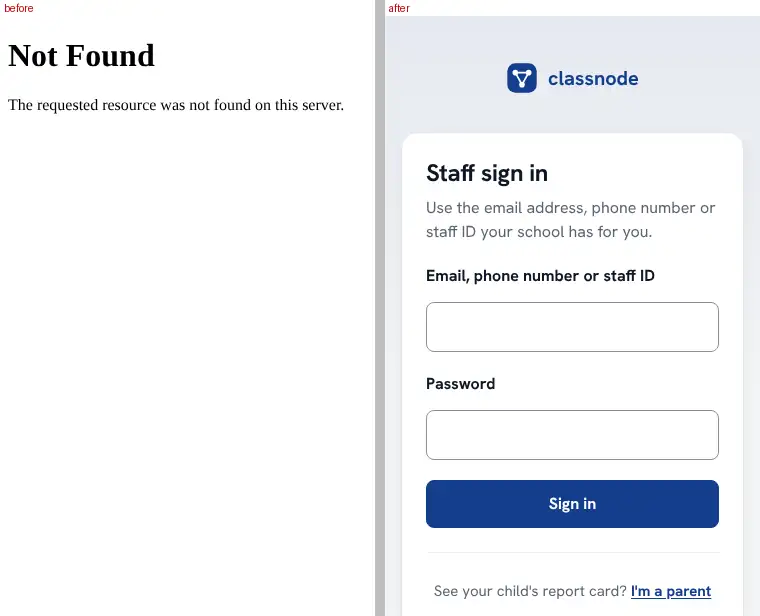
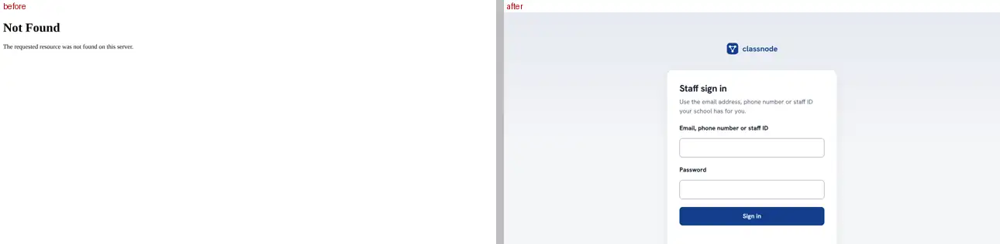

### A mistyped address: portal, school, public site, blog

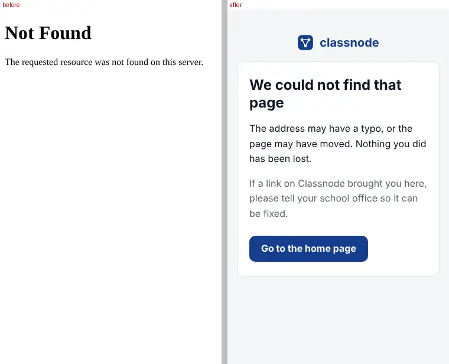

### A server error (500), and an expired form (CSRF)
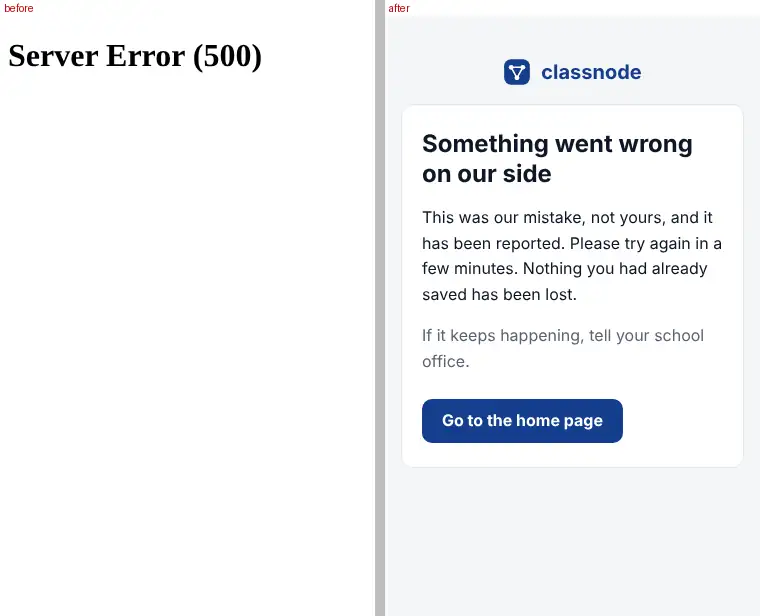
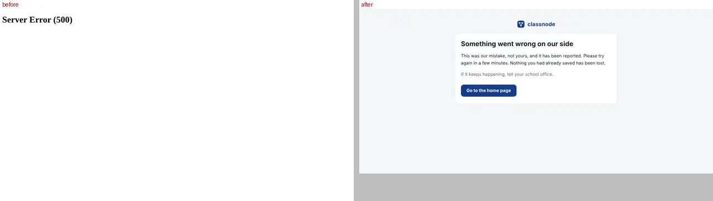
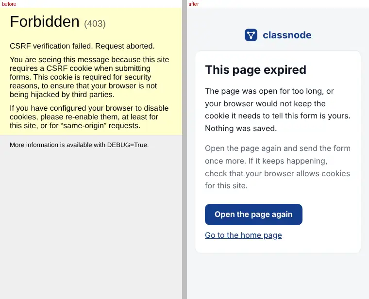
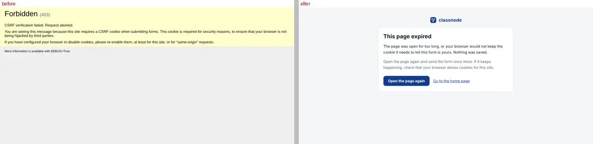

### "You cannot open this page" (403)
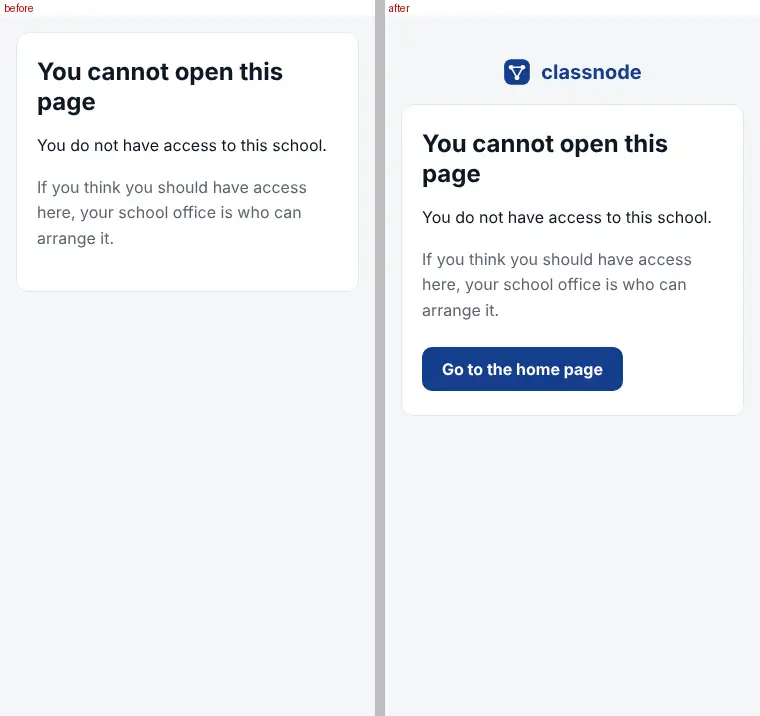
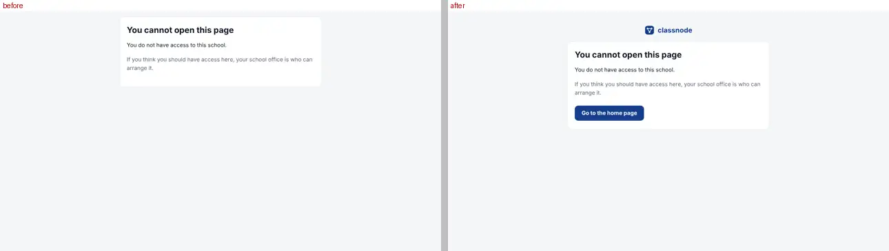

### A platform operator: where they land after signing in, and the menu
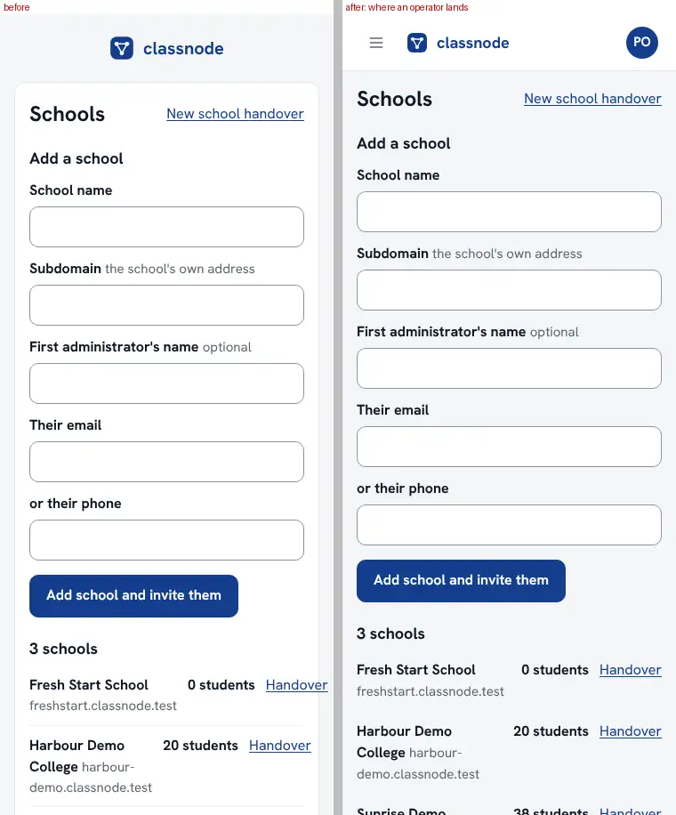
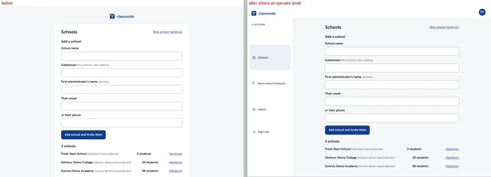
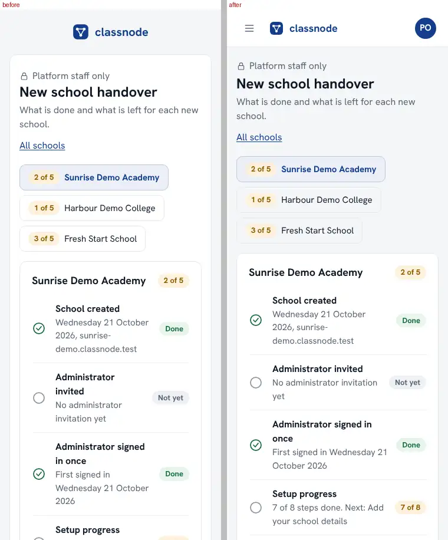
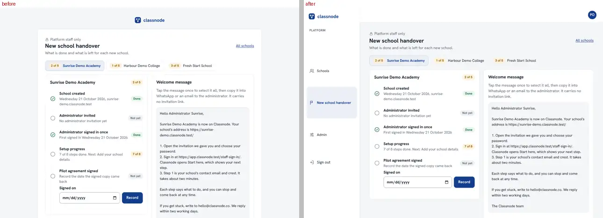
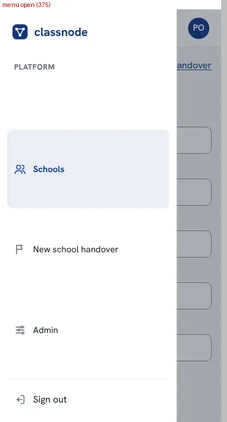
