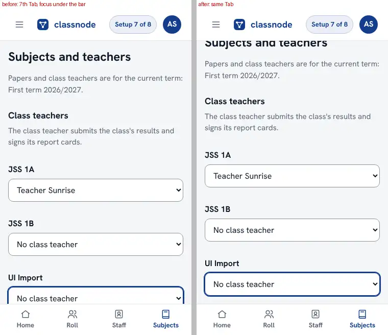
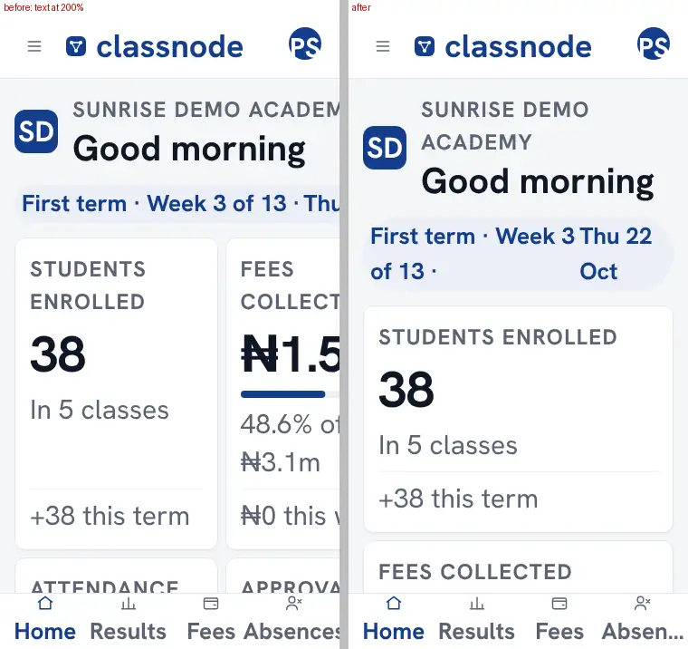
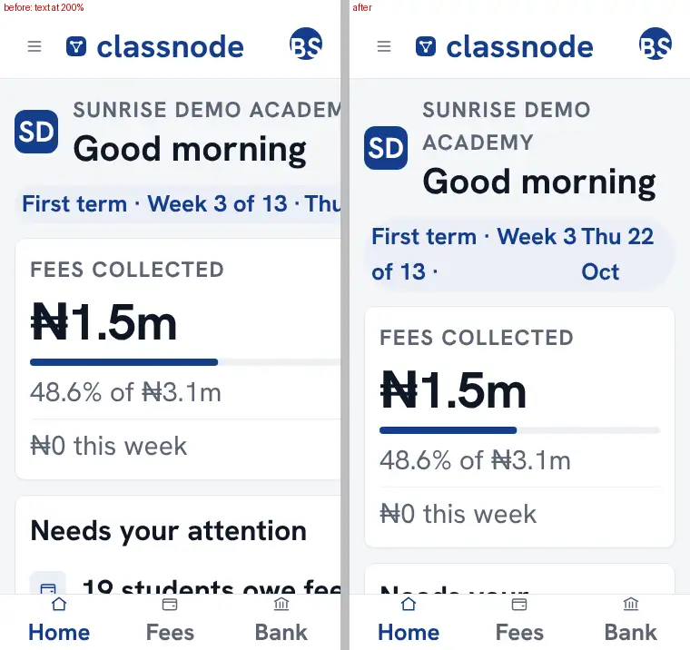
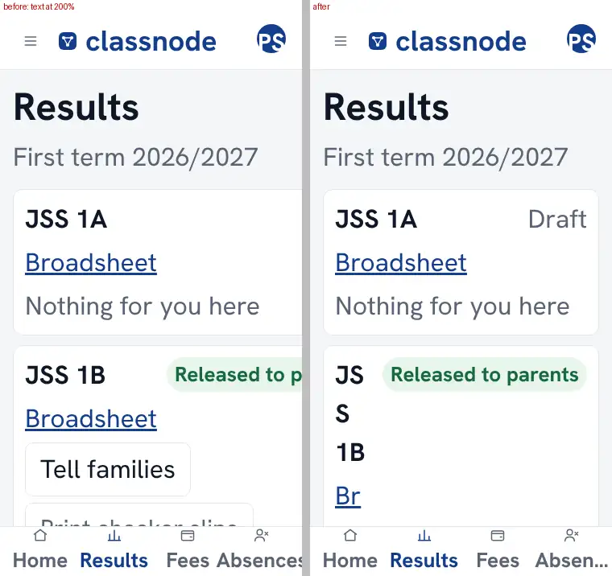
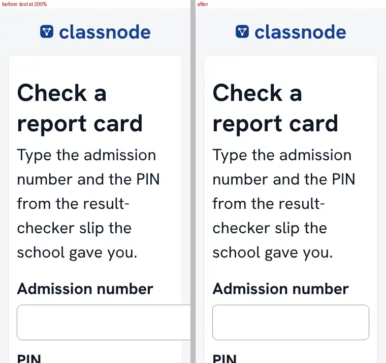
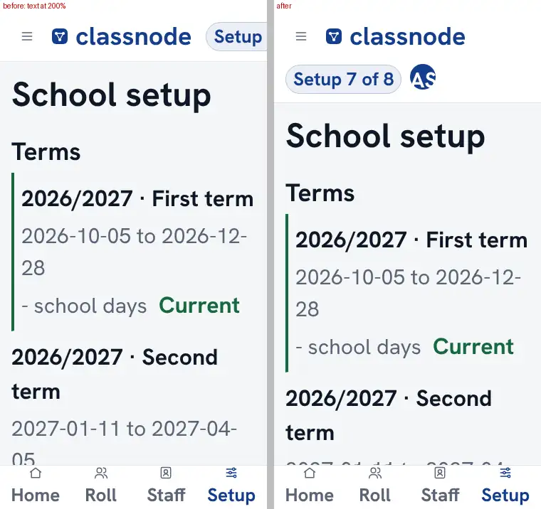
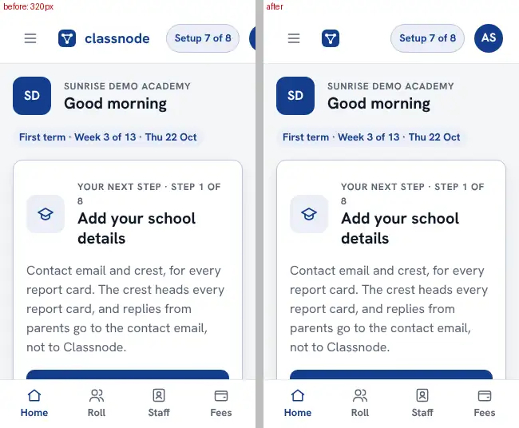
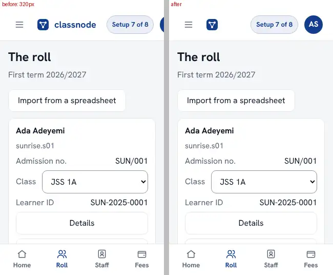

# PR 3: focus clear of the bars, large text, the administrator's top bar at 320px, the parent door's keyboard

All 94 screens and 15 drill-down states were photographed at 375 and 1280 px (100% text) before and after, against the same demo data, and compared pixel by pixel: **212 of 218 captures are identical.** The 6 that differ are noise, not layout: `site-home` (its animated hero), the two marking sheets (a 40-pixel text caret) and `admin-roll--details`, whose tapped-through full-page photograph is taken at a different scroll position now that `scroll-padding` exists (the fixed bars are drawn at the scroll offset; the content is the same).

So at normal text size nothing moves. What changes is at large text, at 320px, and under the keyboard:

## Focus is never under the tab bar (WCAG 2.4.11)

The 7th Tab on Subjects: before, the focused select is cut off under the bar; after, it is scrolled clear of it.

## Large text (the phone's font size at Largest: the root font doubled), 375px

Dashboard (the tiles were 121px off the screen), the bursar's, results, the result checker's fields, and the administrator's setup.

## The administrator's top bar at 320px

The "Setup 7 of 8" chip and the avatar no longer push the account menu (and Sign out) off the screen: below 360px the wordmark gives way to the mark, and the bar can wrap.

## The parent door

`inputmode="tel"` became `inputmode="email"` (with `autocapitalize="none"` and no spell-check): the field takes a phone number or an email, and a dial pad has no letters and no @. A phone's keyboard cannot be photographed here; `tests/js/signin.test.js` holds the attribute.
